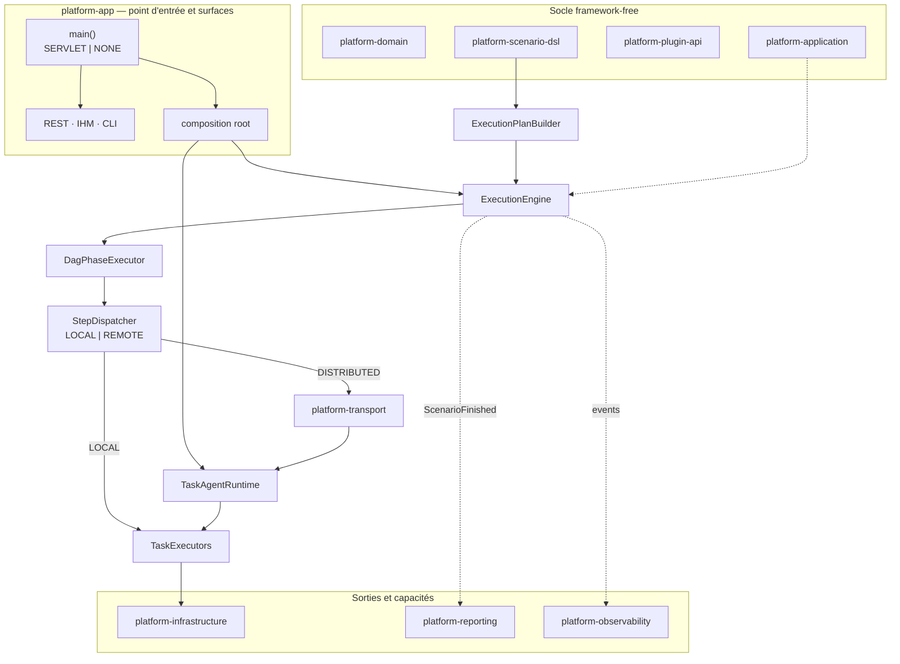
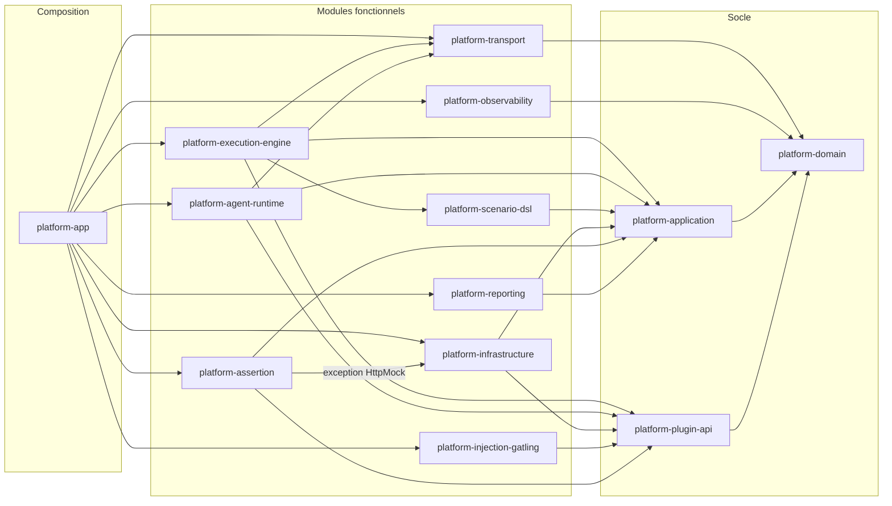
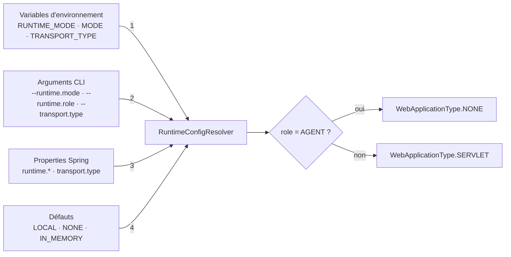
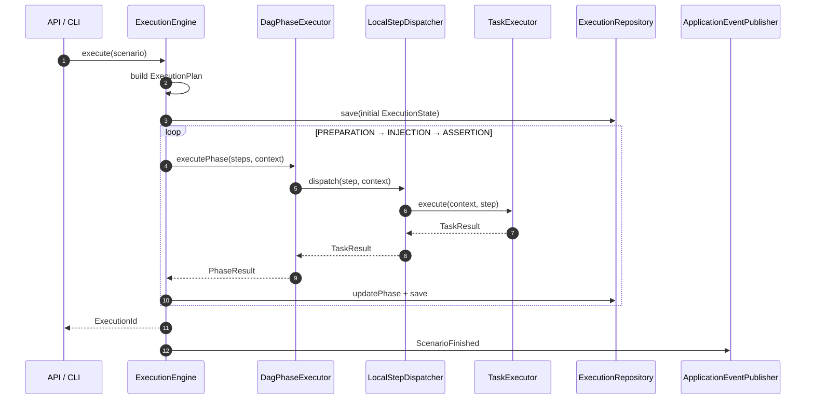
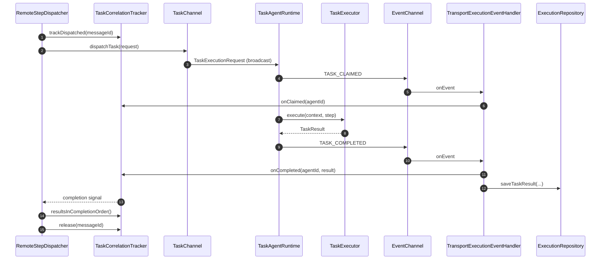
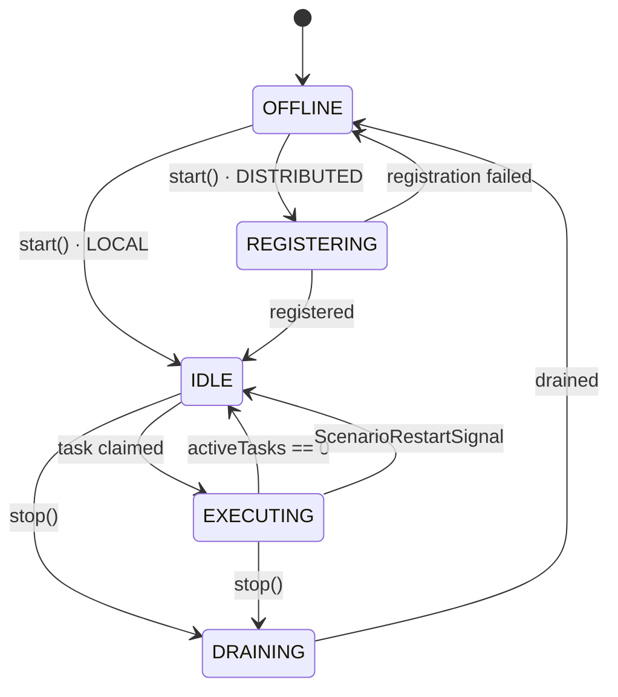
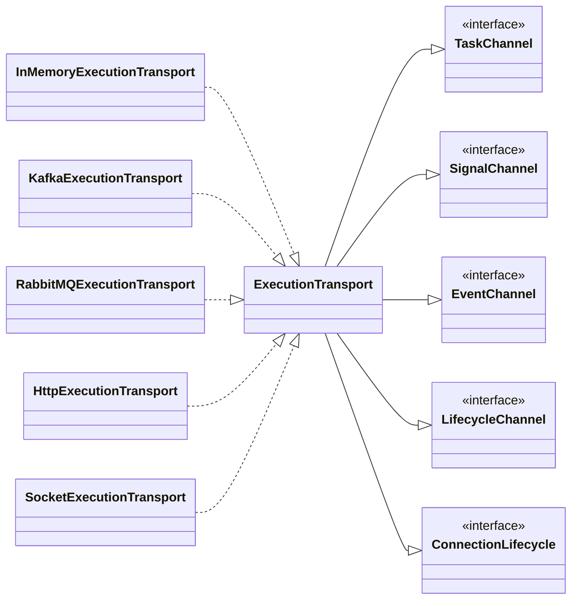
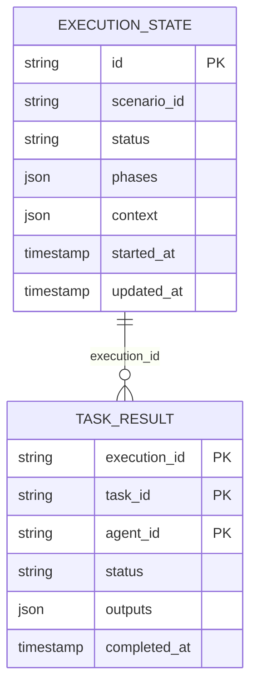
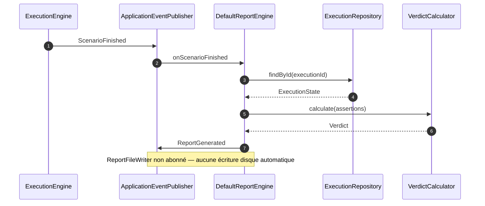

# Architecture — Performance Engineering Platform

> **Document de référence de l'architecture courante.**
> Mis à jour : 2026-10-20. Source de vérité : le code des 14 modules Maven.
> Les décisions historiques sont dans `.claude/knowledge/adr/` ; en cas de divergence,
> le code et les ADR récents (028 → 038) priment sur ce document.

---

## 1. Vue d'ensemble

La plateforme est un **artefact unique** (fat JAR Spring Boot) qui exécute des campagnes
de test de performance en trois phases — `PREPARATION → INJECTION → ASSERTION` — dans
deux modes d'exécution :

| Mode | Topologie | Qui exécute les tâches |
|---|---|---|
| `LOCAL` | Une seule JVM | Un `TaskAgentRuntime` local, via `InMemoryExecutionTransport` |
| `DISTRIBUTED` | Orchestrateur + N agents, JVMs séparées | Les agents, via un transport réseau (Kafka, RabbitMQ, HTTP, Socket) |

Le mode et le rôle sont résolus **au démarrage** (variable d'environnement > argument CLI >
property > défaut, ADR-006/ADR-032). Ni le moteur ni l'agent ne contiennent de `if/switch`
sur le mode : la sélection est portée par des beans Spring conditionnels et par les
collaborations injectées (ADR-037).



### Principes non négociables

1. **Domaine pur** : `platform-domain` et `platform-plugin-api` ne dépendent d'aucun
   framework (Spring, JPA, Jackson interdit dans le domaine).
2. **Ports & adapters** : le métier dépend d'interfaces (`application.ports.*`,
   `plugin.*`) ; les implémentations vivent dans les modules d'infrastructure.
3. **Même artefact, deux modes** : aucun profil Maven ni `main()` distinct.
4. **Sélection déclarative** : `@ConditionalOnProperty` / `@ConditionalOnExpression`,
   jamais de dispatch sur une chaîne de type runtime dans le code métier (CF-03).
5. **I/O bloquants sur Virtual Threads** : DAG, HTTP, Kafka, JPA, Gatling.
6. **Immuabilité** : records + copies défensives ; `ExecutionContext.with()` uniquement.
7. **Events de domaine** : communication inter-modules par `ApplicationEventPublisher`
   (dans la JVM) et par canaux de transport (entre JVMs). Pas d'appel direct
   entre modules fonctionnels.

---

## 2. Modules Maven et packages réels

> Le détail composant par composant (rôle, collaborations, cycle de vie, pièges) est
> dans [`components.md`](components.md).

Ordre de construction : parent → `platform-domain` → `platform-plugin-api` →
`platform-application` → modules fonctionnels → `platform-app` → `platform-deployment`.

### `platform-domain` — cœur métier (0 framework)
```
com.performance.platform.domain
├── agent/        AgentDescriptor, AgentCapabilities, AgentHeartbeat, AgentState
├── assertion/    AssertionResult, AssertionStatus, AssertionSummary, AssertionOperator,
│                 AssertionSample, Evidence
├── event/        Scenario*, Phase*, Task*, Agent*, ExecutionLifecycleSignal,
│                 ScenarioRestartSignal, Report*, Assertion*
├── execution/    ExecutionContext, PartialExecutionContext, ExecutionPlan, ExecutionStep,
│                 ExecutionState, ExecutionProgress, ExecutionStatus, PhaseStatus,
│                 RetryPolicy, TaskCompletionPolicy
├── id/           ExecutionId, ScenarioId, TaskId, AgentId, EventId, MessageId, ReportId, SignalId
├── injection/    LoadModel, LoadModelType, InjectionResult
├── report/       ReportFormat, Verdict
├── scenario/     ScenarioDefinition, StepDefinition, Phase, ExecutionMode
└── task/         TaskResult, TaskStatus
```

### `platform-plugin-api` — API publique des plugins (0 framework)
```
plugin/
├── TaskExecutor            execute(context, step) + getSupportedTaskName()
├── AssertionExecutor       extends TaskExecutor ; evaluate() + getSupportedAssertionName()
├── Preparation             @Preparation(name=…)
├── Injection               @Injection(name=…)
├── Assertion               @Assertion(name=…)
└── StatefulResourceCleaner cleanup(executionId | null)
```

### `platform-application` — ports et use cases (0 framework)
```
application/
├── config/     ExecutionConfig, ResultSelectionPolicy
├── exception/  ExecutionException, InvalidScenarioException, NoAvailableAgentException,
│               ReportGenerationException, ScenarioParsingException
├── ports/in/   ExecuteScenarioUseCase, CancelExecutionUseCase, GetExecutionStatusUseCase,
│               ListExecutionsUseCase, DeleteExecutionUseCase, ScenarioParsingUseCase,
│               GenerateReportUseCase
├── ports/out/  ExecutionRepository, AgentRegistryPort, HttpTargetResolver, HttpTarget,
│               LifecycleSignalHandler
└── usecase/    GetExecutionStatusService, ListExecutionsService, DeleteExecutionService,
                ExecutionProgressCalculator
```

### `platform-scenario-dsl` — parsing et validation YAML (0 framework)
```
scenario/
├── parser/      YamlScenarioParser (SnakeYAML + Jackson), DTOs, DurationParser
├── validation/  DefaultScenarioValidator, DagCycleDetector, ValidationResult/Error/Warning
├── loadmodel/   LoadModelRegistry, DefaultLoadModelRegistry
└── usecase/     DefaultScenarioParsingService
```

### `platform-execution-engine` — moteur unique LOCAL/DISTRIBUTED
```
engine/
├── ExecutionEngine              implémente ExecuteScenarioUseCase + CancelExecutionUseCase
├── ExecutionLifecycleDispatcher signaux START/STOP
├── OutcomeEventPublisher        publication locale des outcomes (no-op en DISTRIBUTED)
├── shared/    StepDispatcher (stratégie), DagPhaseExecutor (parcours DAG)
├── local/     LocalStepDispatcher, LocalOutcomeEventPublisher, TaskExecutorLookup
├── remote/    RemoteStepDispatcher, TransportExecutionEventHandler, PartialContextBuilder
├── plan/      ExecutionPlanBuilder, DefaultExecutionPlanBuilder, DagLevelCalculator
├── correlation/ TaskCorrelationTracker, DefaultTaskCorrelationTracker
├── availability/ AgentAvailabilityChecker, DefaultAgentAvailabilityChecker
├── retry/     RetryExecutor, DefaultRetryExecutor
├── lifecycle/ LocalLifecycleDispatcher, RemoteLifecycleDispatcher
└── config/    ExecutionEngineConfiguration, ExecutionEngineProperties
```

### `platform-agent-runtime` — runtime d'agent et registre d'orchestrateur
```
agent/
├── runtime/    AgentRuntime, TaskAgentRuntime, TaskExecutionPipeline,
│               lifecycle/DefaultLifecycleSignalHandler
├── filter/     TaskSpecializationFilter, DefaultTaskSpecializationFilter, TaskFilterResult
├── registration/ AgentRegistrationPort, TransportAgentRegistration, HeartbeatScheduler,
│               AgentLifecycleIngestion, AgentLifecyclePayloadCodec
├── registry/   AgentRegistry, InMemoryAgentRegistry, AgentTtlMonitor,
│               config/AgentRegistryConfiguration
└── restart/    ScenarioRestartHandler
```

### `platform-transport` — canaux de communication
```
transport/
├── ExecutionTransport   façade composite (extends les 5 ports)
├── TaskChannel · SignalChannel · EventChannel · LifecycleChannel · ConnectionLifecycle
├── message/  TaskExecutionRequest, ExecutionEvent
├── inmemory/ InMemoryExecutionTransport
├── kafka/    KafkaExecutionTransport, DynamicKafkaListenerRegistry, KafkaMessageCodec
├── rabbitmq/ RabbitMQExecutionTransport, RabbitMQConsumerManager, RabbitMQMessageCodec
├── http/     HttpExecutionTransport, HttpEventCallbackController
├── socket/   SocketExecutionTransport, SocketConnectionRegistry
└── config/   TransportConfiguration, *TransportProperties, KafkaTransportBeans
```

### Modules de capacités
| Module | Contenu principal |
|---|---|
| `platform-infrastructure` | Exécuteurs `database`, `docker`, `filesystem`, `http-client`, `kafka-producer`, `kafka-consumer`, `mock-server`, `shell` ; `TaskExecutorRegistry` ; persistance JPA ; `PluginLoader`/`AnnotationScanner`/`PluginRegistry` |
| `platform-injection-gatling` | `GatlingTaskExecutor` (`@Injection(name="gatling")`), `GatlingRunner`, `SimulationInjectionHolder`, `DefaultLoadModelTranslator`, `DefaultGatlingResultParser`, `ProtocolSupportInfo` |
| `platform-assertion` | Exécuteurs `database-assertion`, `file`, `gatling-metric`, `http-mock`, `kafka`, `wiremock` (`AssertionExecutor`) |
| `platform-reporting` | `DefaultReportEngine` (écoute `ScenarioFinished`), `VerdictCalculator`, renderers HTML/PDF/JSON, `ReportFileWriter` |
| `platform-observability` | `ObservabilityEventListener`, `MicrometerExecutionMetrics`, `ExecutionContextMdcFilter` |
| `platform-app` | `PerformancePlatformApplication`, contrôleurs REST, `CliScenarioRunner`, configuration d'assemblage, sécurité, IHM, bootstrap plugins, résolution runtime |
| `platform-deployment` | Dockerfile, Compose, manifests K8s, stack de démo, profils de dev local |

---

## 3. Graphe de dépendances et frontières



> Dépendances de scope `test` omises (par exemple `platform-execution-engine` →
> `platform-assertion` pour les fixtures de test).

Règles effectives :
- `platform-domain` : aucune dépendance framework (test `DomainArchitectureTest`).
- `platform-application`, `platform-scenario-dsl` : 0 annotation Spring ; câblage
  explicite dans `RuntimeAssemblyConfiguration`.
- Frontières inter-modules vérifiées par `ModuleDependencyTest`
  (`platform-app/src/test/.../arch`) : scan bytecode **ASM** (compatible Java 25)
  des `target/classes`, avec test de non-vacuité. Arêtes interdites : engine ↛
  assertion, engine ↛ agent, reporting ↛ injection, assertion ↛ injection,
  assertion ↛ infrastructure (sauf `HttpMockAssertionExecutor`, exception documentée).
- **Spring Modulith a été retiré** (ADR-035). `spring-modulith-bom` reste dans le BOM
  pour compatibilité, mais aucune annotation `@Modulith`/`@ApplicationModuleListener`
  n'est utilisée.

> ⚠️ ArchUnit 1.3/1.4 importe silencieusement 0 classe sur du bytecode Java 25.
> Tout test ArchUnit existant est vacuous ; ne pas s'y fier, utiliser l'ASM.

---

## 4. Modèle runtime : mode, rôle, transport

### Résolution (ADR-006 / ADR-032)
Priorité : **variable d'environnement > argument CLI > property > défaut**.

| Notion | Env var | CLI | Property | Défaut |
|---|---|---|---|---|
| Mode | `RUNTIME_MODE` | `--runtime.mode=` | `runtime.mode` | `LOCAL` |
| Rôle | `MODE` | `--runtime.role=` | `runtime.role` | `NONE` |
| Transport | `TRANSPORT_TYPE` | `--transport.type=` | `transport.type` | `IN_MEMORY` |



`RuntimeConfigEnvironmentPostProcessor` réinjecte les env vars comme properties **avant**
la création des beans, pour que les `@ConditionalOnProperty` voient la bonne valeur.
`RuntimeConfigResolver` est la source unique du parsing ; `RuntimeModeResolver` n'est
qu'une façade Spring. `main()` utilise `resolveBootstrapRole(...)` **avant** Spring pour
choisir `WebApplicationType` : un profil `agent*` force `NONE` (ADR-019/ADR-032).

### Matrice modes d'accès
| Accès | LOCAL | DISTRIBUTED / ORCHESTRATOR | DISTRIBUTED / AGENT |
|---|:---:|:---:|:---:|
| API REST `/api/v1/**` | ✓ | ✓ | ✗ |
| IHM navigateur | ✓ | ✓ | ✗ |
| CLI `--scenario=` | ✓ | ✓ | ✗ |
| Serveur web (Tomcat) | ✓ | ✓ | ✗ (`WebApplicationType.NONE`) |
| Connexion sortante transport | — | — | ✓ |

### Profils Spring fournis
| Profil | Usage |
|---|---|
| `local` | Défaut ; H2 en mémoire, transport `IN_MEMORY`, HTTP targets et cluster Kafka locaux |
| `orchestrator` | `DISTRIBUTED` + `ORCHESTRATOR`, Kafka, PostgreSQL, sécurité activée |
| `agent` | `DISTRIBUTED` + `AGENT`, Kafka, `web.ui.enabled=false`, `agent.supported-tasks` |
| `ide-orchestrator` | Orchestrateur lancé depuis l'IDE contre PostgreSQL/Kafka/WireMock Docker locaux |
| `agent-injector` / `agent-asserter` | Deux agents IDE spécialisés, consumer groups distincts |
| `examples-local` | Démonstrations locales avec les SUT d'exemple |

Les profils `agent-*` sont reconnus par `RuntimeConfigResolver.isAgentProfile(...)`.

---

## 5. Mécanismes d'exécution

### 5.1 D'un scénario YAML à un plan DAG
1. `YamlScenarioParser` parse le YAML en `ScenarioDefinition` (SnakeYAML) puis mappe les
   DTOs avec Jackson (`FAIL_ON_UNKNOWN_PROPERTIES`). Les clés inconnues sont **rejetées**
   (validation structurelle explicite : `ROOT_KEYS`, `SCENARIO_KEYS`, `STEP_KEYS`, …).
2. `DefaultScenarioParsingService` valide via `DefaultScenarioValidator` :
   ids uniques, `taskName`, phase, `dependsOn`, cycles DAG, `requiredContexts`,
   références de `loadModels`, timeouts d'injection.
3. `DefaultExecutionPlanBuilder` produit un `ExecutionPlan` :
   `preparationSteps`, `injectionSteps`, `assertionSteps`, `assertionIntervalSteps`
   (assertions liées à l'injection), `initialContext`.
4. `ExecutionStep` = `StepDefinition` + dépendances résolues + `dagLevel` +
   `requiredContextKeys`.

### 5.2 Engine unique (ADR-037)
`ExecutionEngine` est l'unique implémentation de `ExecuteScenarioUseCase` et
`CancelExecutionUseCase`. Il est actif en `LOCAL` ou en `DISTRIBUTED + ORCHESTRATOR`.
Son comportement est identique dans les deux modes ; seule la stratégie de dispatch change :

| Collaborateur | LOCAL | DISTRIBUTED |
|---|---|---|
| `StepDispatcher` | `LocalStepDispatcher` : appel direct du `TaskExecutor` | `RemoteStepDispatcher` : broadcast + attente |
| `OutcomeEventPublisher` | publie `TaskCompleted`/`TaskFailed` avec l'agent local | no-op (le handler transport publie avec l'agent réel) |
| `ExecutionLifecycleDispatcher` | `LocalLifecycleDispatcher` → `TaskAgentRuntime` | `RemoteLifecycleDispatcher` → `SignalChannel` |
| Réception des résultats | synchrone (retour d'appel) | `TransportExecutionEventHandler` → tracker + repository |

Déroulé d'une exécution :
1. `initializeExecution` : plan, `ExecutionState` initial persisté **avant** toute phase
   (sinon l'API/CLI ne peut pas suivre l'exécution).
2. `PREPARATION` → signaux START aux assertions d'intervalle → `INJECTION` →
   signaux STOP → `ASSERTION`.
3. Chaque phase : `PhaseStarted`, `DagPhaseExecutor.executePhase`, publication des
   outcomes, `PhaseCompleted`, mise à jour de l'état persisté.
4. Verdict :
   - `CANCELLED` si annulation demandée ;
   - `FAILED` si une tâche a échoué ou si aucun agent n'est disponible ;
   - `WARNING` si au moins une tâche est `SKIPPED` ;
   - `SUCCESS` sinon.
5. `ScenarioFinished` est publié ; `DefaultReportEngine` génère alors le rapport.

### 5.2.1 Séquence LOCAL et DISTRIBUTED





### 5.3 Parcours DAG et exécution parallèle
`DagPhaseExecutor` :
- groupe les steps par `dagLevel` et exécute chaque niveau en parallèle via
  `Executors.newVirtualThreadPerTaskExecutor()` ;
- avant un niveau, vérifie les dépendances : si un `dependsOn` est `FAILED`/`SKIPPED`,
  le step est marqué `SKIPPED` (avec `DEFAULT_AGENT = "agent-local"`) ;
- envoie un signal START avant l'exécution et STOP après ;
- supporte l'annulation coopérative : les futures en attente sont annulés ; les steps
  non terminés ne produisent pas de résultat et la phase est marquée en échec ;
- retourne `PhaseResult(updatedContext, anyFailed, outcomes)` ; l'engine seul publie les
  événements de domaine.

### 5.4 ExecutionContext et outputs nommés (ADR-031)
```java
record ExecutionContext(ExecutionId, ScenarioId,
                        Map<String, Map<String, TaskResult>> store)
```
- Store logique `taskId → agentId → TaskResult`.
- Implémentation **persistante par couches** (`PersistentStore`) : `with(...)` est
  O(profondeur) et ne copie que la map de la tâche modifiée ; snapshot matérialisé
  paresseusement et mis en cache. Aucune mutation.
- Accès par **nom d'output** : `getOutput(taskId, agentId, outputName, type)` et
  `getFirstOutput(taskId, outputName, type)` (ordre déterministe par `agentId`).
  Les clés contractuelles sont `InjectionResult.OUTPUT_KEY = "result"` et
  `AssertionSummary.OUTPUT_KEY = "assertion"`.
- `PartialExecutionContext` transporte vers les agents uniquement les
  `requiredContexts`, sous la forme `taskId → agentId → Map<String,Object>` (tous les
  outputs nommés). Les anciens payloads à valeur brute restent tolérés.

### 5.5 Dispatch distant : corrélation, multi-claim, perte d'agent
`RemoteStepDispatcher` :
1. attend un agent disponible (`AgentAvailabilityChecker`, timeout
   `ExecutionConfig.taskAvailabilityTimeout`) ;
2. construit le `PartialExecutionContext` ;
3. crée un `TaskExecutionRequest` (MessageId = clé d'idempotence, **pas** de
   `targetAgentId`) ;
4. `tracker.trackDispatched(...)` **avant** `transport.dispatchTask(...)` pour éviter la
   course, puis `tracker.release(...)` en `finally` ;
5. attend un `CompletableFuture` complété par le tracker (aucun polling) ;
6. sélectionne un résultat de façon déterministe selon
   `TaskCompletionPolicy` (`FIRST_COMPLETE`/`ALL_COMPLETE`) et `ResultSelectionPolicy`
   (`FIRST_COMPLETED`/`LAST_COMPLETED`), avec préférence pour un résultat réussi.

`TransportExecutionEventHandler` consomme `EventChannel` :
- `TASK_CLAIMED` → `tracker.onClaimed`, publie `TaskClaimedByAgent` ;
- `TASK_COMPLETED` → reconstruit `TaskResult`, `tracker.onCompleted`, persiste
  `saveTaskResult`, publie `TaskCompleted` ;
- `TASK_FAILED` → `tracker.onFailed` ;
- `TASK_WORK_IN_PROGRESS` → log/trace ;
- événements inconnus ou déjà libérés → ignorés (protection contre les messages tardifs).
- `@EventListener onAgentLost(AgentLost)` → `tracker.onAgentLost(agentId)` : les claims
  non terminés échouent immédiatement (fast-fail) au lieu d'attendre le timeout.

### 5.6 Retry
`RetryPolicy(maxAttempts, initialDelay, multiplier, maxDelay, retryableExceptions)` avec
backoff exponentiel ; défaut 3 tentatives, 1 s → 30 s. Appliqué par
`LocalStepDispatcher` via `RetryExecutor`. En DISTRIBUTED, la politique est transmise
dans `TaskExecutionRequest`, mais `TaskExecutionPipeline` ne l'applique pas encore :
l'agent exécute la tâche **une seule fois**. Le retry distribué reste à implémenter.

---

## 6. Runtime d'agent (ADR-037)

`TaskAgentRuntime` est l'unique runtime (LOCAL et DISTRIBUTED). Deux collaborations
optionnelles portent la différence :
- `registrationPort == null` → LOCAL : pas d'enregistrement, pas de heartbeat ;
- `registrationPort != null` → DISTRIBUTED : `TransportAgentRegistration` +
  `HeartbeatScheduler`.

Cycle de vie :


Mécanismes :
- **Démarrage** : `connection.connect()`, enregistrement éventuel, abonnement
  `receiveTask`/`receiveSignal`, planification du nettoyage des `processedMessageIds`,
  passage `IDLE`.
- **Réception** : `TaskSpecializationFilter` (égalité `taskName` ∈
  `supportedTaskNames`) ; les messages non concernés sont ignorés silencieusement.
  L'idempotence est assurée par `MessageId` (set des messages déjà traités).
- **Exécution** : `TaskExecutionPipeline` publie `TASK_CLAIMED`, exécute le
  `TaskExecutor` sur un Virtual Thread, publie un `TaskWorkInProgress` périodique
  (intervalle = `taskExecutionTimeout / 3`, min 1 s), puis `TASK_COMPLETED`/`TASK_FAILED`
  avec statut, durée, erreur et outputs.
- **Arrêt** : `DRAINING`, attente des tâches actives (timeout = 2 ×
  `taskExecutionTimeout`), annulation du reste, arrêt du heartbeat, désenregistrement,
  déconnexion, `OFFLINE`.
- **Restart** : `ScenarioRestartHandler` appelle chaque `StatefulResourceCleaner`
  (`cleanup(executionId)`, best-effort), annule les tâches actives, repasse `IDLE`.
- **Spécialisation** : en DISTRIBUTED, `agent.supported-tasks` est la **source unique**
  (ADR-015), surchargée par `AGENT_SUPPORTED_TASKS`. En LOCAL, tous les
  `TaskExecutor` du contexte sont supportés.

### Registre orchestrateur et TTL (ADR-033)
- `AgentLifecycleIngestion` s'abonne au `LifecycleChannel` et alimente
  `AgentRegistryPort` (`registered`, `heartbeat`, `deregistered`, `lost`).
- `InMemoryAgentRegistry` conserve les descripteurs et répond
  `findByTaskName`/`hasAgentFor`.
- `AgentTtlMonitor` (bean démarré avec le contexte, intervalle
  `agent.registry.ttl-check-interval-seconds`, défaut 10 s) évince les agents dont le
  heartbeat a expiré et publie `AgentLost` → fast-fail des steps en cours.

---

## 7. Transport : canaux et implémentations

`ExecutionTransport` est une **façade composite** de migration qui étend cinq ports
étroits (ADR-028). Les consommateurs dépendent du port dont ils ont besoin :

| Port | Responsabilité | Consommateurs |
|---|---|---|
| `TaskChannel` | `dispatchTask` / `receiveTask` | `RemoteStepDispatcher`, `TaskAgentRuntime` |
| `SignalChannel` | `broadcastSignal` / `receiveSignal` | `RemoteLifecycleDispatcher`, `TaskAgentRuntime` |
| `EventChannel` | `publishEvent` / `subscribe` | `TaskExecutionPipeline`, `TransportExecutionEventHandler` |
| `LifecycleChannel` | `publishAgentEvent` / `subscribeAgentEvents` | `TransportAgentRegistration`, `AgentLifecycleIngestion` |
| `ConnectionLifecycle` | `connect` / `disconnect` / `isConnected` | `TaskAgentRuntime` |



`getType()` n'existe plus : le type est une propriété de configuration, jamais une
branche de code.

| Transport | Sélection | Modèle | Notes |
|---|---|---|---|
| `IN_MEMORY` | défaut (`matchIfMissing=true`) | synchrone, même JVM | LOCAL et tests |
| `KAFKA` | `transport.type=KAFKA` | topics tasks/signals/events, consumer group par agent (ADR-009) | `DynamicKafkaListenerRegistry`, `AckMode.RECORD`, `auto.offset.reset=earliest` |
| `RABBITMQ` | `transport.type=RABBITMQ` | exchanges FANOUT, queue exclusive auto-delete, ack manuel | `RabbitMQConsumerManager` |
| `HTTP` | `transport.type=HTTP` | POST vers `httpCallbackUrl`, callbacks sur `/api/v1/events` | `broadcastMode=ALL_CAPABLE|FIRST_AVAILABLE` ; **pas d'endpoint entrant de tâches** ; AGENT sans serveur web (ADR-019) |
| `SOCKET` | `transport.type=SOCKET` | TCP persistant, détection rôle bind/connect | best-effort, reconnexion agent |

Messages :
- `TaskExecutionRequest(MessageId id, ExecutionId, StepDefinition, PartialExecutionContext,
  Instant dispatchedAt, RetryPolicy)` — broadcast, sans `targetAgentId`.
- `ExecutionEvent(EventId, ExecutionId, MessageId correlationId, AgentId, String eventType,
  Map<String,Object> payload, Instant)` — enveloppe les événements agent → orchestrateur.
- `AgentLifecycleEvent` — canal séparé pour `AgentRegistered`, `AgentHeartbeat`,
  `AgentDeregistered`, `AgentLost` (ADR-012).

Garanties : Kafka/RabbitMQ at-least-once ; InMemory synchrone ; HTTP avec retry/timeouts ;
Socket best-effort. L'idempotence côté agent est portée par `TaskExecutionRequest.id`.

---

## 8. Framework de tâches et plugins

- Un `TaskExecutor` implémente `execute(ExecutionContext, StepDefinition)` et
  `getSupportedTaskName()` ; il est annoté **exactement** `@Preparation`, `@Injection`
  ou `@Assertion`. Le `name()` de l'annotation est la clé de résolution YAML.
- `AssertionExecutor extends TaskExecutor` : `evaluate(...)` retourne toujours un
  `AssertionResult` (jamais d'exception) ; `execute(...)` par défaut convertit le
  résultat en `TaskResult` avec `AssertionSummary` sous la clé `"assertion"` (mapping
  `PASSED→SUCCESS`, `FAILED→FAILED`, `SKIPPED→SKIPPED`, `ERROR→FAILED`).
- `TaskExecutorRegistry` / `DefaultTaskExecutorRegistry` collecte les beans Spring
  (les plugins JAR sont enregistrés dans `PluginRegistry`, non raccordé au moteur).
- `RegistryTaskExecutorLookup` expose `findTaskExecutor(taskName)` au moteur LOCAL
  (chemin unique pour toutes les phases).
- Plugins externes : `PluginLoader` scanne `platform.plugins.dir` au démarrage
  (`platform.plugins.enabled=true`), `AnnotationScanner` découvre les classes annotées,
  `PluginRegistry` résout `(phase, taskName) → implémentation`. Un JAR invalide produit
  un warning et est ignoré (CF-06/CF-07). Pas de chargement à chaud.
  **État actuel** : la découverte et le registre `PluginRegistry` existent, mais le
  moteur (`TaskExecutorLookup`) et l'agent (`TaskExecutor` beans injectés) ne
  consomment que `TaskExecutorRegistry` (beans Spring). Les exécuteurs chargés depuis
  un JAR externe ne sont donc pas encore exécutables : le câblage
  `PluginRegistry → TaskExecutorRegistry/agent` reste à faire.
- `StatefulResourceCleaner` : tout exécuteur maintenant un état (Gatling, WireMock,
  Kafka, DB, Docker, Shell) l'implémente pour le restart propre.

Exécuteurs fournis : `database`, `docker`, `filesystem`, `http-client`,
`kafka-producer`, `kafka-consumer`, `mock-server`, `shell`, `gatling` ;
assertions : `database-assertion`, `file`, `gatling-metric`, `http-mock`, `kafka`,
`wiremock`.

---

## 9. Persistance

- Port : `ExecutionRepository` (`save`, `findById`, `updatePhase`, `saveTaskResult`,
  `getTaskResults`, `findAll`, `deleteById`).
- Adapter : `JpaExecutionRepository` (Spring Data JPA + mappers), entités
  `ExecutionStateEntity` et `TaskResultEntity` (clé composite `executionId + taskId +
  agentId`).
- `JpaConfiguration` : configuration JPA manuelle (Spring Boot 4.0 a retiré les
  auto-configurations JPA/Hibernate), activée uniquement si un `DataSource` existe
  (`@ConditionalOnBean`, ADR-025).
- `DatasourceConfiguration` résout les datasources nommées `platform.datasources.*`
  (ADR-014) ; la datasource `default` est primaire.
- L'état est persisté avant les phases puis après chaque phase et à chaque résultat
  distant ; l'API/CLI lit le même repository (read-model CQRS-lean).
- En AGENT sans datasource, aucun bean JPA n'est créé : l'application démarre sans
  persistance.



---

## 10. Reporting

- `DefaultReportEngine` écoute `ScenarioFinished`, relit `ExecutionState`, classifie les
  tâches par phase, calcule le verdict (`VerdictCalculator`) et produit un
  `CampaignReport`.
- Renderers : `HtmlReportRenderer` (template `templates/campaign-report.html`),
  `PdfReportRenderer` (HTML → OpenHTMLToPDF), `JsonReportRenderer`.
- `ReportFileWriter` sait écrire `<output-directory>/<executionId>/campaign.{html,pdf,json}`
  et copier les répertoires Gatling, mais **il n'est pas encore raccordé** à
  `ReportGenerated` dans le câblage de production : le moteur produit le
  `CampaignReport` en mémoire et publie l'événement, sans écriture disque automatique.
  `ReportController` sert uniquement des fichiers déjà présents sur disque.
  Sortie **locale uniquement** (ADR-022) : aucun publisher Confluence/S3/Git.
- Configuration : `reporting.output-directory`, `reporting.formats`
  (défaut HTML/PDF/JSON).
- `ReportGenerated` est publié après génération.



---

## 11. Observabilité

- `ObservabilityEventListener` écoute `TaskCompleted`, `TaskFailed`, `PhaseCompleted`,
  `ScenarioFinished` et alimente `ExecutionMetrics`
  (`execution_duration`, `task_duration`, `task_failures_total`, `phase_duration`).
- `MicrometerExecutionMetrics` enregistre les métriques ; `ObservabilityConfiguration`
  ajoute le tag `service=performance-platform` et filtre les métriques `spring.*`.
- `ExecutionContextMdcFilter` pose `executionId`, `scenarioId`, `taskId`, `agentId`,
  `phase` dans le MDC (contrat set → log → clear).
- Logs : format `action=… executionId=… taskId=…` avec contexte ; Actuator expose
  `health,info` (et `metrics,prometheus` en orchestrateur).

---

## 12. Surfaces d'accès et sécurité

- **API REST** (`platform-app/app/api`) : `ScenarioController` (soumission/validation),
  `ScenarioUploadController`, `ExecutionController` (statut, liste, suppression,
  progression, tâches), `AgentController` (agents enregistrés), `ReportController`.
  Contrôleurs conditionnels à `WebApplicationType.SERVLET`.
- **IHM** : ressources statiques `classpath:/static` servies quand `web.ui.enabled=true`
  (ADR-019).
- **CLI headless** : `CliScenarioRunner` activé par `--scenario=`, exécute et sort avec
  code 0/1/2 (ADR-021). Réservé à LOCAL/ORCHESTRATOR.
- **Sécurité** : `SecurityConfiguration` ; `platform.security.enabled=false` (défaut
  LOCAL) → tout autorisé avec WARN explicite ; `true` → `/api/**` exige un JWT et le rôle
  `USER` ou `ADMIN`, sessions stateless, CSRF désactivé ; endpoints publics
  `/actuator/health/**`, `/`, `/index.html`, `/assets/**` (ADR-038).

---

## 13. Configuration

| Préfixe | Contenu |
|---|---|
| `runtime.*` | `mode`, `role` |
| `execution.*` | timeouts de disponibilité/exécution, `completion-policy`, `result-selection-policy` |
| `transport.*` | `type` + blocs `kafka`, `rabbitmq`, `http`, `socket` |
| `agent.*` | `supported-tasks`, `registry.ttl-check-interval-seconds`, identité/heartbeat |
| `platform.datasources.*` | datasources nommées (ADR-014) |
| `platform.http-targets.*` | cibles nommées + timeouts + mapping de chemins (ADR-036) |
| `platform.kafka-clusters.*` | clusters nommés + mapping de topics |
| `platform.plugins.*` | `enabled`, `dir` |
| `platform.security.enabled` | posture de sécurité (ADR-038) |
| `web.ui.enabled` | IHM statique (ADR-019) |
| `reporting.*` | répertoire et formats de sortie |

Variables d'environnement prioritaires : `RUNTIME_MODE`, `MODE`,
`TRANSPORT_TYPE`, `AGENT_SUPPORTED_TASKS`, `AGENT_ID`, `KAFKA_BOOTSTRAP_SERVERS`,
`DB_URL`/`DB_USERNAME`/`DB_PASSWORD`, `WIREMOCK_URL`, `DEVICE_API_URL`,
`REPORTING_OUTPUT_DIR`, `SPRING_SECURITY_OAUTH2_RESOURCESERVER_JWT_*`.

---

## 14. Build et tests

- Build : `mvn clean install` (Java 25, Spring Boot 4, Maven multi-module).
- Convention des tests :
  - `*Test.java` → unitaire (surefire, `mvn test`), sans conteneur ;
  - `*E2ETest.java` → E2E in-memory (surefire) ;
  - `*IT.java` → intégration (failsafe, `mvn verify -P integration-tests`), Testcontainers.
- Tests d'architecture : `DomainArchitectureTest`, `ModuleDependencyTest` (ASM),
  `InfrastructurePackageSeparationTest` (ArchUnit — vide sur Java 25, voir §3).
- Tests de contrat : `LocalDistributedEquivalenceIT` (même verdict/statuts dans les deux
  modes), `LocalFlowIT`, `LocalModeAllTasksIT`, `WebUiApiIT`, `AgentLossRecoveryIT`.
- Sur `/mnt/c` (9p), le classpath Java est très lent : préférer un checkout WSL ext4
  pour les builds complets. Un build complet mesure ~2 min sur ext4 contre ~20 min sur 9p.

---

## 15. Points d'extension

| Extension | Mécanisme |
|---|---|
| Nouvelle tâche de préparation/injection | Bean annoté `@Preparation(name="…")` ou `@Injection(name="…")` + `getSupportedTaskName()` |
| Nouvelle assertion | Bean annoté `@Assertion(name="…")` implémentant `AssertionExecutor` |
| Plugin externe | JAR dans `platform.plugins.dir`, `platform.plugins.enabled=true` (découverte OK ; exécution non raccordée — voir §8) |
| Nouveau transport | Implémenter les 5 canaux + bean `@ConditionalOnProperty(transport.type=…)` |
| Nouvelle cible HTTP | `platform.http-targets.<nom>` (base-url, timeouts, paths) |
| Nouveau cluster Kafka | `platform.kafka-clusters.<nom>` (bootstrap, acks, topics) |
| Nouvelle datasource | `platform.datasources.<nom>` (ADR-014) |
| Nouveau renderer | Implémenter `ReportRenderer` et l'exposer comme bean |
| Nouvelles métriques | Étendre `ExecutionMetrics` + `ObservabilityEventListener` |

---

## 16. Index des ADR structurantes

| Sujet | ADR |
|---|---|
| Transport abstrait, priorité config, plugin JAR | ADR-002, ADR-006, ADR-007 |
| Spécialisation d'agent par configuration | ADR-015 (remplace ADR-008) |
| Consumer group Kafka par agent | ADR-009 |
| PartialExecutionContext, multi-claim, lifecycle séparé | ADR-010, ADR-011, ADR-012 |
| Spring-first infrastructure, datasources | ADR-013, ADR-014 |
| IHM/sécurité, CLI headless, sortie locale des rapports | ADR-019, ADR-021, ADR-022 |
| Read-model et progression | ADR-020 |
| Composition root mince | ADR-026 |
| Assertions distribuées | ADR-027 |
| **Segrégation des ports de transport** | **ADR-028** |
| Registre d'assertions supprimé | ADR-029, ADR-030 |
| **ExecutionContext : outputs nommés + store persistant** | **ADR-031** |
| Détection de rôle au bootstrap | ADR-032 |
| **Ingestion lifecycle agent + perte de claim** | **ADR-033** |
| Sélection déterministe multi-claim | ADR-034 |
| **Retrait de Spring Modulith + test ASM** | **ADR-035** |
| Port `HttpTargetResolver` | ADR-036 |
| **Consolidation moteur + agent** | **ADR-037** |
| **Posture de sécurité** | **ADR-038** |

> ADR obsolètes/superseded : ADR-001 (Java 21/Modulith, voir ADR-035),
> ADR-008 (agentTags, voir ADR-015), ADR-022 `report-output-local-only` reste valide ;
> les fichiers `ADR-022-spring-boot-bom-single-source` et
> `ADR-024-spring-boot-bom-single-source` sont des doublons historiques de numérotation.
