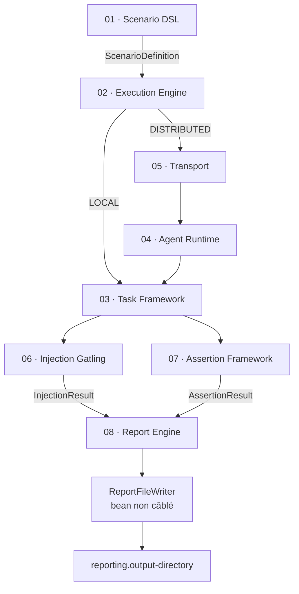

# Specifications Overview — Performance Engineering Platform

> Point d'entrée des specs. Lire d'abord `../architecture.md` (vue d'ensemble,
> modules, mécanismes) et `../components.md` (catalogue des composants), puis la spec
> du composant concerné.
> Pour comprendre QUI implémente quoi et dans quel ordre, voir
> `.claude/guides/agent-orchestration.md`.

---

## Index des Spécifications

| Fichier | Domaine | Modules Maven | Concepts clés |
|---|---|---|---|
| `01-scenario-dsl.md` | Parsing YAML, validation DAG, LoadModels | `platform-scenario-dsl` | `ScenarioDefinition`, `StepDefinition`, `ValidationResult` |
| `02-execution-engine.md` | Orchestration, DAG, phases, verdict, dispatch | `platform-execution-engine` | `ExecutionEngine`, `StepDispatcher`, `DagPhaseExecutor`, `ExecutionPlan` |
| `03-task-framework.md` | Contrats de tâches, registre, plugins JAR | `platform-plugin-api`, `platform-infrastructure` | `TaskExecutor`, `@Preparation/@Injection/@Assertion`, `TaskExecutorRegistry` |
| `04-agent-runtime.md` | Runtime agent unique, spécialisation, registre, TTL | `platform-agent-runtime` | `TaskAgentRuntime`, `TaskSpecializationFilter`, `AgentTtlMonitor` |
| `05-transport-layer.md` | Canaux de communication et implémentations | `platform-transport` | `TaskChannel`, `SignalChannel`, `EventChannel`, `LifecycleChannel` |
| `06-injection-gatling.md` | Injection de charge Gatling | `platform-injection-gatling` | `GatlingTaskExecutor`, `GatlingRunner`, `LoadModelTranslator` |
| `07-assertion-framework.md` | Assertions post-injection | `platform-assertion` | `AssertionExecutor`, `AssertionResult`, `AssertionSummary` |
| `08-report-engine.md` | Rapport de campagne | `platform-reporting` | `DefaultReportEngine`, `CampaignReport`, renderers, `ReportFileWriter` |
| `09-deployment.md` | Docker, Kubernetes, stacks locales | `platform-deployment` | Dockerfile, Compose, K8s, profils Spring |

> Il n'existe **pas** de module publisher : la sortie des rapports est locale
> (`reporting.output-directory`, ADR-022). Les anciens Confluence/S3/Git/SharePoint/Nexus
> ne font plus partie du périmètre.

---

## Relations Entre Composants

Les flèches `06`/`07` représentent la résolution par `taskName` via les annotations
`@Injection`/`@Assertion` ; le moteur ne connaît ni Gatling ni les assertions.

Tous les composants partagent `platform-domain` (records immuables) et
`platform-plugin-api` (contrats). `platform-app` assemble le tout (composition root
mince, ADR-026).

---

## Modes d'Accès (même artefact)

Le fat JAR unique expose trois modes d'accès à une campagne — API REST, IHM (navigateur),
CLI headless — mais leur **disponibilité dépend du mode runtime et du rôle**. Seul
l'orchestrateur (ou le mode LOCAL) expose des surfaces d'accès ; un nœud AGENT n'expose
rien (ADR-019).

### Matrice canonique : mode runtime × mode d'accès

| Accès | LOCAL (orchestrateur + agent, même JVM) | DISTRIBUTED / ORCHESTRATOR | DISTRIBUTED / AGENT |
|---|:---:|:---:|:---:|
| API (REST `/api/v1/**`) | ✓ | ✓ | ✗ |
| IHM (navigateur) | ✓ | ✓ | ✗ |
| CLI headless (`--scenario=`) | ✓ | ✓ | ✗ |
| Serveur web (Tomcat) | ✓ | ✓ | ✗ (`WebApplicationType.NONE`) |
| Connexion sortante au transport | — | — | ✓ (seul rôle) |

**Règle** : en LOCAL et ORCHESTRATOR, les trois modes d'accès sont disponibles depuis le
même artefact. En AGENT, la JVM démarre **sans aucun serveur web** : ni API, ni IHM, ni
CLI. L'agent est un pur worker — il se connecte en sortant au transport, s'enregistre et
exécute les `TaskExecutionRequest` reçues. Voir ADR-019 (matrice d'accès + absence de
Tomcat en AGENT) et ADR-021 (CLI headless réservé orchestrateur).

> NB : le récepteur de transport HTTP entrant de l'agent (`HttpEventCallbackController`,
> actif seulement si `transport.type=HTTP`) n'est PAS une surface d'accès API/IHM/CLI ;
> c'est le canal interne de réception des événements du transport.

### Invocation par mode d'accès (orchestrateur : LOCAL / ORCHESTRATOR)

| Mode | Invocation | Serveur | ADR |
|---|---|---|---|
| CLI headless | `java -jar platform-app.jar --scenario=x.yaml` | aucun (`WebApplicationType.NONE`) | ADR-021 |
| API | `java -jar platform-app.jar` puis `POST /api/v1/scenarios` | long-running | — |
| IHM | `java -jar platform-app.jar` (`web.ui.enabled=true`) puis navigateur | long-running | ADR-019 |

En mode CLI headless, l'application parse le scénario, l'exécute, imprime un résumé sur
stdout et sort avec un code de retour (0 succès / 1 échec / 2 arguments invalides).
Aucun serveur HTTP ni IHM. En l'absence de `--scenario=`, l'application démarre en
serveur long-running (API + IHM si activée).

### Profiles Spring fournis

| Profil | Rôle | Infrastructure |
|---|---|---|
| `local` | LOCAL + NONE | H2 mémoire, `IN_MEMORY`, cibles HTTP/Kafka locales |
| `orchestrator` | DISTRIBUTED + ORCHESTRATOR | Kafka, PostgreSQL, sécurité |
| `agent` | DISTRIBUTED + AGENT | Kafka, `agent.supported-tasks`, aucune surface web |
| `ide-orchestrator` | DISTRIBUTED + ORCHESTRATOR | PostgreSQL/Kafka/WireMock Docker locaux |
| `agent-injector` | DISTRIBUTED + AGENT | Consumer group `ide-agent-injector`, tâches d'injection |
| `agent-asserter` | DISTRIBUTED + AGENT | Consumer group `ide-agent-asserter`, tâches d'assertion |

Un profil dont le nom commence par `agent` force `WebApplicationType.NONE`
(`RuntimeConfigResolver.isAgentProfile`).

---

## Règles de Lecture

1. Pour implémenter un composant, lire SA spec + la spec des composants dont il dépend.
2. Les interfaces définies dans une spec ne doivent pas être modifiées sans ADR.
3. Les exemples YAML sont des exemples de RÉFÉRENCE — les implémenter exactement.
4. Les types de retour et signatures sont définitifs à partir de la Phase 1.
5. En cas d'ambiguïté : escalader vers l'Architect (voir
   `.claude/guides/agent-orchestration.md`).
