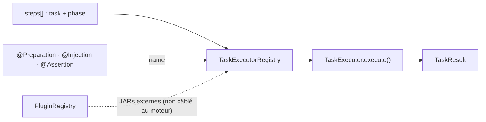

# Spec 03 — Task Framework

**Modules** : `platform-plugin-api` (contrats + annotations),
`platform-infrastructure` (implémentations internes, registre, plugins)
**Dépend de** : `platform-domain`, `platform-application`

---

## 1. Interface Principale

```java
public interface TaskExecutor {
    /**
     * Exécute la tâche et retourne un résultat immuable.
     * NE PAS lancer d'exception pour un échec métier → retourner TaskResult.failed().
     * Lancer une exception UNIQUEMENT pour une erreur technique irrécupérable.
     *
     * StepDefinition remplace l'ancienne TaskDefinition.
     * taskName matche la spécialisation déclarée dans agent.supported-tasks.
     */
    TaskResult execute(ExecutionContext context, StepDefinition step);

    /**
     * Nom de la task supportée par cet executor.
     * Doit correspondre à la valeur de l'annotation @Preparation/@Injection/@Assertion.
     * Remplace getSupportedType() — plus de TaskType enum pour l'enregistrement.
     */
    String getSupportedTaskName();
}

public interface TaskExecutorRegistry {
    void register(TaskExecutor executor);          // dernier enregistré gagne (WARN si remplacement)
    TaskExecutor getFor(String taskName) throws UnsupportedTaskNameException;
    Set<String> getSupportedTaskNames();
}
```

---



## 2. TaskResult

```java
public record TaskResult(
    TaskId taskId,
    String taskName,                    // String libre — jamais d'enum
    TaskStatus status,                  // SUCCESS | FAILED | SKIPPED | TIMEOUT
    Duration duration,
    Map<String, Object> outputs,        // outputs nommés, stockés dans ExecutionContext
    String errorMessage,                // null si SUCCESS
    Throwable cause,                    // null si SUCCESS
    Instant completedAt
) {
    public static TaskResult success(TaskId id, String taskName, Duration duration,
                                     Map<String, Object> outputs) { ... }
    public static TaskResult failed(TaskId id, String taskName, Duration duration,
                                    String message, Throwable cause) { ... }
    public static TaskResult skipped(TaskId id, String taskName, String reason) { ... }
    public boolean isSuccess() { return status == TaskStatus.SUCCESS; }
}
```

---

## 3. Types de Tâches et Paramètres YAML

Chaque step déclare `task:` (nom résolu par annotation) et `phase:`. Les paramètres
spécifiques vivent sous `parameters:`. Les exemples ci-dessous sont des extraits de
`steps:`.

### `database` — PREPARATION
```yaml
- id: purge-db
  task: database
  phase: PREPARATION
  parameters:
    operation: PURGE            # PURGE | POPULATE | QUERY
    datasource: customer-db     # datasource nommée (ADR-014)
    table: orders               # PURGE
    scriptPath: sql/populate.sql # POPULATE
    query: "SELECT COUNT(*) FROM orders" # QUERY
    queryType: COUNT            # COUNT | EXISTS | SCALAR (QUERY)
  timeout: 60s
```
Outputs : `rowsAffected` (PURGE), `scriptExecuted` (POPULATE), `rows`/`rowCount` (QUERY SELECT) ou `rowsAffected` (QUERY UPDATE), plus `duration`.

### `filesystem` — PREPARATION
```yaml
- id: prepare-files
  task: filesystem
  phase: PREPARATION
  parameters:
    operation: CREATE           # CREATE | DELETE | UPLOAD | CLEANUP
    path: /data/input
    source: classpath:fixtures/input.csv   # UPLOAD
    recursive: true             # DELETE / CLEANUP
```
Outputs : `path`, `filesAffected`.

### `shell` — PREPARATION
```yaml
- id: seed
  task: shell
  phase: PREPARATION
  parameters:
    command: ./scripts/prepare.sh
    args: ["--env", "prod"]
    workingDirectory: /app
    env:
      MY_VAR: value
    successExitCodes: [0, 1]    # défaut [0]
  timeout: 2m
```
Outputs : `exitCode`, `stdout`, `stderr`.

### `docker` — PREPARATION
```yaml
- id: start-nginx
  task: docker
  phase: PREPARATION
  parameters:
    action: START               # START | STOP | PULL
    image: nginx:latest
    containerName: test-nginx
    ports: ["8080:80"]
    env:
      NGINX_PORT: "80"
    waitForHealthCheck: true
    healthCheckTimeout: 30s
```
Outputs : `containerId`, `status`, `image` (selon action).

### `kafka-producer` — PREPARATION / INJECTION
```yaml
- id: preload
  task: kafka-producer
  phase: PREPARATION
  parameters:
    operation: PRELOAD          # PRODUCE | PRELOAD
    cluster: default            # cluster nommé (préféré)
    # bootstrapServers: kafka:9092   # legacy, WARN
    topic: input-events         # nom logique -> topic physique via kafka-clusters.<cluster>.topics
    messageCount: 10000
    key: "dev-{index:5}"        # défaut msg-{index}
    headers:                    # valeurs dynamiques (DynamicValues)
      x-correlation-id: "{uuid}"
    payload:                    # string ou map/list (JSON) ; alias messageTemplate
      id: "{index}"
      value: "{random:1-100}"
    batchSize: 500
```
Preparation-only : cadence et durée = step `gatling` avec `protocol: kafka` + `loadModel` (spec 06 §7).
Key, headers et payload acceptent les placeholders `DynamicValues` (ADR-039), résolus par message
(`{index}` = index 1-based du message). Placeholder invalide → step FAILED.
Outputs : `messagesProduced`, `messagesFailed`. La tâche échoue si
`messagesFailed > 0`. Les appels Kafka sont bornés par le `timeout` du step.

### `kafka-consumer` — PREPARATION / ASSERTION
```yaml
- id: consume
  task: kafka-consumer
  phase: PREPARATION
  parameters:
    operation: CONSUME          # CONSUME | COUNT
    cluster: default
    topic: customer-events
    groupId: perf-monitor
    maxMessages: 1000
  timeout: 5m
```
Outputs : `messagesConsumed`, `lag`.

### `mock-server` — PREPARATION
```yaml
- id: start-mock
  task: mock-server
  phase: PREPARATION
  parameters:
    deployment: EMBEDDED        # EMBEDDED | EXTERNAL
    action: START               # START | STOP | RESET | VERIFY
    port: 8090                  # EMBEDDED
    mappingsPath: wiremock/mappings
    target: wiremock            # EXTERNAL : cible nommée
    wiremockUrl: http://mock:8080  # EXTERNAL (legacy)
```
Outputs : `port`, `url`, `totalRequests` (VERIFY). Un port `0` demande un port éphémère.

### `http-client` — PREPARATION
```yaml
- id: health
  task: http-client
  phase: PREPARATION
  parameters:
    target: device-api          # cible nommée (platform.http-targets)
    method: GET                 # GET | POST | PUT | PATCH | DELETE
    path: health                # chemin logique mappé par la cible
    expectedStatus: 200
    body: '{"x":1}'             # POST/PUT/PATCH
    contentType: application/json
    queryParams:                # optionnel — ?k=v, encodés ; liste → paramètre répété
      device_id: "device-{index:4}"
    pathParams:                 # optionnel — variables du path : path: /devices/{deviceId}
      deviceId: "{index}"
    headers:                    # optionnel
      X-Request-Id: "{uuid}"
```
Outputs : `statusCode`, `responseBody`, `durationMs`.

**Contenu dynamique** (ADR-039) — `path`, `pathParams`, `queryParams`, `headers` et `body` acceptent des placeholders résolus à chaque requête par `DynamicValues` (`platform-plugin-api`) :

| Placeholder | Valeur |
|---|---|
| `{index}` `{index:4}` `{index+100}` `{index*2}` `{index%5}` | compteur de requête (1-based, global à l'injection) ; `:N` = zéro-padding ; opérations `+ - * / %` |
| `{uuid}` `{timestamp}` | UUID aléatoire / epoch millis |
| `{date}` `{date:yyyy-MM-dd}` | date ISO / pattern `DateTimeFormatter` |
| `{random}` `{random:1-100}` | entier aléatoire |
| `{randomString:8}` `{randomHex:16}` | chaîne alphanumérique / hexadécimale |
| `{choice:a\|b\|c}` `{cycle:a\|b\|c}` | valeur aléatoire / valeur tournante (pilotée par `{index}`) |
| `{executionId}` `{stepId}` | contexte d'exécution |

Un `{nom}` inconnu est laissé tel quel (JSON sûr). Un argument invalide fait échouer le step. Un `body` peut être une chaîne ou une map/liste YAML (sérialisée en JSON, placeholders dans toutes les chaînes). Dans `http-client`, `{index}` vaut toujours 1 (une seule requête).

Le même contenu dynamique est supporté par les trois phases :
- **PREPARATION** (`http-client`) : requête unique.
- **INJECTION** (`gatling`, sans `simulation`) : injection HTTP générique créée dynamiquement (voir ci-dessous) ; placeholders résolus pour chaque requête, avec le même `{index}` pour toutes les parties d'une requête.
- **ASSERTION** (`http-mock`) : `queryParams` filtre les appels comptés ; valeur statique → `equalTo`, valeur avec placeholder → regex `matches` (`DynamicValues.toRegex`).

### `gatling` — INJECTION (voir spec 06)
Injection HTTP décrite par le scénario (aucune classe de simulation à fournir) :
```yaml
- id: load
  task: gatling
  phase: INJECTION
  parameters:
    target: device-api            # ou baseUrl: http://host:port ; path logique résolu via la cible
    method: POST
    path: /devices/{deviceId}/events
    pathParams: { deviceId: "device-{index:4}" }
    queryParams: { run: "{executionId}" }
    headers: { X-Request-Id: "{uuid}" }
    body: { value: "{random:1-100}" }     # chaîne ou map/liste (JSON)
    expectedStatus: 201                   # optionnel (défaut Gatling : 2xx/3xx)
    loadModel: { type: RAMP, parameters: { from: 1, to: 100, durationSeconds: 60 } }
  timeout: 20m
```
`simulation: com.example.CustomSimulation` reste possible pour une simulation Gatling personnalisée (les paramètres HTTP ci-dessus sont alors ignorés).

---

## 4. Enregistrement des Executors

```java
// Chaque executor s'annote et s'enregistre automatiquement
@Preparation(name = "database", description = "DB operations: purge, populate, migrate")
public class DatabaseTaskExecutor implements TaskExecutor {

    @Override
    public String getSupportedTaskName() { return "database"; }

    @Override
    public TaskResult execute(ExecutionContext context, StepDefinition step) {
        var operation = (String) step.parameters().get("operation");
        // ...
    }
}
```

Le `TaskExecutorRegistry` est un Spring Bean qui collecte tous les `TaskExecutor`
via injection de collection :

```java
@Component
public class DefaultTaskExecutorRegistry implements TaskExecutorRegistry {
    // Spring injecte tous les beans TaskExecutor via collection
    // Clé de registre : executor.getSupportedTaskName() (String, pas enum)
    public DefaultTaskExecutorRegistry(List<TaskExecutor> executors) {
        executors.forEach(this::register);
    }
}
```

---

## 5. Convention de Stockage dans ExecutionContext

Chaque executor stocke ses résultats dans l'ExecutionContext sous la clé correspondant
au `step.id()`. La structure du store est : `taskId → Map<AgentId, TaskResult>`.

```java
// Convention : clé = step.id(), valeur = résultats par agent
// L'orchestrateur merge les résultats de l'agent dans le store global après réception.
// L'executor retourne ses outputs dans TaskResult.outputs — l'orchestrateur s'occupe du merge.
```

Exemples de clés dans l'ExecutionContext global (côté orchestrateur) :
- `"purge-db"`  → `{ "agent-local": TaskResult(outputs={rowsAffected: 1500}) }`
- `"kafka-monitor"` → `{ "agent-kafka-01": TaskResult(outputs={messagesConsumed: 850}) }`
- `"start-mock"` → `{ "agent-local": TaskResult(outputs={port: 8090, url: "..."}) }`
- `"customer-api-load"` → `{ "agent-perf-01": TaskResult(outputs=InjectionResult) }`

Les assertions accèdent au contexte via les **outputs nommés** :
`context.getOutput(taskId, agentId, outputName, type)` ou
`context.getFirstOutput(taskId, outputName, type)` (ordre déterministe par `agentId`).
`context.getAll(taskId)` reste disponible pour itérer sur les résultats multi-agents
(voir spec 02 section 4).

---

## 6. Datasource Configuration (ADR-014)

**Règle** : la config technique JDBC vit dans `application.yaml` sous
`platform.datasources.<nom-logique>`. Le YAML de scénario ne référence qu'un **nom
logique** — jamais de credentials (CNF-03, ADR-006). Les credentials passent par
variables d'environnement.

### 6.1 application.yaml — config technique

```yaml
platform:
  datasources:
    customer-db:
      url: jdbc:postgresql://localhost:5432/customers
      username: ${DB_USER:postgres}
      password: ${DB_PASSWORD:changeme}
      driver-class-name: org.postgresql.Driver
      hikari:
        maximum-pool-size: 10
        minimum-idle: 2
        connection-timeout: 30000
    warehouse-db:
      url: jdbc:postgresql://warehouse:5432/wh
      username: ${WH_USER:postgres}
      password: ${WH_PASSWORD:changeme}
      driver-class-name: org.postgresql.Driver
```

### 6.2 scenario.yaml — référence logique uniquement

```yaml
steps:
  - id: purge-db
    task: database
    phase: PREPARATION
    parameters:
      operation: PURGE
      datasource: customer-db      # ← résolu contre platform.datasources.customer-db
      table: orders
```

### 6.3 Résolution nom logique → DataSource (Sous-option C1)

`@ConfigurationProperties(prefix = "platform")` binde `platform.datasources.*` dans
une `Map<String, DatasourceProperties>`. Un `@Bean DatasourceProvider` construit un
`HikariDataSource` par entrée et l'enregistre par nom. Le `DatabaseTaskExecutor`
injecte `DatasourceProvider` et résout via `datasourceProvider.get(name)`.

- `PlatformDatasourcesProperties` (record `@ConfigurationProperties`)
- `DatasourceConfiguration` (`@Bean DatasourceProvider`, construit les HikariDataSource)
- `DatasourceProvider` : registre logique (n'est plus `@Component` — fourni par le `@Bean`)

Si le scénario référence une datasource absente de `application.yaml` →
`TaskResult.failed("No datasource registered for name: ...")`.

Détail complet et code de référence : `.claude/knowledge/adr/ADR-014-datasource-configuration.md`.

---

## 7. Système de Plugin — JARs Externes

### 7.1 Configuration

```yaml
platform:
  plugins:
    dir: /plugins      # répertoire scanné au démarrage (défaut : ./plugins)
    enabled: true      # désactiver pour les environnements sans plugins
```

### 7.2 Annotations — Contrat des Plugins

Les trois annotations sont définies dans le module `platform-plugin-api`
(artifact léger fourni aux développeurs de plugins) :

```java
@Target(ElementType.TYPE)
@Retention(RetentionPolicy.RUNTIME)
@Documented
public @interface Preparation {
    String name();                   // clé de résolution DSL → doit être unique dans le registre
    String version() default "1.0.0";
    String description() default "";
}

@Target(ElementType.TYPE)
@Retention(RetentionPolicy.RUNTIME)
@Documented
public @interface Injection {
    String name();
    String version() default "1.0.0";
    String description() default "";
}

@Target(ElementType.TYPE)
@Retention(RetentionPolicy.RUNTIME)
@Documented
public @interface Assertion {
    String name();
    String version() default "1.0.0";
    String description() default "";
}
```

### 7.3 Usage — Implémentations Internes

Les composants internes de la plateforme utilisent exactement les mêmes annotations :

```java
@Preparation(name = "database", version = "1.0.0", description = "DB operations: purge, populate, query")
public class DatabaseTaskExecutor implements TaskExecutor { ... }

@Preparation(name = "kafka-consumer", ...)
public class KafkaConsumerTaskExecutor implements TaskExecutor { ... }

@Preparation(name = "kafka-producer", ...)
public class KafkaProducerTaskExecutor implements TaskExecutor { ... }

@Preparation(name = "mock-server", ...)
public class MockServerTaskExecutor implements TaskExecutor { ... }

@Preparation(name = "shell", ...)
public class ShellTaskExecutor implements TaskExecutor { ... }

@Preparation(name = "docker", ...)
public class DockerTaskExecutor implements TaskExecutor { ... }

@Preparation(name = "filesystem", ...)
public class FilesystemTaskExecutor implements TaskExecutor { ... }

@Preparation(name = "http-client", ...)
public class HttpClientTaskExecutor implements TaskExecutor { ... }

@Injection(name = "gatling", description = "Gatling load injection")
public class GatlingTaskExecutor implements TaskExecutor { ... }

// Assertions : AssertionExecutor extends TaskExecutor
@Assertion(name = "gatling-metric", ...)
public class GatlingMetricAssertionExecutor implements AssertionExecutor { ... }

@Assertion(name = "database-assertion", ...)
public class DatabaseAssertionExecutor implements AssertionExecutor { ... }

@Assertion(name = "kafka", ...)          public class KafkaAssertionExecutor
@Assertion(name = "wiremock", ...)      public class WireMockAssertionExecutor
@Assertion(name = "http-mock", ...)     public class HttpMockAssertionExecutor
@Assertion(name = "file", ...)          public class FileAssertionExecutor
```

### 7.4 Usage — Plugin Externe

```java
// Dans un JAR plugin externe — dépendance uniquement sur platform-plugin-api
@Preparation(name = "my-custom-seeder", version = "2.1.0",
             description = "Seeds the ACME legacy database")
public class AcmeDbSeeder implements TaskExecutor {

    @Override
    public TaskResult execute(ExecutionContext context, StepDefinition step) {
        var connectionString = (String) step.parameters().get("connectionString");
        // ... logique custom
    }
}
```

```yaml
# Scénario — aucune distinction interne/externe dans le YAML
steps:
  - id: seed-acme
    task: my-custom-seeder     # → résolu par @Preparation(name = "my-custom-seeder")
    phase: PREPARATION
    parameters:
      connectionString: jdbc:legacy://host:1521/acme
```

### 7.5 Résolution DSL → Implémentation

Le `task` du YAML (avec la `phase`) est la clé de lookup dans le registre :

```
DSL (phase, task)  →  PluginRegistry.lookup(phase, name)
                     ↓
                   cherche @Preparation(name="X") si phase=PREPARATION
                   cherche @Injection(name="X")   si phase=INJECTION
                   cherche @Assertion(name="X")   si phase=ASSERTION
```

**Règle de collision** : si un plugin externe déclare le même `name` qu'un composant
interne, le plugin externe écrase l'interne. Un warning est loggé :
```
WARN PluginRegistry - Override: @Preparation(name="database") from plugin
     acme-plugin-1.0.jar supersedes internal DatabaseTaskExecutor
```

### 7.6 Extensions transport / reporting

Il n'y a **pas** de chargement dynamique par nom de classe ni de publisher de rapport.
- Transport : ajouter une implémentation des 5 canaux et un `@Bean`
  `@ConditionalOnProperty(name="transport.type", havingValue="…")`.
  `transport.type=CUSTOM` est un emplacement de configuration, pas un mécanisme de
  chargement automatique.
- Reporting : la sortie est locale (`reporting.output-directory`, ADR-022). Pour un
  nouveau format, implémenter `ReportRenderer` et l'exposer comme bean.

### 7.7 Interface PluginLoader

```java
public interface PluginLoader {
    PluginLoadResult load(Path pluginDirectory);
}

public record PluginLoadResult(
    int jarsLoaded,
    int executorsRegistered,
    List<PluginWarning> warnings,  // collisions, non-instanciables
    List<PluginError> errors       // JARs corrompus, interfaces non implémentées
) {
    public boolean hasErrors() { return !errors.isEmpty(); }
}
```

> **État du câblage d'exécution (2026-10-20)** : `PluginLoader` + `PluginRegistry`
> découvrent et enregistrent les exécuteurs externes, mais le moteur LOCAL
> (`RegistryTaskExecutorLookup`) et l'agent (`List<TaskExecutor>` injectée) ne lisent
> que `TaskExecutorRegistry`, alimenté par les beans Spring. Un exécuteur chargé depuis
> un JAR externe est donc visible dans `PluginRegistry` mais **pas encore exécutable**
> par le moteur. Le raccordement `PluginRegistry → TaskExecutorRegistry` (ou un
> adaptateur de lookup) reste à implémenter.

**Comportement au démarrage** :
- JAR invalide (corrompu, manque de dépendances) → `PluginError` loggé, JAR ignoré
- Collision de `name` → `PluginWarning` loggé, plugin externe gagne
- Classe non instanciable (pas de constructeur no-arg) → `PluginError`, classe ignorée
- Aucun plugin trouvé → démarrage normal, log INFO

### 7.8 Module platform-plugin-api

Module Maven léger fourni aux développeurs de plugins. Il dépend de
`platform-domain` pour les types métier, et ne contient **que** :
- les 3 annotations (`@Preparation`, `@Injection`, `@Assertion`) ;
- l'interface `TaskExecutor` ;
- `AssertionExecutor` (extends `TaskExecutor`) ;
- `StatefulResourceCleaner`.
Les records `TaskResult`, `ExecutionContext`, `StepDefinition`, `TaskId` vivent dans
`platform-domain` (0 framework). `TaskType` est supprimé — le type est le `String
taskName` de `StepDefinition`. Aucune dépendance Spring.

```xml
<dependency>
    <groupId>com.performance</groupId>
    <artifactId>platform-plugin-api</artifactId>
    <version>${platform.version}</version>
    <scope>provided</scope>  <!-- provided : disponible au runtime de la plateforme -->
</dependency>
```

---

## 8. Règle Spring-first — Composants à Utiliser (ADR-013)

**Règle ferme (CC-05)** : pour tout composant de `platform-infrastructure`, vérifier
d'abord si Spring/Spring Boot fournit un équivalent configurable. Ne coder custom que
ce que Spring n'offre pas. Ne s'applique **jamais** à `platform-domain` ni
`platform-plugin-api` (0 Spring — CF-08, ADR-004).

| Besoin | À utiliser (Spring) | NE PAS coder à la main |
|---|---|---|
| Exécuter un script SQL | `ResourceDatabasePopulator` | `sql.split(";")` + boucle `Statement.execute` |
| Lire une ressource `classpath:`/`file:` | `DefaultResourceLoader` → `Resource` | `getResourceAsStream` + `Files.readString` |
| Pool de connexions JDBC | `HikariDataSource` | pool maison, `DriverManager` ad hoc |
| Binding YAML → objet | `@ConfigurationProperties` (records) | parsing manuel de `Map<String,Object>` |
| SQL simple (COUNT/EXISTS) | `JdbcTemplate` / `JdbcClient` | `Connection` + `PreparedStatement` manuels |
| Transaction | `TransactionTemplate` / `@Transactional` | `setAutoCommit`/`commit`/`rollback` manuels |

**Dépendances `platform-infrastructure`** : `spring-jdbc` + `HikariCP` (cf. ADR-013).

> Note POPULATE : `ResourceDatabasePopulator` n'expose pas de `rowsAffected`. L'output
> de POPULATE devient `scriptExecuted` (et non `rowsAffected`). PURGE conserve
> `rowsAffected`. Détail : `.claude/knowledge/adr/ADR-013-spring-first-infrastructure.md`.
