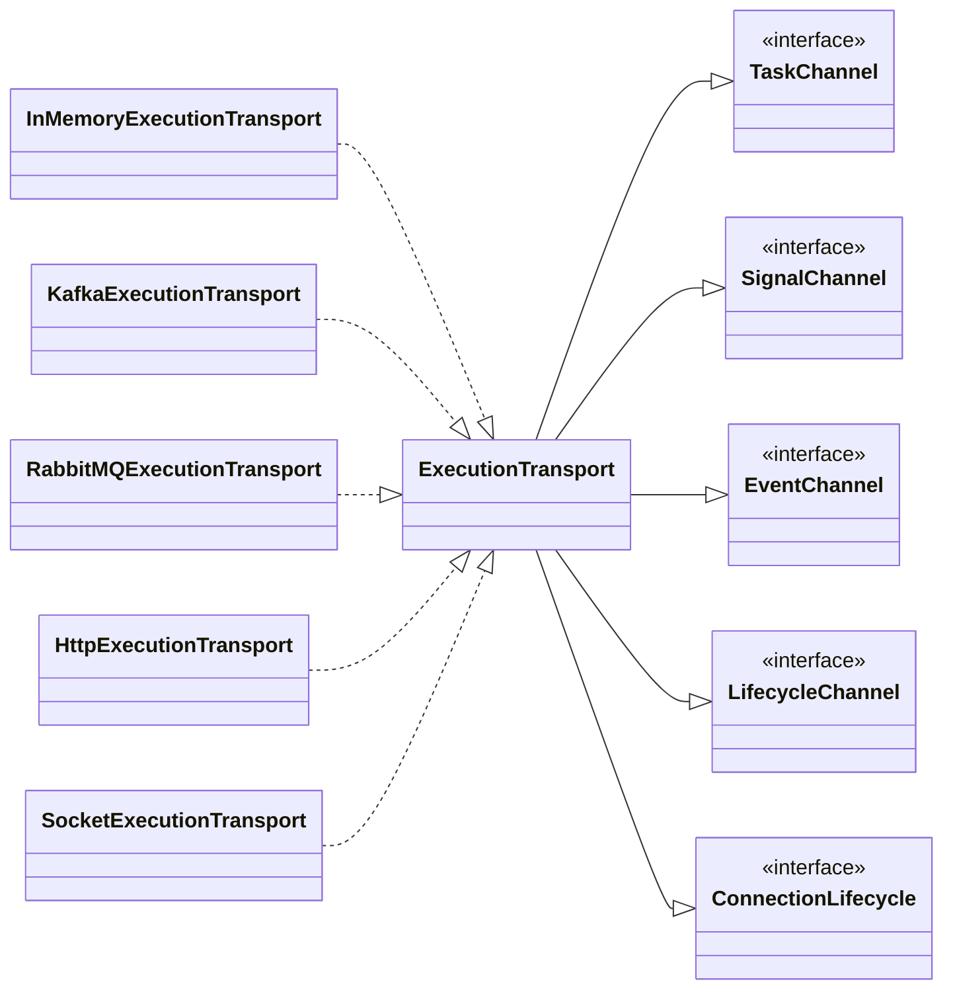
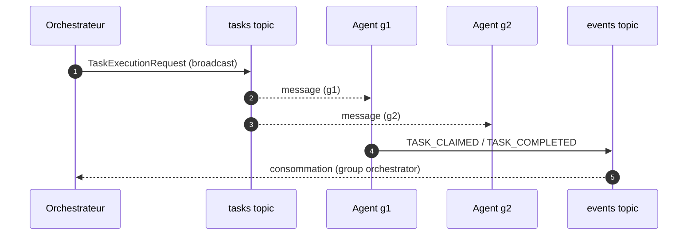

# Spec 05 — Transport Layer

**Module** : `platform-transport`
**Dépend de** : `platform-domain`

---

## 1. Objectif

Abstraire le mécanisme de communication entre orchestrateur et agents. Changer de
transport = changer `transport.type` ; aucun changement de code métier.

Modèle de communication : **broadcast + filtre côté agent**. L'orchestrateur publie une
`TaskExecutionRequest` sans ciblage ; chaque agent décide localement s'il est concerné
(`TaskSpecializationFilter`, spec 04).

Depuis ADR-028, `ExecutionTransport` n'est plus une interface monolithique : c'est une
**façade composite de migration** qui étend cinq ports étroits. Les consommateurs
dépendent du port dont ils ont besoin (ISP), et `getType()` a été supprimé (aucun
`if/switch` sur le type — CF-03).

---

## 2. Ports

```java
public interface TaskChannel {
    void dispatchTask(TaskExecutionRequest request);   // orchestrateur → agents (broadcast)
    void receiveTask(TaskRequestHandler handler);      // côté agent
}

public interface SignalChannel {
    void broadcastSignal(AgentSignal signal);          // restart, START/STOP
    void receiveSignal(AgentSignalHandler handler);    // côté agent
}

public interface EventChannel {
    void publishEvent(ExecutionEvent event);           // agents → orchestrateur
    Subscription subscribe(ExecutionEventHandler handler);
}

public interface LifecycleChannel {
    void publishAgentEvent(AgentLifecycleEvent event); // registration/heartbeat/lost
    Subscription subscribeAgentEvents(AgentLifecycleEventHandler handler);
}

public interface ConnectionLifecycle {
    void connect() throws TransportException;
    void disconnect();
    boolean isConnected();
}

// Façade conservée pour les beans Spring et TransportConfiguration
public interface ExecutionTransport
        extends TaskChannel, SignalChannel, EventChannel, LifecycleChannel, ConnectionLifecycle {}
```

Handlers :

```java
@FunctionalInterface public interface TaskRequestHandler { void onRequest(TaskExecutionRequest r); }
@FunctionalInterface public interface AgentSignalHandler { void onSignal(AgentSignal s); }
@FunctionalInterface public interface ExecutionEventHandler { void onEvent(ExecutionEvent e); }
@FunctionalInterface public interface AgentLifecycleEventHandler { void onEvent(AgentLifecycleEvent e); }
```



Consommateurs et ports utilisés :

| Consommateur | Port |
|---|---|
| `RemoteStepDispatcher` | `TaskChannel` |
| `RemoteLifecycleDispatcher` | `SignalChannel` |
| `TaskExecutionPipeline` | `EventChannel` |
| `TransportExecutionEventHandler` | `EventChannel` |
| `TransportAgentRegistration` | `LifecycleChannel` |
| `AgentLifecycleIngestion` | `LifecycleChannel` |
| `TaskAgentRuntime` | `TaskChannel` + `SignalChannel` + `EventChannel` + `ConnectionLifecycle` |

---

## 3. Messages et événements

### 3.1 TaskExecutionRequest (remplace TaskMessage)

```java
public record TaskExecutionRequest(
    MessageId id,                       // clé d'idempotence côté agent
    ExecutionId executionId,
    StepDefinition step,                // taskName, phase, parameters, timeout, retryPolicy
    PartialExecutionContext context,    // uniquement step.requiredContexts()
    Instant dispatchedAt,
    RetryPolicy retryPolicy
) {}
```

- **Pas de `targetAgentId`** : la sélection appartient aux agents.
- Le payload du contexte peut être volumineux (résultats Gatling) ; surveiller la taille
  si de nombreux `requiredContexts` sont déclarés.

### 3.2 ExecutionEvent (agents → orchestrateur)

```java
public record ExecutionEvent(
    EventId id,
    ExecutionId executionId,
    MessageId correlationId,       // MessageId de la TaskExecutionRequest
    AgentId agentId,
    String eventType,
    Map<String, Object> payload,   // copie défensive immuable
    Instant occurredAt
) {
    public static final String TASK_CLAIMED          = "TaskClaimedByAgent";
    public static final String TASK_WORK_IN_PROGRESS = "TaskWorkInProgress";
    public static final String TASK_COMPLETED        = "TaskCompleted";
    public static final String TASK_FAILED           = "TaskFailed";
}
```

Types de payload :
- `TASK_CLAIMED` : `taskName`, `agentId` ;
- `TASK_WORK_IN_PROGRESS` : `taskId`, `agentId`, `messageId` ;
- `TASK_COMPLETED` : `taskName`, `taskId`, `status`, `durationMs`, `outputs` ;
- `TASK_FAILED` : `taskName`, `taskId`, `status`, `durationMs`, `error`.

### 3.3 AgentLifecycleEvent (canal séparé, ADR-012)

```java
public record AgentLifecycleEvent(
    EventId id,
    AgentId agentId,
    String eventType,              // AGENT_REGISTERED | AGENT_HEARTBEAT |
                                   // AGENT_DEREGISTERED | AGENT_LOST
    Map<String, Object> payload,   // AgentDescriptor ou AgentHeartbeat (codec typé)
    Instant occurredAt
) {}
```

Séparé du canal d'exécution : pas d'`ExecutionId`, pas de pollution du tracker de
corrélation.

### 3.4 AgentSignal

```java
public sealed interface AgentSignal permits ScenarioRestartSignal, ExecutionLifecycleSignal {
    SignalId id();
    Instant issuedAt();
}
```

### 3.5 PartialExecutionContext

```java
public record PartialExecutionContext(
    ExecutionId executionId,
    ScenarioId scenarioId,
    Map<String, Map<String, Object>> store   // taskId → agentId → outputs nommés
) {
    <T> Optional<T> getOutput(String taskId, String agentId, String outputName, Class<T> type);
    <T> Optional<T> getFirstOutput(String taskId, String outputName, Class<T> type);
    <T> Optional<T> get(String taskId, String agentId, Class<T> type);   // historique
    <T> Optional<T> getFirst(String taskId, Class<T> type);              // historique
}
```

Les messages récents transportent la map complète des outputs ; les anciens messages à
valeur brute restent lisibles via les accesseurs historiques.

---

## 4. Implémentations

### 4.1 InMemory (LOCAL, tests)

- Sélection : `transport.type` absent ou `IN_MEMORY` (`matchIfMissing = true`).
- Livraison **synchrone** : `dispatchTask` invoque immédiatement les handlers ;
  `publishEvent` notifie les souscripteurs.
- Aucun broker, aucun serveur. Utilisé par le `TaskAgentRuntime` LOCAL.

### 4.2 Kafka

```yaml
transport:
  type: KAFKA
  kafka:
    bootstrap-servers: ${KAFKA_BOOTSTRAP_SERVERS:localhost:9092}
    tasks-topic: platform-tasks
    events-topic: platform-events
    signals-topic: platform-signals
    producer-acks: all
    consumer-group: ${AGENT_ID:agent}-${random.uuid}   # agent ; "orchestrator" côté orchestrateur
```

- Producer : `KafkaTemplate<String, byte[]>` qualifié `transportKafkaTemplate`.
- Consumer : `DynamicKafkaListenerRegistry` crée un `KafkaMessageListenerContainer` par
  agent et par type de flux (tasks, signals, events exécution, events lifecycle).
- `AckMode.RECORD`, `auto.offset.reset=earliest`, `enable.auto.commit=false`.
- **ADR-009** : chaque agent a un consumer group unique, sinon Kafka distribuerait les
  messages entre agents au lieu de les broadcaster.
- Topics : tasks (orchestrateur → tous les agents), signals (orchestrateur → agents),
  events (agents → orchestrateur, groupe `orchestrator`).
- Beans qualifiés `transport*` pour éviter les collisions avec les clusters métier
  (`platform.kafka-clusters.*`) et l'auto-configuration `spring.kafka.*`.



### 4.3 RabbitMQ

```yaml
transport:
  type: RABBITMQ
  rabbitmq:
    host: ${RABBITMQ_HOST:localhost}
    port: 5672
    virtual-host: /
    tasks-exchange: tasks
    events-exchange: events
    signals-exchange: signals
    username: ${RABBITMQ_USER:guest}
    password: ${RABBITMQ_PASSWORD:guest}
```

- Exchanges FANOUT pour tasks/signals (broadcast), queue exclusive auto-delete par agent.
- Ack manuel, at-least-once, I/O sur Virtual Threads.
- `RabbitMQConsumerManager` gère les consommateurs et la reconnexion.

### 4.4 HTTP

```yaml
transport:
  type: HTTP
  http:
    broadcast-mode: ALL_CAPABLE        # ALL_CAPABLE | FIRST_AVAILABLE
    request-timeout-seconds: 30
    task-availability-timeout-seconds: 120
    callback-base-path: /api/v1/events
```

- L'orchestrateur POST les `TaskExecutionRequest` aux agents capables via leur
  `httpCallbackUrl` ; l'agent répond `202 Accepted`.
- Les agents remontent leurs événements en POST sur `/api/v1/events`
  (`HttpEventCallbackController`), qui les republie dans le transport local.
- `ALL_CAPABLE` = multi-claim natif ; `FIRST_AVAILABLE` = un seul agent.
- Appels bloquants exécutés sur Virtual Threads (client JDK `HttpClient`).

> **Limite actuelle** : le code fournit l'envoi sortant et le contrôleur de callbacks
> d'événements (`POST /api/v1/events`), mais **aucun endpoint entrant de tâches**
> (`TaskExecutionRequest`) n'est exposé par la plateforme. Un agent HTTP nécessiterait
> un récepteur externe. De plus, un nœud AGENT démarre sans serveur web (ADR-019), donc
> `HttpEventCallbackController` n'y est pas actif. Le transport HTTP est utilisable pour
> le dispatch orchestrateur → système externe et les callbacks, pas comme canal complet
> orchestrateur ↔ agent plateforme en l'état.

### 4.5 Socket

```yaml
transport:
  type: SOCKET
  socket:
    orchestrator-host: localhost
    orchestrator-port: 9090
    backlog: 50
    keep-alive: true
    reconnect-interval-ms: 5000
```

- Connexions TCP persistantes, `SocketConnectionRegistry` côté orchestrateur.
- Détection de rôle : bind réussi = orchestrateur, port occupé = agent.
- Best-effort (pas de garantie at-least-once), reconnexion automatique côté agent.

### 4.6 CUSTOM

`transport.type=CUSTOM` est réservé à une configuration explicite de bean ; il n'existe
pas d'implémentation fournie. Aucun chargement dynamique par nom de classe.

---

## 5. Sélection par configuration

```java
@Configuration
@EnableConfigurationProperties({
    KafkaTransportProperties.class, RabbitMQTransportProperties.class,
    HttpTransportProperties.class, SocketTransportProperties.class})
public class TransportConfiguration {

    @Bean @ConditionalOnProperty(name="transport.type", havingValue="IN_MEMORY", matchIfMissing=true)
    InMemoryExecutionTransport inMemoryExecutionTransport() { ... }

    @Bean @ConditionalOnProperty(name="transport.type", havingValue="RABBITMQ")
    ExecutionTransport rabbitMQExecutionTransport(RabbitMQTransportProperties props) { ... }

    @Bean @ConditionalOnProperty(name="transport.type", havingValue="HTTP")
    ExecutionTransport httpExecutionTransport(HttpTransportProperties props,
                                               ObjectProvider<AgentRegistryPort> registry) { ... }

    @Bean @ConditionalOnProperty(name="transport.type", havingValue="SOCKET")
    ExecutionTransport socketExecutionTransport(SocketTransportProperties props) { ... }
}
```

Kafka est configuré dans `KafkaTransportBeans`, conditionnel à `transport.type=KAFKA`.

Priorité de configuration (ADR-006) : `TRANSPORT_TYPE` env > `--transport.type=` >
`transport.type` property > défaut `IN_MEMORY`.

---

## 6. Garanties de livraison

| Transport | Modèle | At-least-once | Ordre | Idempotence agent |
|---|---|---|---|---|
| IN_MEMORY | synchrone | oui (même JVM) | garanti | non nécessaire |
| KAFKA | broadcast par consumer group | oui (offsets) | par partition | requise (`MessageId`) |
| RABBITMQ | FANOUT + ack manuel | oui | par queue | requise |
| HTTP | POST + timeouts | via retry orchestrateur | non garanti | requise |
| SOCKET | broadcast connexions | non (best-effort) | par connexion | requise |

Clé d'idempotence : `TaskExecutionRequest.id`. Un agent ne ré-exécute jamais un
`MessageId` déjà traité.

---

## 7. Enregistrement des agents

L'enregistrement passe par le **canal lifecycle** (ADR-012), pas par le canal exécution :

```
Agent démarre
  → connection.connect()
  → LifecycleChannel.publishAgentEvent(AGENT_REGISTERED, AgentDescriptor)
  → orchestrateur : AgentLifecycleIngestion → AgentRegistry.onAgentRegistered

Heartbeat (toutes les 10 s)
  → LifecycleChannel.publishAgentEvent(AGENT_HEARTBEAT, AgentHeartbeat)
  → AgentRegistry.onAgentHeartbeat → refresh TTL

Arrêt graceful
  → LifecycleChannel.publishAgentEvent(AGENT_DEREGISTERED)
  → AgentRegistry.onAgentDeregistered

TTL expiré
  → AgentTtlMonitor publie AgentLost
  → tracker invalide les claims → fast-fail des steps en cours
```

L'orchestrateur ne peut dispatcher que si `AgentLifecycleIngestion` est actif
(DISTRIBUTED + ORCHESTRATOR). Sans lui, le registre reste vide.
