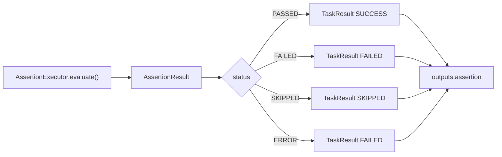

# Spec 07 — Assertion Framework

**Module** : `platform-assertion`
**Dépend de** : `platform-domain`, `platform-application`, `platform-plugin-api`

---

## 1. Objectif

Évaluer des assertions en lisant l'`ExecutionContext` (outputs d'injection/préparation)
et, si nécessaire, des systèmes externes (datasource, WireMock, Kafka). Produire des
`AssertionResult` avec une `Evidence` détaillée.

Depuis ADR-029/ADR-030, il n'existe **plus de registre d'assertions séparé** :
`AssertionExecutor extends TaskExecutor` et les implémentations sont collectées par le
`TaskExecutorRegistry` commun. Le moteur traite donc les assertions comme des tâches
standard (chemin unique LOCAL/DISTRIBUTED).

---

## 2. Interfaces

```java
public interface AssertionExecutor extends TaskExecutor {

    AssertionResult evaluate(ExecutionContext context, StepDefinition step);

    String getSupportedAssertionName();       // correspond à @Assertion(name = "...")

    // Héritage de TaskExecutor
    @Override
    default String getSupportedTaskName() { return getSupportedAssertionName(); }

    @Override
    default TaskResult execute(ExecutionContext context, StepDefinition step) {
        return toTaskResult(evaluate(context, step));
    }
}
```

- `evaluate(...)` ne lance **jamais** d'exception métier : il retourne un statut
  `PASSED`, `FAILED`, `SKIPPED` ou `ERROR`.
- `execute(...)` convertit le résultat en `TaskResult` et place un `AssertionSummary`
  dans les outputs sous la clé `AssertionSummary.OUTPUT_KEY = "assertion"`.
- Mapping des statuts : `PASSED → SUCCESS`, `FAILED → FAILED`, `SKIPPED → SKIPPED`,
  `ERROR → FAILED`.

Il n'y a pas d'interface `AssertionExecutorRegistry` : la découverte se fait par
annotation (`@Assertion`) et le registre est `TaskExecutorRegistry`.

---

## 3. AssertionResult et Evidence

```java
public record AssertionResult(
    TaskId assertionId,
    AssertionStatus status,         // PASSED | FAILED | SKIPPED | ERROR
    String description,
    Evidence evidence,
    Duration evaluationDuration,
    Instant evaluatedAt
) {}

public record Evidence(
    Object actualValue,
    Object expectedValue,
    AssertionOperator operator,
    String unit,
    Map<String, Object> details
) {}

public record AssertionSummary(
    TaskId assertionId,
    AssertionStatus verdict,
    String description,
    Map<String, Object> collectedData,
    List<AssertionSample> history,
    Duration evaluationDuration,
    Instant evaluatedAt
) {
    public static final String OUTPUT_KEY = "assertion";
}
```

`AssertionStatus` : `PASSED`, `FAILED`, `SKIPPED`, `ERROR`.
`AssertionOperator` : `LT`, `LTE`, `GT`, `GTE`, `EQ`, `NEQ` (comparaison numérique).

---

## 4. Types d'assertions

Toutes les assertions se déclarent dans `steps:` avec `task:` et `phase: ASSERTION`.

### `gatling-metric`
```yaml
- id: p95-check
  task: gatling-metric
  phase: ASSERTION
  requiredContexts: [customer-api-load]
  parameters:
    metric: p95                # p50|p75|p90|p95|p99|max|min|mean|
                               # errorRate|throughput|totalRequests|failedRequests
    operator: LT
    value: 500
    unit: ms                   # ms|percent|req_per_sec|count
    refTaskId: customer-api-load   # optionnel si une seule injection
```
Lit `InjectionResult` depuis le contexte (clé `"result"`) ; `refTaskId` par défaut =
premier résultat d'injection disponible.

### `database-assertion`
```yaml
- id: db-count
  task: database-assertion
  phase: ASSERTION
  parameters:
    datasource: customer-db    # nom du bean DataSource ; "default" → datasource primaire ; sinon ERROR si introuvable
    query: "SELECT COUNT(*) FROM orders WHERE status = 'CREATED'"
    operator: GT
    value: 1000
    unit: count
```

### `kafka`
```yaml
- id: consumed
  task: kafka
  phase: ASSERTION
  requiredContexts: [kafka-monitor]
  parameters:
    metric: consumedCount      # consumedCount | producedCount | lag
    topic: customer-events
    groupId: perf-monitor
    operator: GT
    value: 5000
    refTaskId: kafka-monitor
```
Lit les outputs du `KafkaConsumerTaskExecutor` / `KafkaProducerTaskExecutor`
(`messagesConsumed`, `messagesProduced`, `lag`).

### `wiremock`
```yaml
- id: calls
  task: wiremock
  phase: ASSERTION
  parameters:
    mockUrl: http://localhost:8090   # ou target: wiremock
    endpoint: /api/customers
    operator: EQ
    expectedCount: 1000
```
Interroge l'API d'administration WireMock (`POST /__admin/requests/count`).

### `http-mock`
```yaml
- id: received
  task: http-mock
  phase: ASSERTION
  requiredContexts: [start-mock]
  parameters:
    metric: receivedCalls      # receivedCalls | matchedCalls | unmatchedCalls
    endpoint: POST /api/customers
    operator: GTE
    value: 1000
    target: wiremock           # ou wiremockUrl
    refTaskId: start-mock
```

### `file`
```yaml
- id: output-file
  task: file
  phase: ASSERTION
  parameters:
    path: /reports/output.csv
    check: EXISTS              # EXISTS | NOT_EXISTS | CHECKSUM | SIZE_GT | SIZE_LT
    checksum: sha256:abc123    # CHECKSUM
    sizeBytes: 1024            # SIZE_GT / SIZE_LT
```

### Assertions d'intervalle (`linkedTo`)
Une assertion dont le paramètre `linkedTo` référence un step d'injection est placée
dans `ExecutionPlan.assertionIntervalSteps`. Elle n'est pas exécutée après l'injection :
le moteur lui envoie `START` avant l'INJECTION et `STOP` après. Elle peut ainsi
échantillonner pendant la charge (ex. assertion Gatling périodique). `linkedTo` inconnu
→ `InvalidScenarioException` au build du plan.

---



## 5. Contribution au verdict

Deux calculs coexistent :

1. **Verdict d'exécution** (`ExecutionEngine`) : toute tâche `FAILED` — y compris une
   assertion — rend le verdict `FAILED` ; un `SKIPPED` donne `WARNING`.
2. **Verdict de rapport** (`VerdictCalculator`) : `ERROR` → `FAILED`,
   `FAILED` → `WARNING`, tout `PASSED`/`SKIPPED` (ou aucune assertion) → `SUCCESS`.

Le rapport expose donc une sévérité plus nuancée que le statut d'exécution.
Il n'existe pas de champ `severity` dans le modèle actuel : la distinction
FAILED/WARNING provient du statut de l'assertion (`FAILED` vs `ERROR`).

---

## 6. Découverte et exécution

- Découverte : beans Spring annotés `@Assertion(name="…")`, collectés par
  `TaskExecutorRegistry` (et par `PluginRegistry` pour les plugins externes).
- Chargement plugin : `platform.plugins.enabled=true` + JAR dans `platform.plugins.dir`.
- Exécution : chemin unique `LocalStepDispatcher`/`RemoteStepDispatcher` ; aucune
  branche spécifique aux assertions.
- En DISTRIBUTED, l'agent doit déclarer le nom d'assertion dans
  `agent.supported-tasks` (ex. `wiremock`, `database-assertion`).
