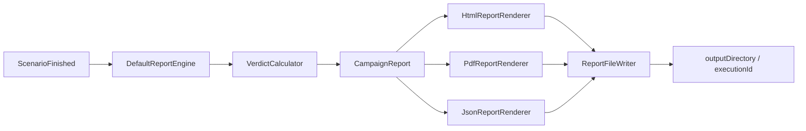
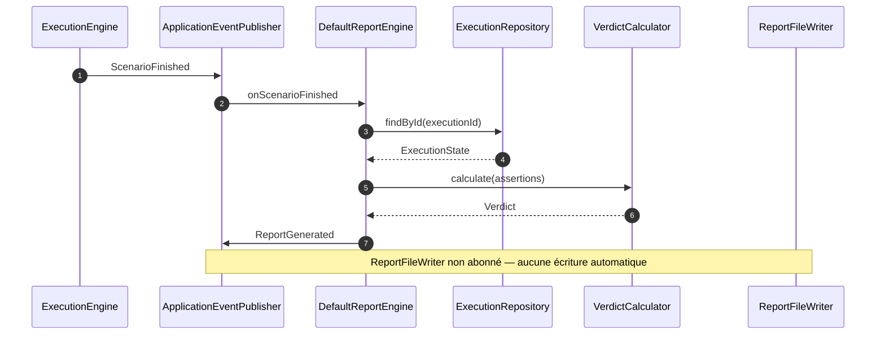

# Spec 08 — Report Engine

**Module** : `platform-reporting`
**Dépend de** : `platform-domain`, `platform-application`

---

## 1. Objectif

Générer un rapport complet de campagne (HTML, PDF, JSON) à partir de l'état persisté
d'une exécution, et l'écrire **localement** sur disque. Il n'y a pas de publication vers
des systèmes externes (ADR-022) : les anciens publishers Confluence/S3/Git/SharePoint/
Nexus sont hors périmètre.

Le moteur est **event-driven** : `DefaultReportEngine` écoute `ScenarioFinished` et
génère le rapport à la fin de chaque exécution. Il peut aussi être appelé directement via
`generate(ExecutionState)`.

---



## 2. Interfaces

```java
public interface ReportEngine {
    CampaignReport generate(ExecutionState state) throws ReportGenerationException;
}

public interface ReportRenderer {
    ReportFormat getFormat();                      // HTML | PDF | JSON
    byte[] render(CampaignReport report) throws RenderException;
}
```

`DefaultReportEngine` :
- est conditionnel à la présence d'une datasource (`platform.datasources.default.url`) ;
- relit `ExecutionState` depuis `ExecutionRepository` ;
- classifie les résultats par phase grâce aux types présents dans le contexte
  (`InjectionResult`, `AssertionSummary`, `TaskResult`) ;
- calcule le verdict via `VerdictCalculator` ;
- publie `ReportGenerated(executionId, reportId, timestamp)` après génération ;
- une erreur de génération est loggée (`action=report_generation_failed`) et ne fait pas
  échouer l'exécution.

---

## 3. Structure du rapport

```java
public record CampaignReport(
    ReportId id,
    ScenarioId scenarioId,
    String scenarioName,
    String scenarioVersion,
    List<String> tags,
    Map<String, String> metadata,
    EnvironmentInfo environment,
    ExecutionSummary executionSummary,
    List<TaskReportEntry> preparationResults,
    List<InjectionReportEntry> injectionResults,
    List<AssertionReportEntry> assertionResults,
    Verdict verdict,
    String verdictReason,
    Instant generatedAt,
    Duration totalDuration
) {}

public record EnvironmentInfo(
    List<String> agentIds,
    String jvmVersion,
    Map<String, String> systemProperties
) {}

public record ExecutionSummary(
    int totalTasks, int successfulTasks, int failedTasks, int skippedTasks,
    Duration preparationDuration, Duration injectionDuration, Duration assertionDuration
) {}

public record TaskReportEntry(
    TaskId taskId, String taskName, TaskStatus status,
    Duration duration, Map<String, Object> outputs
) {}

public record InjectionReportEntry(
    TaskId taskId, InjectionResult metrics, Path gatlingReportDirectory
) {}

public record AssertionReportEntry(
    TaskId assertionId, AssertionResult result, Evidence evidence
) {}
```

Classes de résultat (dans `platform-domain`) :
- `InjectionResult` — KPIs Gatling (`totalRequests`, `successfulRequests`, ...),
  `OUTPUT_KEY = "result"` ;
- `AssertionResult` / `AssertionSummary` — statut, description, evidence,
  `OUTPUT_KEY = "assertion"`.

---

## 4. Calcul du verdict

`VerdictCalculator.calculate(assertionEntries)` :

| Condition | Verdict |
|---|---|
| aucune assertion | `SUCCESS` |
| au moins une assertion `ERROR` | `FAILED` |
| au moins une assertion `FAILED` | `WARNING` |
| toutes `PASSED`/`SKIPPED` | `SUCCESS` |

`buildVerdictReason(...)` produit une explication lisible (compteurs / première cause).
Le verdict du rapport peut différer du verdict d'exécution (`ExecutionEngine`) : ce
dernier reflète les statuts de tâches, le rapport reflète les assertions.

---

## 5. Formats de sortie

| Format | Renderer | Mécanisme |
|---|---|---|
| HTML | `HtmlReportRenderer` | template `templates/campaign-report.html` + substitution de placeholders et sections générées |
| PDF | `PdfReportRenderer` | rendu HTML puis conversion OpenHTMLToPDF (`openhtmltopdf-pdfbox`) |
| JSON | `JsonReportRenderer` | sérialisation Jackson de `CampaignReport` |

Le template HTML contient : badge de verdict, raison, résumé d'exécution, tableau de
préparation, KPIs d'injection, tableau des assertions et informations d'environnement.
Les renderers sont des beans Spring ; `ReportFileWriter` les indexe par `ReportFormat`.

---

## 6. Écriture sur disque

`ReportFileWriter.write(executionId, report)` :

```
<reporting.output-directory>/<executionId>/
  campaign.html
  campaign.pdf
  campaign.json
  gatling/<simulationClass>/...     ← copié depuis les répertoires Gatling
```

- Seuls les formats listés dans `reporting.formats` sont produits.
- Les répertoires Gatling sont copiés en parallèle sur Virtual Threads.
- Les erreurs d'I/O sont remontées en `UncheckedIOException`.
- Le répertoire de sortie est créé si nécessaire.

> **État du câblage (2026-10-20)** : `ReportFileWriter` est un bean mais aucun composant
> de production ne l'appelle. `DefaultReportEngine` génère le `CampaignReport` en
> mémoire et publie `ReportGenerated` ; il n'écrit pas sur disque. `ReportController`
> (`GET /api/v1/executions/{id}/report`) ne sert que des fichiers déjà présents.
> Le port `GenerateReportUseCase` est défini mais n'a pas d'implémentation. L'écriture
> automatique reste donc à raccorder (candidat : un `@EventListener(ReportGenerated)`).

Configuration (`ReportProperties`, préfixe `reporting`) :

```yaml
reporting:
  output-directory: ${REPORTING_OUTPUT_DIR:reports}   # défaut : reports
  formats:
    - HTML
    - PDF
    - JSON
```

Si `formats` est absent ou vide, les trois formats sont actifs.

---

## 7. Déclenchement et intégration



Note : `DefaultReportEngine` est désactivé en AGENT sans datasource ; le reporting est
une responsabilité d'orchestrateur (ou de LOCAL). Aucun accès réseau n'est effectué pour
produire ou écrire un rapport.
