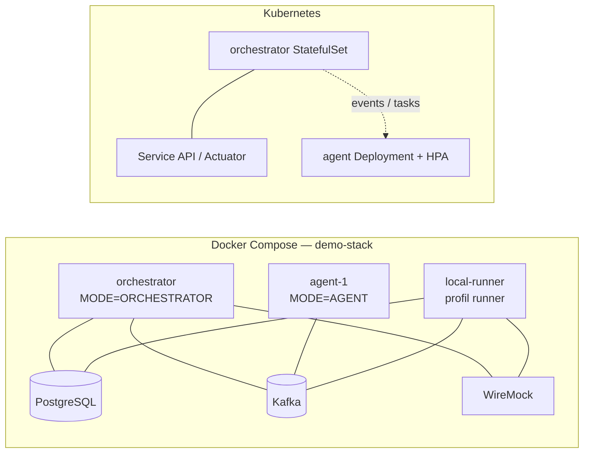

# Spec 09 — Deployment

**Module** : `platform-deployment`
**Artefacts** : `docker/Dockerfile`, `docker/docker-compose.yaml`, `kubernetes/*`,
`local-dev/docker-compose.yaml`, `examples/demo-stack/*`

---

## 1. Image unique

Le Dockerfile multi-stage construit le fat JAR puis l'exécute sur un JRE Java 25 Alpine,
avec un utilisateur non-root (`perf`).

```dockerfile
# Build (depuis la racine du dépôt — le contexte doit inclure tous les modules)
docker build -f platform-deployment/docker/Dockerfile -t performance-platform:latest .

# Stage build : eclipse-temurin:25-jdk-alpine + Maven
RUN mvn clean package -pl platform-app -am -DskipTests -B -q

# Stage runtime : eclipse-temurin:25-jre-alpine
USER perf
ENTRYPOINT ["java", "-XX:MaxRAMPercentage=75.0", "-jar", "app.jar"]
EXPOSE 8080 9000
HEALTHCHECK ... /actuator/health
```

Points importants :
- **Virtual Threads sont natifs en Java 25** : aucun flag `-XX:+UseVirtualThreads`
  (il n'existe pas et faisait échouer le démarrage).
- Le `.dockerignore` à la racine exclut `target/`, `.git`, `.claude`, les exemples, etc.
- L'image est la même pour LOCAL, ORCHESTRATOR et AGENT ; le rôle est porté par
  `RUNTIME_MODE`/`MODE`.
- En AGENT, le conteneur n'expose aucun port applicatif (pas de Tomcat) ; n'exposer que
  ce qui est nécessaire au transport (généralement aucun port entrant).

### Variables d'environnement

| Variable | Valeurs | Description |
|---|---|---|
| `RUNTIME_MODE` | `LOCAL`, `DISTRIBUTED` | prioritaire sur `runtime.mode` |
| `MODE` | `ORCHESTRATOR`, `AGENT` | prioritaire sur `runtime.role` |
| `TRANSPORT_TYPE` | `KAFKA`, `RABBITMQ`, `HTTP`, `SOCKET`, `IN_MEMORY` | prioritaire sur `transport.type` |
| `AGENT_SUPPORTED_TASKS` | liste CSV | spécialisation d'agent (ADR-015) ; remplace `AGENT_TAGS` |
| `AGENT_ID` | string | identité stable (consumer group Kafka) |
| `KAFKA_BOOTSTRAP_SERVERS` | host:port | brokers |
| `DB_URL` / `DB_USERNAME` / `DB_PASSWORD` | — | PostgreSQL |
| `WIREMOCK_URL` / `DEVICE_API_URL` | URL | cibles HTTP nommées |
| `REPORTING_OUTPUT_DIR` | chemin | sortie des rapports |
| `SPRING_SECURITY_OAUTH2_RESOURCESERVER_JWT_ISSUER_URI` | URL | OAuth2/JWT (sécurité activée) |
| `SPRING_PROFILES_ACTIVE` | `local`, `orchestrator`, `agent`, … | profil Spring |

Règle (ADR-006) : une variable d'environnement définie gagne toujours sur la property
correspondante, via `RuntimeConfigEnvironmentPostProcessor`.

---

## 2. Docker Compose

### 2.1 Dépendances de développement IDE (`local-dev/docker-compose.yaml`)

Uniquement l'infrastructure externe, la plateforme tourne depuis l'IDE :

| Service | Port hôte | Identifiants |
|---|---|---|
| PostgreSQL 16 | 5432 | `postgres` / `changeme`, base `performance` |
| Kafka KRaft 7.7.1 | 9092 | — |
| WireMock 3.12.1 | 8090 | mappings du demo-stack |

```bash
docker compose -f platform-deployment/local-dev/docker-compose.yaml up -d
docker compose -f platform-deployment/local-dev/docker-compose.yaml down -v
```

Profils IDE fournis dans `platform-app/src/main/resources` :
`application-ide-orchestrator.yaml`, `application-agent-injector.yaml`,
`application-agent-asserter.yaml`.

### 2.2 Stack de démonstration (`examples/demo-stack/docker-compose.yaml`)

Services : PostgreSQL, Kafka, WireMock, orchestrateur, `agent-1`, plus un `local-runner`
sous profil `runner`. Deux scénarios :

| Scénario | Mode | Couverture |
|---|---|---|
| `scenarios/remote-demo.yaml` | DISTRIBUTED | base de données, Kafka producer/consumer, mock HTTP, assertions |
| `scenarios/local-demo.yaml` | LOCAL | mêmes tâches, exécution dans l'orchestrateur |

```bash
cd platform-deployment/examples/demo-stack
./run-demo.sh                      # remote puis local
```

Exemple d'agent spécialisé :

```yaml
agent-1:
  environment:
    RUNTIME_MODE: DISTRIBUTED
    MODE: AGENT
    AGENT_SUPPORTED_TASKS: "database,database-assertion,kafka-producer,kafka,http-client,http-mock"
```

> `AGENT_TAGS` n'existe plus : le routage se fait uniquement par nom de tâche
> (`agent.supported-tasks`, ADR-015).



### 2.3 Compose historique (`docker/docker-compose.yaml`)

Orchestrateur + agents + Kafka + PostgreSQL. Les variables `MODE`, `RUNTIME_MODE`,
`TRANSPORT_TYPE`, `DB_URL` y sont utilisées de la même manière.

---

## 3. Kubernetes

Manifests dans `platform-deployment/kubernetes/` :

| Fichier | Contenu |
|---|---|
| `orchestrator-statefulset.yaml` | StatefulSet orchestrateur, `MODE=ORCHESTRATOR` |
| `agent-deployment.yaml` | Deployment agents, `MODE=AGENT`, `AGENT_SUPPORTED_TASKS` |
| `agent-hpa.yaml` | HPA CPU sur le Deployment agent |
| `service.yaml` | Service API/Actuator |
| `configmap.yaml` | configuration commune (transport, topics, datasource) |
| `secret-template.yaml` | template des secrets (DB, OAuth2) |

Probes : `/actuator/health/readiness` (initialDelay 30 s) et
`/actuator/health/liveness` (initialDelay 60 s). Les agents n'ont pas de Service ni de
probe HTTP : ils n'exposent aucun serveur web (ADR-019) — surveiller leur état via le
registre orchestrateur et les logs.

Recommandations :
- `execution.task-availability-timeout` ≥ 120 s en K8s (cold start d'un agent).
- `agent.supported-tasks` explicite par type d'agent (injecteur vs asserteur).
- Consumer group Kafka unique par pod (défaut `${AGENT_ID:agent}-${random.uuid}`).
- Secrets OAuth2/JWT fournis via `SPRING_SECURITY_OAUTH2_RESOURCESERVER_JWT_*` ;
  ne pas déclarer de valeur vide (Spring échoue au démarrage).

---

## 4. Modes de lancement

```bash
# LOCAL (défaut) — H2 en mémoire, transport IN_MEMORY
java -jar platform-app/target/performance-platform.jar

# LOCAL avec dépendances Docker (PostgreSQL/Kafka/WireMock)
java -jar app.jar --spring.profiles.active=local

# CLI headless (run-and-exit, codes 0/1/2 — ADR-021)
java -jar app.jar --scenario=platform-deployment/examples/scenarios/device-api-local.yaml

# ORCHESTRATOR distribué
MODE=ORCHESTRATOR RUNTIME_MODE=DISTRIBUTED TRANSPORT_TYPE=KAFKA java -jar app.jar

# AGENT distribué (aucun serveur web)
MODE=AGENT RUNTIME_MODE=DISTRIBUTED TRANSPORT_TYPE=KAFKA \
  AGENT_SUPPORTED_TASKS=mock-server,http-client java -jar app.jar
```

---

## 5. Sécurité de déploiement

- `platform.security.enabled=false` : autorisé mais WARN explicite (posture permissive,
  ADR-038).
- `true` : `/api/**` exige un JWT avec rôle `USER` ou `ADMIN` ; endpoints publics
  `/actuator/health/**`, `/`, `/index.html`, `/assets/**`.
- Secrets jamais dans les YAML : variables d'environnement ou Secrets Kubernetes.
- API REST stateless, CSRF désactivé.
