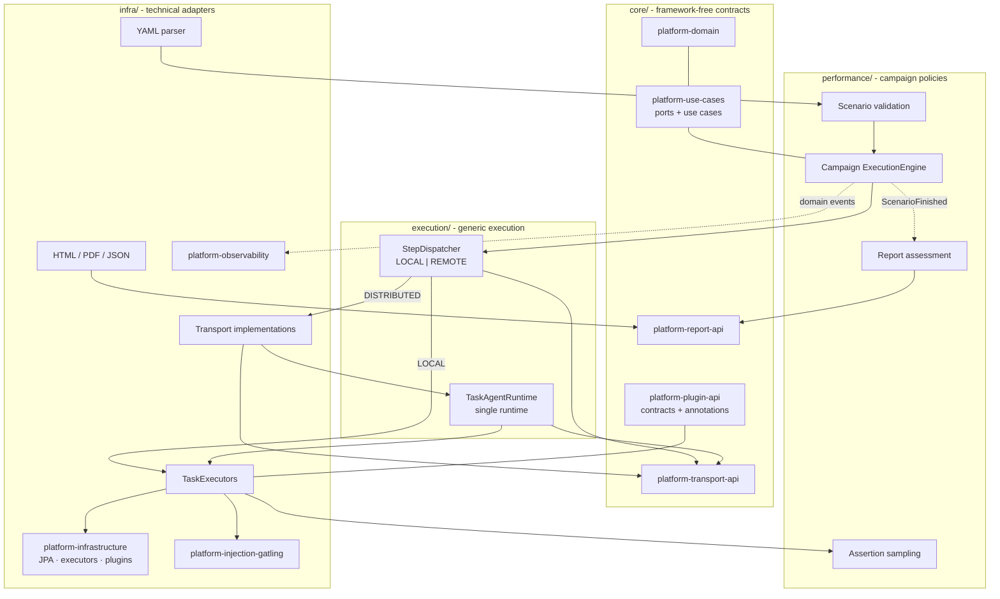

# Performance Engineering Platform

Distributed performance-testing platform built on **Java 25** and **Spring Boot 4**.
The same fat JAR runs as a self-contained LOCAL runner or as a DISTRIBUTED
orchestrator with specialized agents.

A campaign is a YAML scenario executed in three ordered phases:

```
PREPARATION → INJECTION → ASSERTION
```

Within each phase, steps form a **DAG**: independent steps run in parallel on virtual
threads, dependent steps wait for their prerequisites.

---

## Architecture at a glance



| Directory / module | Responsibility |
|---|---|
| `core/platform-domain` | Immutable scenario, task, execution, result and event models |
| `core/platform-use-cases` | Framework-free ports and use cases (formerly `platform-application`) |
| `core/platform-plugin-api` | Public executor contracts and annotations |
| `core/platform-transport-api` | Framework-free channels, messages and subscriptions |
| `core/platform-report-api` | Report models and rendering/output contracts |
| `execution/platform-execution-engine` | Generic DAG scheduling, dispatch, retry and correlation |
| `execution/platform-agent-runtime` | Generic workers, specialization, heartbeat and registration |
| `performance/platform-campaign-engine` | Performance phases, load configuration, campaign state and verdict |
| `performance/platform-scenario-dsl` | Scenario validation, DAG checks and load-model registry |
| `performance/platform-assertion` | Assertion mapping and sampling policy |
| `performance/platform-reporting` | SLI/SLO assessment and campaign report assembly |
| `infra/platform-scenario-yaml` | SnakeYAML/Jackson scenario parser |
| `infra/platform-transport` | In-memory, Kafka, RabbitMQ, HTTP and socket adapters |
| `infra/platform-infrastructure` | Built-in task adapters, JPA persistence and plugin loading |
| `infra/platform-injection-gatling` | Gatling injection and result parsing |
| `infra/platform-assertion-adapters` | Database, file, Kafka, HTTP mock and Gatling assertions |
| `infra/platform-report-renderers` | HTML/PDF/JSON rendering and file output |
| `infra/platform-observability` | Micrometer metrics and MDC logging |
| `bootstrap` (`platform-bootstrap`) | Only executable: Spring Boot assembly, REST, UI and CLI |
| `distribution` | Docker, Compose, Kubernetes, scenarios and demo SUT applications |

Project documentation lives in `docs/knowledge/`, independently of any agent
harness. Harness workflows live in `.claude/skills/<name>/SKILL.md`.
`distribution/examples/sut/` contains the independently built demo applications,
not production platform modules. The single executable remains
`bootstrap/target/performance-platform.jar`.

The generic execution modules depend only on core platform contracts in production:
they do not interpret load models, evaluate SLOs or construct assertion sampling.
The performance campaign layer supplies these policies. See
[ADR-045](docs/knowledge/adr/ADR-045-project-layout-and-execution-boundaries.md).

Detailed documentation: [architecture](docs/knowledge/architecture.md),
[component catalogue](docs/knowledge/components.md),
[specifications](docs/knowledge/specs/00-overview.md).

---

## Access modes

| Access | LOCAL | DISTRIBUTED / ORCHESTRATOR | DISTRIBUTED / AGENT |
|---|:---:|:---:|:---:|
| REST API `/api/v1/**` | ✓ | ✓ | ✗ |
| Web UI | ✓ | ✓ | ✗ |
| CLI `--scenario=` | ✓ | ✓ | ✗ |
| Web server (Tomcat) | ✓ | ✓ | ✗ (`WebApplicationType.NONE`) |
| Outbound transport only | — | — | ✓ |

An agent is a pure worker: it registers over the transport and executes tasks; it never
exposes an API, UI, or CLI.

### CLI (headless)

```bash
java -jar bootstrap/target/performance-platform.jar \
  --scenario=file:distribution/examples/scenarios/device-api-local.yaml
echo $?   # 0 success, 1 failed, 2 invalid arguments/scenario
```

When `--scenario=` is present the application runs once and exits
(`WebApplicationType.NONE`, ADR-021).

### REST API

```bash
java -jar bootstrap/target/performance-platform.jar

curl -X POST http://localhost:8080/api/v1/scenarios \
  -H "Content-Type: application/yaml" --data-binary @scenario.yaml
# 202 Accepted → {"executionId":"…","status":"ACCEPTED"}

curl http://localhost:8080/api/v1/executions/{executionId}
curl http://localhost:8080/api/v1/executions/{executionId}/tasks
curl -X POST http://localhost:8080/api/v1/executions/{executionId}/cancel
```

Additional endpoints: `GET /api/v1/executions`, `DELETE /api/v1/executions/{id}`,
`POST /api/v1/scenarios/upload` (multipart `file` or form field `yaml`),
`GET /api/v1/agents`, `GET /api/v1/executions/{id}/report?format=html|pdf|json`.

### Web UI

```bash
java -jar bootstrap/target/performance-platform.jar --web.ui.enabled=true
# http://localhost:8080
```

---

## Quick start

### Prerequisites

- Java 25
- Maven 3.9+
- Docker (optional, for PostgreSQL/Kafka/WireMock and the demo stack)

### Build

```bash
mvn clean install
```

### Run in LOCAL mode

```bash
java -jar bootstrap/target/performance-platform.jar
# or explicitly
RUNTIME_MODE=LOCAL java -jar bootstrap/target/performance-platform.jar
```

LOCAL uses H2 in memory and the `IN_MEMORY` transport by default.

### IDE profiles with Docker dependencies

```bash
docker compose -f distribution/local-dev/docker-compose.yaml up -d
```

Then run one of the Spring profiles from the IDE:

| Profile | Role |
|---|---|
| `ide-orchestrator` | DISTRIBUTED + ORCHESTRATOR, local PostgreSQL/Kafka/WireMock |
| `agent-injector` | DISTRIBUTED + AGENT for preparation/injection tasks |
| `agent-asserter` | DISTRIBUTED + AGENT for assertion tasks |

### Operational demo stack

```bash
cd distribution/examples/demo-stack
./run-demo.sh
```

The stack runs:

- `scenarios/remote-demo.yaml` — DISTRIBUTED, covering database, Kafka producer/consumer,
  HTTP client, WireMock and assertions;
- `scenarios/local-demo.yaml` — the same coverage through the headless CLI.

---

## Runtime configuration

Priority: **environment variable > CLI argument > Spring property > default**
(ADR-006 / ADR-032).

| Concept | Env var | CLI | Property | Default |
|---|---|---|---|---|
| Mode | `RUNTIME_MODE` | `--runtime.mode=` | `runtime.mode` | `LOCAL` |
| Role | `MODE` | `--runtime.role=` | `runtime.role` | `NONE` |
| Transport | `TRANSPORT_TYPE` | `--transport.type=` | `transport.type` | `IN_MEMORY` |

```bash
# Orchestrator
RUNTIME_MODE=DISTRIBUTED MODE=ORCHESTRATOR TRANSPORT_TYPE=KAFKA \
  java -jar performance-platform.jar

# Agent (no web server)
RUNTIME_MODE=DISTRIBUTED MODE=AGENT TRANSPORT_TYPE=KAFKA \
  AGENT_SUPPORTED_TASKS=mock-server,http-client,database \
  java -jar performance-platform.jar
```

Provided Spring profiles: `local`, `orchestrator`, `agent`, `ide-orchestrator`,
`agent-injector`, `agent-asserter`, `examples-local`. A profile whose name starts with
`agent` forces `WebApplicationType.NONE`.

---

## Scenario DSL

```yaml
scenario:
  id: customer-api-perf
  name: Customer API Campaign
  version: 1.0.0
  tags: [performance, regression]
  metadata:
    owner: team-api
  execution:
    mode: DISTRIBUTED
  taskAvailabilityTimeoutSeconds: 120

  steps:
    - id: purge-db
      task: database
      phase: PREPARATION
      parameters:
        operation: PURGE
        datasource: customer-db
      timeout: 30s

    - id: start-mock
      task: mock-server
      phase: PREPARATION
      parameters:
        deployment: EMBEDDED
        action: START
        port: 8090
        mappingsPath: wiremock/mappings

    - id: inject
      task: gatling
      phase: INJECTION
      requiredContexts: [purge-db, start-mock]
      dependsOn: [purge-db, start-mock]
      parameters:
        simulation: com.example.CustomerApiSimulation
        loadModel: api-load
      timeout: 20m

    - id: p95-check
      task: gatling-metric
      phase: ASSERTION
      requiredContexts: [inject]
      dependsOn: [inject]
      parameters:
        metric: p95
        operator: LT
        value: 500
        unit: ms

loadModels:
  api-load:
    type: RAMP
    stages:
      - {duration: 2m, usersPerSecond: 10}
      - {duration: 5m, usersPerSecond: 100}
      - {duration: 2m, usersPerSecond: 0}
```

Unknown YAML keys are rejected. Validation covers duplicate ids, phases, dependencies,
DAG cycles, `requiredContexts`, `linkedTo` and load-model references.

Load-model types: `RAMP`, `RAMP_UP_DOWN`, `CONSTANT`, `SPIKE`, `STAIR`, `SOAK`, `BURST`,
`CUSTOM`.

---

## Built-in tasks

### Preparation

| Task | Operations |
|---|---|
| `database` | `PURGE`, `POPULATE`, `QUERY` |
| `filesystem` | `CREATE`, `DELETE`, `UPLOAD`, `CLEANUP` |
| `shell` | Command execution with timeout and allowed exit codes |
| `docker` | `START`, `STOP`, `PULL` |
| `http-client` | HTTP calls to named targets (`GET`, `POST`, `PUT`, `PATCH`, `DELETE`) |
| `kafka-consumer` | `CONSUME`, `COUNT` |
| `kafka-producer` | `PRODUCE`, `PRELOAD` |
| `mock-server` | `START`, `STOP`, `RESET`, `VERIFY` on embedded/external WireMock |

### Injection

| Task | Notes |
|---|---|
| `gatling` | Gatling 3.11 Java DSL. HTTP/HTTPS and WebSocket are bundled; JMS is optional; Kafka requires an external Gatling plugin. gRPC is out of scope. |

### Assertion

| Task | Notes |
|---|---|
| `gatling-metric` | `p50`, `p75`, `p90`, `p95`, `p99`, `max`, `min`, `mean`, `errorRate`, `throughput`, `totalRequests`, `failedRequests` |
| `database-assertion` | SQL `COUNT`/`EXISTS`/`SCALAR` comparisons |
| `kafka` | `consumedCount`, `producedCount`, `lag` |
| `wiremock` | Request count on a WireMock endpoint |
| `http-mock` | Received/matched/unmatched calls |
| `file` | `EXISTS`, `NOT_EXISTS`, `CHECKSUM`, `SIZE_GT`, `SIZE_LT` |

Assertions can use `linkedTo` to sample during an injection step; the engine sends them
`START` before the injection and `STOP` after it.

---

## Distributed agents

Each agent declares its supported task names. The orchestrator broadcasts every task;
each agent filters locally and executes only what it supports.

```yaml
agent:
  supported-tasks:
    - database
    - mock-server
    - gatling
    - wiremock
  registry:
    ttl-check-interval-seconds: 10
```

`AGENT_SUPPORTED_TASKS` (comma-separated) overrides the list. `AGENT_TAGS` no longer
exists: routing is by `task` name only (ADR-015).

Multiple agents may claim the same task. The orchestrator tracks every claim and selects
the result according to `execution.completion-policy` (`FIRST_COMPLETE`/`ALL_COMPLETE`)
and `execution.result-selection-policy` (`FIRST_COMPLETED`/`LAST_COMPLETED`). A lost agent
fast-fails its outstanding claims via heartbeat TTL detection.

### Transports

| `transport.type` | Mechanism |
|---|---|
| `IN_MEMORY` | Synchronous, same JVM (LOCAL and tests) |
| `KAFKA` | Tasks/signals/events topics; one consumer group per agent |
| `RABBITMQ` | FANOUT exchanges; exclusive auto-delete queues; manual ack |
| `HTTP` | POST to agent callback URLs; events posted to `/api/v1/events` |
| `SOCKET` | Persistent TCP connections; best-effort |

gRPC is not supported. See the [transport spec](docs/knowledge/specs/05-transport-layer.md)
for current HTTP limitations.

---

## Reporting

The report engine listens to `ScenarioFinished`, classifies tasks by phase, computes the
verdict (`SUCCESS`/`WARNING`/`FAILED`) and builds a `CampaignReport`. Renderers produce:

| Format | Renderer |
|---|---|
| HTML | `HtmlReportRenderer` |
| PDF | `PdfReportRenderer` (OpenHTMLToPDF) |
| JSON | `JsonReportRenderer` |

Output configuration: `reporting.output-directory` (default `reports`) and
`reporting.formats` (default HTML, PDF, JSON).

The performance report engine assembles the report after `ScenarioFinished`, delegates
writing to the `ReportOutput` port and publishes `ReportGenerated` after output is ready.
`ReportFileWriter` and the format renderers implement that output in `infra/`.

---

## Observability

- Micrometer metrics: `execution_duration`, `task_duration`, `task_failures_total`,
  `phase_duration`
- MDC keys: `executionId`, `scenarioId`, `taskId`, `agentId`, `phase`
- Actuator: `GET /actuator/health` (readiness/liveness probes enabled)

---

## Plugin system

Implement `TaskExecutor` (or `AssertionExecutor`) and annotate the class with exactly one
of `@Preparation`, `@Injection`, `@Assertion`. The annotation `name` is the `task:` key
used in YAML.

```java
@Preparation(name = "acme-seeder", version = "1.0.0")
public class AcmeSeeder implements TaskExecutor {
    @Override public String getSupportedTaskName() { return "acme-seeder"; }
    @Override public TaskResult execute(ExecutionContext context, StepDefinition step) {
        // ...
    }
}
```

External plugins depend only on `platform-plugin-api` and are placed in
`platform.plugins.dir` (default `./plugins`) with `platform.plugins.enabled=true`.
Invalid JARs are reported as warnings and skipped.

> JAR discovery and registration in `PluginRegistry` are implemented; execution wiring
> from `PluginRegistry` to the engine/agent is still pending. See “Current limitations”.

---

## Build and tests

```bash
mvn clean install                    # full build
mvn test                             # unit + in-memory E2E tests
mvn verify -P integration-tests      # Testcontainers integration tests (*IT)
```

Test tiers:

| Pattern | Tier | Runner |
|---|---|---|
| `*Test.java` | unit / in-memory E2E | surefire (`mvn test`) |
| `*IT.java` | integration, Testcontainers | failsafe (`mvn verify -P integration-tests`) |

Architecture boundaries are enforced by `ModuleDependencyTest` (ASM scan, Java 25
compatible). ArchUnit tests are vacuous on Java 25 and must not be used for new rules.

> On WSL, build the repository from an ext4 path: the `/mnt/c` 9p mount dominates test
> time (class loading). A full suite measured ~1:40 on ext4 versus ~20 min on `/mnt/c`.

---

## Current limitations

- External plugin executors are discoverable but not yet executable by the engine/agent.
- Distributed retry policy is carried in the request but not applied by the agent
  pipeline.
- `ReportFileWriter` is not subscribed to `ReportGenerated`; `GenerateReportUseCase` has
  no implementation.
- HTTP transport has no inbound task endpoint, and AGENT nodes do not start a web server
  (ADR-019).

---

## Documentation

| Topic | File |
|---|---|
| Architecture and mechanisms | `docs/knowledge/architecture.md` |
| Component catalogue | `docs/knowledge/components.md` |
| Specifications | `docs/knowledge/specs/00-overview.md` |
| Architecture decisions | `docs/knowledge/adr/` |
| Glossary | `docs/knowledge/glossary.md` |
| Constraints | `docs/knowledge/constraints.md` |

---

## License

[To be defined]
