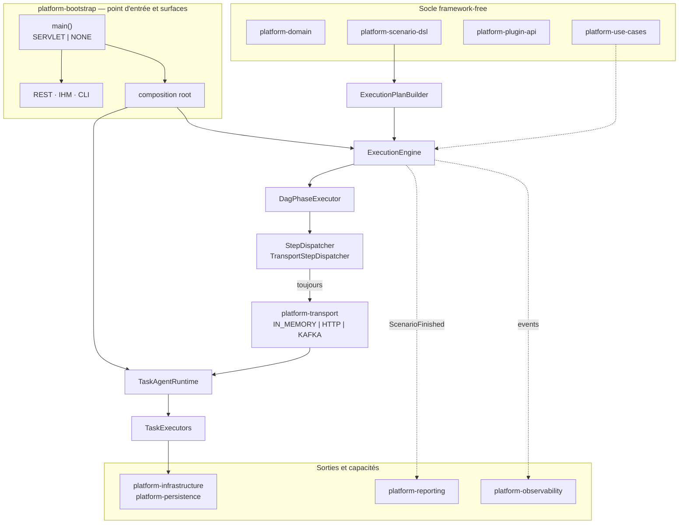
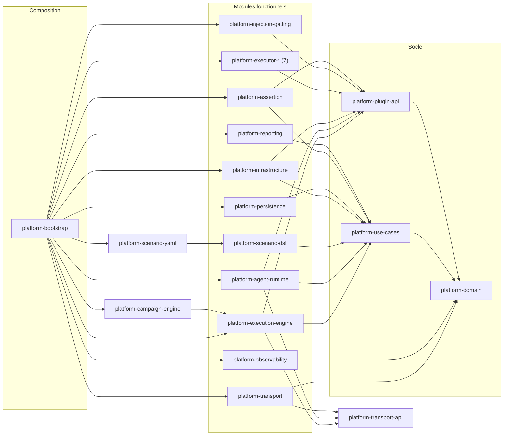
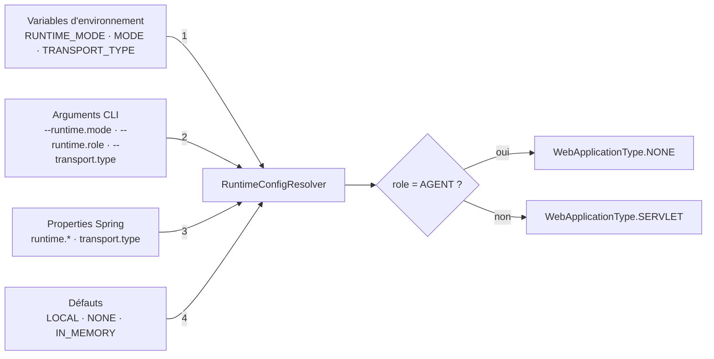
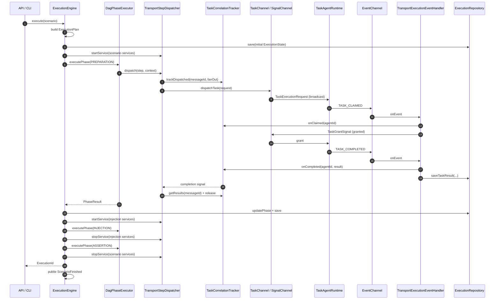
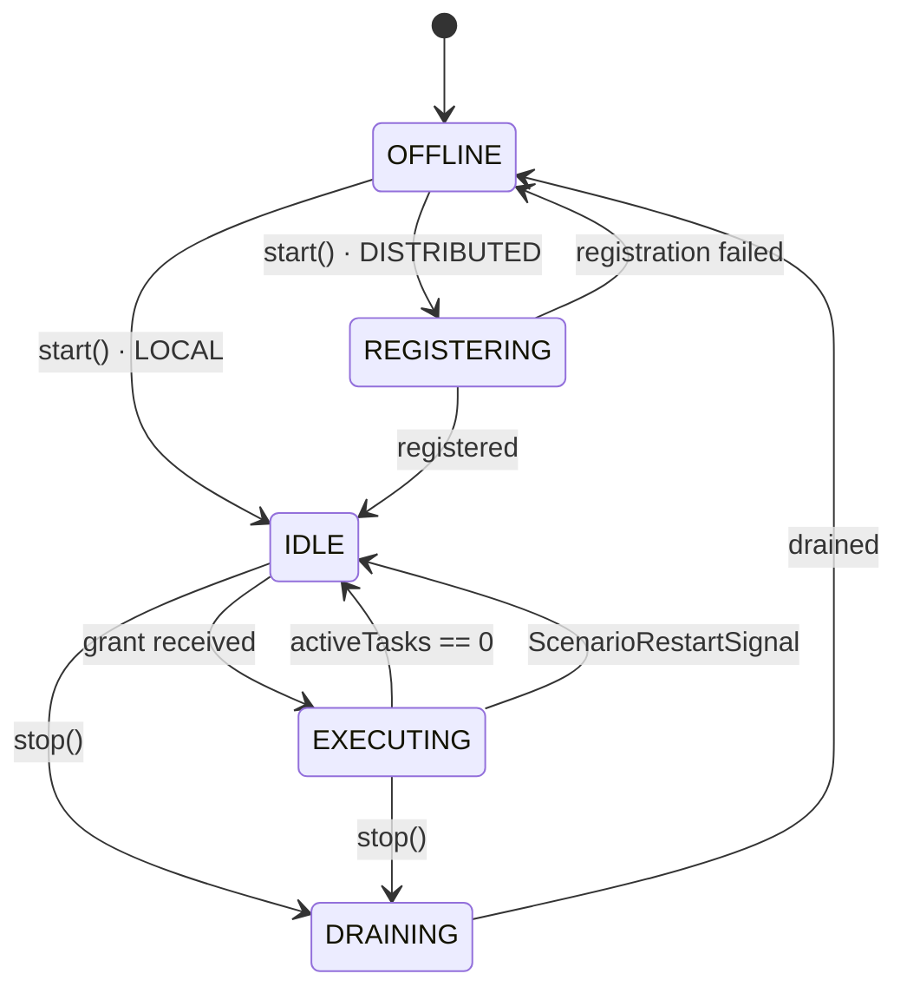
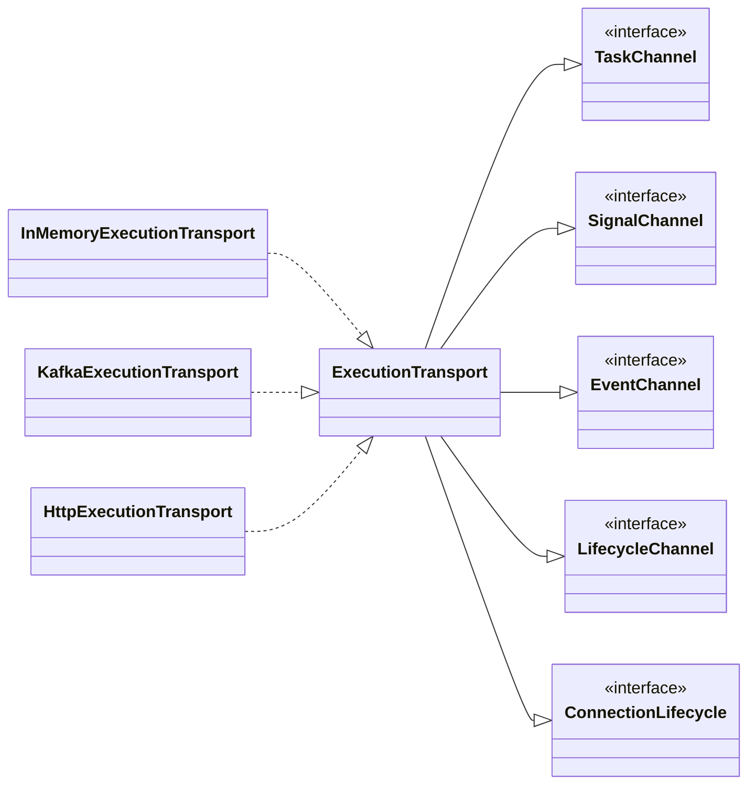
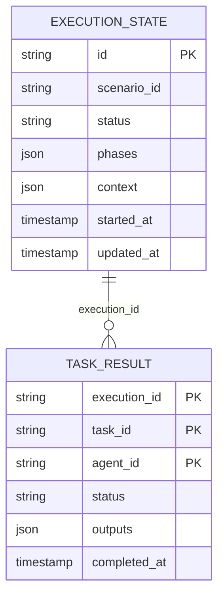
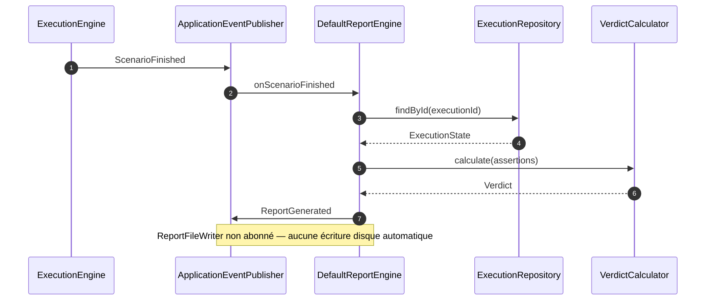

# Architecture — Performance Engineering Platform

> **Document de référence de l'architecture courante (ADR-061).**
> Mis à jour : 2026-11-15. Source de vérité : le code des 20 modules Maven.
> Ce document est **la** description de l'état courant ; les ADR de
> `docs/knowledge/adr/` expliquent **pourquoi** et ne sont pas nécessaires pour savoir
> ce que le système est. Les specs détaillent chaque domaine.

---

## Organisation du depot (ADR-045)

Les groupes de repertoires ne sont pas des parents Maven intermediaires.
Le POM racine agrege directement les 20 modules.

| Groupe | Modules |
|---|---|
| `core/` | `platform-domain`, `platform-use-cases`, `platform-plugin-api`, `platform-transport-api`, `platform-report-api` |
| `execution/` | `platform-execution-engine`, `platform-agent-runtime` |
| `performance/` | `platform-scenario-dsl`, `platform-campaign-engine`, `platform-assertion`, `platform-reporting` |
| `infra/` | `platform-scenario-yaml`, `platform-transport`, `platform-infrastructure`, `platform-persistence`, `executors/platform-executor-*` (7 familles, ADR-057), `platform-injection-gatling`, `platform-assertion-adapters`, `platform-report-renderers`, `platform-observability` |
| `bootstrap/` | `platform-bootstrap`, seul executable |
| `distribution/` | `platform-distribution`, image Docker et un exemple exécutable ; le SUT est dans `example/sut/` hors reactor |

La documentation projet appartient a `docs/knowledge/`, pas au harness.
Les skills sont decouvrables sous `.claude/skills/<nom>/SKILL.md`.

`platform-use-cases` remplace `platform-application` ; `platform-bootstrap`
remplace `platform-app`. Les autres noms de packages publics sont conserves,
sauf le moteur de campagne desormais dans `com.performance.platform.campaign`.

Le moteur generique et les agents ne dependent en production que des contrats
du core. Le moteur de campagne choisit les phases et les modeles de charge.
Le sampling est injecte via `LifecycleSignalHandler`, les sorties de rapport via
`ReportOutput`. Les implementations reseau, YAML et rendu sont dans `infra/`.
Le core conserve le vocabulaire scenario/tache de la plateforme : cette separation
n'introduit pas un produit de workflow independant.

## 1. Vue d'ensemble

La plateforme est un **artefact unique** (fat JAR Spring Boot) qui exécute des campagnes
de test de performance en trois phases — `PREPARATION → INJECTION → ASSERTION` — dans
deux modes d'exécution :

| Mode | Topologie | Qui exécute les tâches |
|---|---|---|
| `LOCAL` | Une seule JVM | Orchestrateur + **un agent embarqué** via `InMemoryExecutionTransport` |
| `DISTRIBUTED` | Orchestrateur + N agents, JVMs séparées | Les agents, via un transport réseau (Kafka, HTTP) |

`LOCAL` n'est pas un second moteur : c'est le moteur distribué avec le transport en
mémoire et un agent embarqué, dans un processus (ADR-059). Il n'existe **qu'un seul
chemin d'exécution** (`TransportStepDispatcher`, `TransportLifecycleDispatcher`,
`TransportExecutionEventHandler`), identique dans les deux modes. Le transport en mémoire
livre sur Virtual Threads, jamais sur le thread de l'émetteur.

Le mode et le rôle sont résolus **au démarrage** (variable d'environnement > argument CLI >
property > défaut, ADR-006/ADR-032). Ni le moteur ni l'agent ne contiennent de `if/switch`
sur le mode : la sélection est portée par des beans Spring conditionnels ; le mode n'est
lu que par la racine de composition (ADR-026/ADR-059).



### Principes non négociables

1. **Domaine pur** : `platform-domain` et `platform-plugin-api` ne dépendent d'aucun
   framework (Spring, JPA, Jackson interdit dans le domaine).
2. **Ports & adapters** : le métier dépend d'interfaces (`application.ports.*`,
   `plugin.*`) ; les implémentations vivent dans les modules d'infrastructure.
3. **Même artefact, deux modes** : aucun profil Maven ni `main()` distinct. LOCAL est le
   moteur distribué avec le transport en mémoire et un agent embarqué (ADR-059).
4. **Sélection déclarative** : `@ConditionalOnProperty` / `@ConditionalOnExpression`,
   jamais de dispatch sur une chaîne de type runtime dans le code métier (CF-03).
5. **I/O bloquants sur Virtual Threads** : DAG, HTTP, Kafka, JPA, Gatling.
6. **Immuabilité** : records + copies défensives ; `ExecutionContext.with()` uniquement.
7. **Events de domaine** : communication inter-modules par `ApplicationEventPublisher`
   (dans la JVM) et par canaux de transport (entre JVMs). Pas d'appel direct
   entre modules fonctionnels.
8. **Un seul orchestrateur par déploiement** (ADR-058) : pas de reprise après
   redémarrage, pas de haute disponibilité. Un redémarrage échoue les exécutions en cours.

---

## 2. Modules Maven et packages réels

> Le détail composant par composant (rôle, collaborations, cycle de vie, pièges) est
> dans [`components.md`](components.md).

Ordre de construction : parent → `platform-domain` → `platform-plugin-api` →
`platform-use-cases` → modules fonctionnels → `platform-bootstrap` → `distribution`.

### `platform-domain` — cœur métier (0 framework)

**Cible (ADR-060)** : uniquement ce dont le modèle d'exécution générique a besoin —
`scenario`, `execution`, `task`, `agent`, `event`, `id`.

```
com.performance.platform.domain
├── agent/      AgentDescriptor, AgentCapabilities, AgentHeartbeat, AgentState
├── event/      Scenario*, Phase*, Task*, Agent*, ExecutionLifecycleSignal,
│               ScenarioRestartSignal, TaskGrantSignal, Report*, Assertion*
├── execution/  ExecutionContext, PartialExecutionContext, ExecutionPlan, ExecutionStep,
│               ExecutionState, ExecutionProgress, ExecutionStatus, PhaseStatus, RetryPolicy
├── id/         ExecutionId, ScenarioId, TaskId, AgentId, EventId, MessageId, ReportId,
│               SignalId, ScheduledRunId
├── scenario/   ScenarioDefinition, StepDefinition, Phase, ServiceScope, FanOut
└── task/       TaskResult, TaskStatus
```

Règle d'admission : un type n'entre dans `platform-domain` que si au moins deux modules
de dossiers racine différents (`execution/`, `performance/`, `infra/`, `bootstrap/`) en
ont besoin et qu'aucun ne peut le posséder.

**État actuel : le déplacement de paquets n'est pas terminé.** Les paquets de
fonctionnalité encore présents dans `core/platform-domain` sont `assertion`,
`injection`, `report`, `schedule` et `template`. Leur destination est `platform-report-api`
(`report`), les contrats de `performance/` (`assertion`, `injection`), le scheduling
(`schedule`, ADR-048) et la résolution de valeurs dynamiques (`template`, ADR-039).
Tant qu'ils restent, `execution/` continue de les voir.

### `platform-plugin-api` — API publique des plugins (0 framework)
```
plugin/
├── TaskExecutor            execute(context, step) + getSupportedTaskName()
├── ServiceTaskExecutor     executeService(context, step, control) — service step (ADR-054)
├── ServiceControl          awaitStop() / isStopRequested()
├── AssertionExecutor       extends TaskExecutor ; evaluate() + getSupportedAssertionName()
├── Preparation             @Preparation(name=…)
├── Injection               @Injection(name=…)
├── Assertion               @Assertion(name=…)
├── StatefulResourceCleaner cleanup(executionId | null)
├── resource/               Endpoint, EndpointResolver (ADR-036), NamedResourceResolver (ADR-042),
│                           MessageChannel, MessageChannelFactory — ports de ressources nommées
└── template/               DynamicValues, MessageTemplate, JsonText — valeurs dynamiques (ADR-039)
```

Tout ce dont un executor (built-in ou plugin externe) a besoin vit ici : un module
d'executor ne dépend que de `platform-plugin-api` et `platform-domain` (ADR-057).

### `platform-use-cases` — ports et use cases (0 framework)
```
application/
├── config/     ExecutionConfig
├── exception/  ExecutionException, InvalidScenarioException, NoAvailableAgentException,
│               ReportGenerationException, ScenarioParsingException
├── ports/in/   ExecuteScenarioUseCase, CancelExecutionUseCase, GetExecutionStatusUseCase,
│               ListExecutionsUseCase, DeleteExecutionUseCase, ScenarioParsingUseCase,
│               GenerateReportUseCase
├── ports/out/  ExecutionRepository, AgentRegistryPort, LifecycleSignalHandler,
│               ExecutionPlanBuilder
└── usecase/    GetExecutionStatusService, ListExecutionsService, DeleteExecutionService,
                ExecutionProgressCalculator
```

`ExecutionConfig` porte `taskAvailabilityTimeout`, `taskExecutionTimeout` et
`claimWindow` (`execution.claim-window`, ADR-055) ; les politiques globales de complétion
et de sélection de résultat ont été supprimées.

### `platform-scenario-dsl` — validation et modeles de charge (0 framework)
```
scenario/
├── validation/  DefaultScenarioValidator, DagCycleDetector, ValidationResult/Error/Warning
└── usecase/     DefaultScenarioParsingService
```

Le profil de charge est un `WorkloadPlan` (`platform-domain`, `domain.injection`, ADR-064)
inline dans `parameters.workload`. Les presets `loadModel` (RAMP, CONSTANT, SPIKE…) sont
développés en plan au parsing (`LoadPresets`, `WorkloadPlanCodec`) ; seul le plan existe
ensuite. Pas de registre nommé (ADR-053).

`ScenarioParser` est un port du core. `YamlScenarioParser`, les DTOs et
`DurationParser` vivent dans `infra/platform-scenario-yaml`.

### `platform-campaign-engine` — politique de campagne LOCAL/DISTRIBUTED

`campaign.ExecutionEngine` implemente les use cases d'execution et d'annulation, et
coordonne les durées de vie des service steps (ADR-054).
`campaign.plan.DefaultExecutionPlanBuilder` choisit les phases, sépare les service steps
par portée et calcule le DAG intra-phase. Le port `ExecutionPlanBuilder` appartient au
core.
`campaign.schedule.ScheduleRunService` porte la planification (immédiate,
one-shot, cron) et `campaign.schedule.ScheduledRunDispatcher` réveille les runs
arrivés à échéance ; les ports `ScheduleScenarioUseCase`,
`ListScheduledRunsUseCase`, `CancelScheduledRunUseCase`, `ScheduledRunRepository`
et `ScheduleCalculator` appartiennent au core.

### `platform-execution-engine` — orchestration generique
```
engine/
├── ExecutionLifecycleDispatcher  port START/STOP
├── shared/    StepDispatcher (port), StepDispatchResult, DagPhaseExecutor
├── remote/    TransportStepDispatcher, TransportExecutionEventHandler, PartialContextBuilder
├── local/     TaskExecutorLookup
├── lifecycle/ TransportLifecycleDispatcher (seule implémentation, ADR-059)
├── plan/      DagLevelCalculator
├── correlation/ TaskCorrelationTracker, DefaultTaskCorrelationTracker, GrantDecision
├── availability/ AgentAvailabilityChecker, DefaultAgentAvailabilityChecker
├── retry/     RetryExecutor, DefaultRetryExecutor (défini, non câblé)
└── config/    ExecutionEngineConfiguration, ExecutionEngineProperties,
               OrchestratorRestartFailureModel
```

`LocalStepDispatcher`, `LocalLifecycleDispatcher`, `LocalOutcomeEventPublisher` et
`RemoteLifecycleDispatcher` sont supprimés (ADR-059) : un seul dispatcher et un seul
dispatcher de signaux, dans tous les modes. `OrchestratorRestartFailureModel` applique le
modèle de défaillance de l'orchestrateur unique (ADR-058).

### `platform-agent-runtime` — runtime d'agent et registre d'orchestrateur
```
agent/
├── runtime/    AgentRuntime, TaskAgentRuntime, TaskExecutionPipeline
├── filter/     TaskSpecializationFilter, DefaultTaskSpecializationFilter, TaskFilterResult
├── registration/ AgentRegistrationPort, TransportAgentRegistration, HeartbeatScheduler,
│               AgentLifecycleIngestion, AgentLifecyclePayloadCodec
├── registry/   AgentRegistry, InMemoryAgentRegistry, AgentTtlMonitor,
│               config/AgentRegistryConfiguration
└── restart/    ScenarioRestartHandler
```

### `platform-transport-api` et `platform-transport` — contrats et adaptateurs

Les interfaces a la racine et `message/` appartiennent a
`core/platform-transport-api`. Les sous-packages techniques ci-dessous
appartiennent a `infra/platform-transport`.
```
transport/
├── ExecutionTransport   façade composite (extends les 5 ports)
├── TaskChannel · SignalChannel · EventChannel · LifecycleChannel · ConnectionLifecycle
├── message/  TaskExecutionRequest, ExecutionEvent
├── inmemory/ InMemoryExecutionTransport (Virtual Threads, ADR-059)
├── kafka/    KafkaExecutionTransport, DynamicKafkaListenerRegistry, KafkaMessageCodec
├── http/     HttpExecutionTransport, HttpEventCallbackController, HttpTransportListener
└── config/   TransportConfiguration, *TransportProperties, KafkaTransportBeans
```

Transports supportés : `IN_MEMORY`, `HTTP`, `KAFKA` (ADR-056). RabbitMQ et socket ne
font plus partie du build cœur ; ils peuvent être fournis comme plugins via `CUSTOM`.
`TransportType` vaut `KAFKA`, `HTTP`, `IN_MEMORY`, `CUSTOM`.

### Modules de capacités
| Module | Contenu principal |
|---|---|
| `platform-infrastructure` | Socle runtime commun : `TaskExecutorRegistry` (`infrastructure.executor`), `infrastructure.plugin` (`PluginLoader`/`AnnotationScanner`/`PluginRegistry`), `infrastructure.scheduling` (`SpringScheduleCalculator`). Aucune dépendance technique lourde. |
| `platform-persistence` | Store de l'orchestrateur : `infrastructure.persistence` (JPA, Flyway `db/migration`, runs programmés), `PersistenceDataSourceConfiguration` (DataSource primaire `platform.datasources.default`). |
| `platform-executor-<famille>` (`infra/executors/`) | Un module par famille (ADR-057) : `database` (`database`, `DatasourceProvider`), `docker`, `filesystem` (paquet `.fs`), `http` (`http-client`, `HttpTargetRegistry` = `EndpointResolver`), `kafka` (`kafka-producer`, `kafka-consumer`, `KafkaClusterRegistry`), `mock` (`mock-server`, service step), `shell`. Dépendances : `platform-domain`, `platform-plugin-api` (ports `plugin.resource`, valeurs dynamiques `plugin.template`) et leurs bibliothèques techniques uniquement. |
| `platform-injection-gatling` | `GatlingTaskExecutor` (`@Injection(name="gatling")`), `GatlingRunner`, `SimulationInjectionHolder`, `DefaultWorkloadPlanTranslator`, `PlanAdmission`, `PlanScaler`, `InjectionWorkerMain` (JVM fille), `SimulationLogResultParser`, `RequestMix`, `ProtocolSupportInfo` |
| `platform-assertion` | `CheckEvaluator`, `TemporalCheckEvaluator`, `ParameterBinder`, `OperatorResolver`, `AssertionSummaryFactory`, sampling `assertion.lifecycle.DefaultLifecycleSignalHandler` |
| `platform-assertion-adapters` | `performance-thresholds`, `direct-assertion` (ADR-049), `DirectMeasurementResolver` |
| `platform-report-api` | Modeles et ports `ReportEngine`, `ReportRenderer`, `ReportOutput` |
| `platform-reporting` | `DefaultReportEngine` (écoute `ScenarioFinished`), `PerformanceAssessmentBuilder`, `VerdictCalculator` |
| `platform-report-renderers` | Renderers HTML/PDF/JSON, `ReportFileWriter` implementant `ReportOutput` |
| `platform-observability` | `ObservabilityEventListener`, `MicrometerExecutionMetrics`, `ExecutionContextMdcFilter` |
| `platform-bootstrap` | `PerformancePlatformApplication`, contrôleurs REST (`Scenario`, `ScenarioUpload`, `Schedule`, `Execution`, `Agent`, `Report`), `CliScenarioRunner`, configuration d'assemblage, sécurité, IHM, bootstrap plugins, résolution runtime |
| `distribution` | Dockerfile, compose LOCAL/DISTRIBUTED et exemple exécutable (`example/`) |

---

## 3. Graphe de dépendances et frontières



> Dependances de scope `test` omises. Les tests de campagne vivent dans
> `platform-campaign-engine`, et non dans le moteur generique.

Règles effectives :
- `platform-domain` : aucune dépendance framework (test `DomainArchitectureTest`).
- `platform-use-cases`, `platform-scenario-dsl` : 0 annotation Spring ; câblage
  explicite dans `RuntimeAssemblyConfiguration`.
- Frontières inter-modules vérifiées par `ModuleDependencyTest`
  (`bootstrap/src/test/.../arch`) : scan bytecode **ASM** (compatible Java 25)
  des `target/classes`, avec test de non-vacuité. Arêtes interdites : engine ↛
  assertion, engine ↛ agent, reporting ↛ injection, assertion ↛ injection,
  assertion ↛ infrastructure, executor ↛ autre executor, executor ↛
  persistence, persistence ↛ executor, executor ↛ `platform-use-cases`, JPA hors
  `platform-persistence` (ADR-057).
  Les modules d'execution generique ne dependent ni des politiques de
  performance ni des adaptateurs de transport (ADR-045).
- **Spring Modulith a été retiré** (ADR-035). `spring-modulith-bom` reste dans le BOM
  pour compatibilité, mais aucune annotation `@Modulith`/`@ApplicationModuleListener`
  n'est utilisée.

> ⚠️ ArchUnit 1.3/1.4 importe silencieusement 0 classe sur du bytecode Java 25.
> Tout test ArchUnit existant est vacuous ; ne pas s'y fier, utiliser l'ASM.

---

## 4. Modèle runtime : mode, rôle, transport

### Résolution (ADR-006 / ADR-032)
Priorité : **variable d'environnement > argument CLI > property > défaut**.

| Notion | Env var | CLI | Property | Défaut |
|---|---|---|---|---|
| Mode | `RUNTIME_MODE` | `--runtime.mode=` | `runtime.mode` | `LOCAL` |
| Rôle | `MODE` | `--runtime.role=` | `runtime.role` | `NONE` |
| Transport | `TRANSPORT_TYPE` | `--transport.type=` | `transport.type` | `IN_MEMORY` |



`RuntimeConfigEnvironmentPostProcessor` réinjecte les env vars comme properties **avant**
la création des beans, pour que les `@ConditionalOnProperty` voient la bonne valeur.
`RuntimeConfigResolver` est la source unique du parsing ; `RuntimeModeResolver` n'est
qu'une façade Spring. `main()` utilise `resolveBootstrapRole(...)` **avant** Spring pour
choisir `WebApplicationType` : un profil `agent*` force `NONE` (ADR-019/ADR-032).

### Matrice modes d'accès
| Accès | LOCAL | DISTRIBUTED / ORCHESTRATOR | DISTRIBUTED / AGENT |
|---|:---:|:---:|:---:|
| API REST `/api/v1/**` | ✓ | ✓ | ✗ |
| IHM navigateur | ✓ | ✓ | ✗ |
| CLI `--scenario=` | ✓ | ✓ | ✗ |
| Serveur web (Tomcat) | ✓ | ✓ | ✗ (`WebApplicationType.NONE`) |
| Connexion sortante transport | — | — | ✓ |

### Profils Spring fournis
| Profil | Usage |
|---|---|
| `local` | Défaut ; H2 en mémoire, transport `IN_MEMORY`, HTTP targets et cluster Kafka locaux |
| `orchestrator` | `DISTRIBUTED` + `ORCHESTRATOR`, Kafka, PostgreSQL, sécurité activée |
| `agent` | `DISTRIBUTED` + `AGENT`, Kafka, `web.ui.enabled=false`, `agent.supported-tasks` |
| `example` | Ressources SUT de l'exemple (`sut-db`, cible `sut-api`), chargée avec `orchestrator`/`agent` |

Les profils `agent-*` sont reconnus par `RuntimeConfigResolver.isAgentProfile(...)`.

---

## 5. Mécanismes d'exécution

### 5.1 D'un scénario YAML à un plan DAG
1. `YamlScenarioParser` parse le YAML en `ScenarioDefinition` (SnakeYAML) puis mappe les
   DTOs avec Jackson (`FAIL_ON_UNKNOWN_PROPERTIES`). Les clés inconnues sont **rejetées**
   (`ROOT_KEYS`, `SCENARIO_KEYS`, `STEP_KEYS`, `RETRY_KEYS`) : `execution.mode`,
   `loadModels`, `parameters.refTaskId` et `parameters.linkedTo` n'existent plus
   (ADR-053).
2. `DefaultScenarioParsingService` valide via `DefaultScenarioValidator` : ids uniques,
   `taskName`, `phase` ou `during`, `dependsOn` intra-phase et cycles, `ref`,
   `requiredContexts` effectifs, load model inline, timeouts d'injection (spec 01 §5).
3. `DefaultExecutionPlanBuilder` produit un `ExecutionPlan` : `preparationSteps`,
   `injectionSteps`, `assertionSteps`, `injectionServices`, `scenarioServices`,
   `initialContext` (ADR-054).
4. `ExecutionStep` = `StepDefinition` + dépendances résolues + `dagLevel` +
   `requiredContextKeys` (= `resolvedRequiredContexts()`).

### 5.2 Engine unique (ADR-037, ADR-059)
`ExecutionEngine` est l'unique implémentation de `ExecuteScenarioUseCase`,
`SubmitScenarioUseCase` et `CancelExecutionUseCase`. Il est actif en `LOCAL` ou en
`DISTRIBUTED + ORCHESTRATOR`. Il n'y a **aucune** différence de chemin entre les modes :

| Collaborateur | Rôle | Modes |
|---|---|---|
| `StepDispatcher` | `TransportStepDispatcher` : dispatch via les ports de transport, grant, service steps | tous |
| `ExecutionLifecycleDispatcher` | `TransportLifecycleDispatcher` : START/STOP sur le `SignalChannel` | tous |
| `TransportExecutionEventHandler` | consomme les événements agent, alimente tracker + repository, publie les events | tous |
| Réception des résultats | toujours asynchrone, via le transport | tous |

Déroulé d'une exécution :
1. `initializeExecution` : plan, `ExecutionState` initial persisté **avant** toute phase
   (sinon l'API/CLI ne peut pas suivre l'exécution).
2. `startServices(scenarioServices)` → `PREPARATION` → `startServices(injectionServices)`
   → `INJECTION` → `stopServices(injectionServices)` → `ASSERTION` →
   `stopServices(scenarioServices)`.
3. Chaque phase : `PhaseStarted`, `DagPhaseExecutor.executePhase`, `PhaseCompleted`, mise
   à jour de l'état persisté. Les `TaskCompleted`/`TaskFailed` sont publiés par
   `TransportExecutionEventHandler`, pas par le moteur.
4. Verdict :
   - `CANCELLED` si annulation demandée ;
   - `FAILED` si une tâche a échoué ou si aucun agent n'est disponible ;
   - `WARNING` si au moins une tâche est `SKIPPED` ;
   - `SUCCESS` sinon.
5. `ScenarioFinished` est publié ; `DefaultReportEngine` génère alors le rapport.

### 5.2.1 Séquence (identique en LOCAL et DISTRIBUTED)



En LOCAL, `TX` est l'`InMemoryExecutionTransport` et `AG` est l'agent embarqué : la
séquence est la même, seule la latence change (ADR-059).

### 5.3 Parcours DAG et exécution parallèle
`DagPhaseExecutor` :
- groupe les steps par `dagLevel` et exécute chaque niveau en parallèle via
  `Executors.newVirtualThreadPerTaskExecutor()` ;
- avant un niveau, vérifie les dépendances : si un `dependsOn` est `FAILED`/`SKIPPED`,
  le step est marqué `SKIPPED` (avec `DEFAULT_AGENT = "agent-local"`) ;
- envoie un signal START avant l'exécution et STOP après ;
- supporte l'annulation coopérative : les futures en attente sont annulés ; les steps
  non terminés ne produisent pas de résultat et la phase est marquée en échec ;
- retourne `PhaseResult(updatedContext, anyFailed, outcomes)`.

### 5.4 ExecutionContext et outputs nommés (ADR-031)
```java
record ExecutionContext(ExecutionId, ScenarioId,
                        Map<String, Map<String, TaskResult>> store)
```
- Store logique `taskId → agentId → TaskResult`.
- Implémentation **persistante par couches** (`PersistentStore`) : `with(...)` est
  O(profondeur) et ne copie que la map de la tâche modifiée ; snapshot matérialisé
  paresseusement et mis en cache. Aucune mutation.
- Accès par **nom d'output** : `getOutput(taskId, agentId, outputName, type)` et
  `getFirstOutput(taskId, outputName, type)` (ordre déterministe par `agentId`).
  Les clés contractuelles sont `InjectionResult.OUTPUT_KEY = "result"` et
  `AssertionSummary.OUTPUT_KEY = "assertion"`.
- `fanOut: one` (défaut) stocke le résultat sous `context[taskId]` : le cas courant ne
  manipule pas de map indexée par agent. `fanOut: all` stocke un résultat par agent
  accordé et les assertions agrègent par règle déclarée sur la métrique (ADR-049,
  ADR-055).
- `PartialExecutionContext` transporte vers les agents uniquement les
  `requiredContexts` effectifs, sous la forme `taskId → agentId → Map<String,Object>`
  (tous les outputs nommés). Les anciens payloads à valeur brute restent tolérés.

### 5.5 Dispatch : claim, grant et perte d'agent (ADR-055)
`TransportStepDispatcher` (unique, tous modes) :
1. attend un agent disponible (`AgentAvailabilityChecker`, timeout
   `ExecutionConfig.taskAvailabilityTimeout`) ;
2. construit le `PartialExecutionContext` ;
3. crée un `TaskExecutionRequest` (MessageId = clé d'idempotence, **pas** de
   `targetAgentId`) ;
4. `tracker.trackDispatched(...)` **avant** `transport.dispatchTask(...)` pour éviter la
   course, puis `tracker.release(...)` en `finally` ;
5. attend le **grant** : premier claim en `fanOut: one`, settlement de la fenêtre
   (`execution.claim-window`) en `fanOut: all` ; un agent sans grant n'exécute pas ;
6. attend la complétion (`CompletableFuture` du tracker, aucun polling) ;
7. retourne un `StepDispatchResult` par agent accordé, trié par `AgentId`.

Il n'y a plus de `completion-policy` ni de `result-selection-policy` : le fan-out est
déclaré par étape (`fanOut: one | all`).

`TransportExecutionEventHandler` consomme `EventChannel` :
- `TASK_CLAIMED` → `tracker.onClaimed`, publie `TaskClaimedByAgent` et diffuse le
  `TaskGrantSignal` correspondant ;
- `TASK_COMPLETED` → reconstruit `TaskResult`, `tracker.onCompleted`, persiste
  `saveTaskResult`, publie `TaskCompleted` ;
- `TASK_FAILED` → `tracker.onFailed` ;
- `TASK_WORK_IN_PROGRESS` → log/trace ;
- événements inconnus ou déjà libérés → ignorés (protection contre les messages tardifs) ;
- résultat tardif pour une exécution terminale → journalisé et ignoré (ADR-058).
- `@EventListener onAgentLost(AgentLost)` → `tracker.onAgentLost(agentId)` : les grants
  non répondus échouent immédiatement (fast-fail) au lieu d'attendre le timeout.

### 5.5.1 Injection : plan, part, worker, mesures (ADR-064..070)
- **Plan** : `WorkloadPlan(model, scope, stages)` — `Ramp`, `Hold`, `Burst`, `Pause`, flag
  `measured` (warm-up exclu). Neutre vis-à-vis du moteur.
- **Part** : `TaskGrantSignal.share = GrantShare(index, count, fraction)`. `fanOut: one` →
  `(0,1,1.0)` ; `all` → agents triés, `1/count`. L'orchestrateur ne connaît ni débit ni charge
  (ADR-045). `minAgents` non atteint → échec avant tout grant, aucune charge.
- **Agent** : un executor qui implémente `ExecutorAvailability` peut refuser de claim
  (`injection.worker.max-concurrent`, défaut 1). `GatlingTaskExecutor` : admission du plan
  (`PlanAdmission`, rejet explicite sans approximation, garde-fou `injection.max-*`), mise à
  l'échelle par la part si `scope: global` (`PlanScaler`), puis **une JVM fille par run**
  (`InjectionWorkerMain`), identique en LOCAL. Annulation : `destroy` → `stop-grace` →
  `destroyForcibly`.
- **Mesures** : `InjectionResult` porte histogramme, fenêtres `LoadWindow`, `GeneratorHealth`,
  `complete`, `perRequest`. `Reduction.MERGE` fusionne les histogrammes (percentile global) ;
  `injection.latency.pNN.worst-agent` conserve le pire agent.
- **Verdict** : contrôles d'intégrité automatiques (déviation d'arrivée, perte d'agent, run
  incomplet, saturation) → `INVALID` > `FAILED` > `WARNING` > `SUCCESS` ; CLI exit `2`.
- **Mix** : `requests` pondérées, une requête par utilisateur virtuel ; pas de DSL de parcours.

### 5.6 Retry
`RetryPolicy(maxAttempts, initialDelay, multiplier, maxDelay, retryableExceptions)` avec
backoff exponentiel ; défaut 3 tentatives, 1 s → 30 s. **État actuel** : la politique
voyage dans `TaskExecutionRequest`, mais ni `TransportStepDispatcher` ni
`TaskExecutionPipeline` ne l'appliquent — une tâche est exécutée **une seule fois**.
`RetryExecutor`/`DefaultRetryExecutor` restent disponibles, non câblés.

### 5.7 Service steps (ADR-054)
Une service step déclare `during` et a une durée de vie : démarrée, maintenue, arrêtée.

| Portée | START | STOP |
|---|---|---|
| `during: injection` | avant INJECTION | après INJECTION |
| `during: scenario` | avant PREPARATION | après ASSERTION |

- L'orchestrateur envoie START puis, à la fin de la portée, un
  `ExecutionLifecycleSignal` STOP ; l'agent exécute
  `ServiceTaskExecutor.executeService(...)` et publie son résultat **au STOP**.
- `drain` retarde le STOP et remplace les steps `shell sleep`.
- Les assertions lisent le résultat de la service step via `ref`.
- `mock-server` est une service step : `parameters.action: START|STOP` a disparu.
- Règle : l'orchestrateur coordonne des **durées de vie**, jamais des messages
  individuels. Un enchaînement requête → réponse reste interne à un exécuteur.

### 5.8 Orchestrateur unique et redémarrage (ADR-058)
- Un seul orchestrateur par déploiement ; le grant et la coordination de groupe
  (ADR-046) sont corrects par construction, sans verrou distribué.
- Au démarrage, `OrchestratorRestartFailureModel` marque toute exécution non terminale
  `FAILED` (raison `orchestrator restarted`) et publie `ScenarioFinished`.
- `work-in-progress-reset-interval` est supprimé : les seuls mécanismes de vivacité sont
  `task-execution-timeout`, le claim/grant et la perte d'agent (ADR-033).
- Pas de reprise, pas de haute disponibilité.

---

## 6. Runtime d'agent (ADR-037)

`TaskAgentRuntime` est l'unique runtime (LOCAL et DISTRIBUTED). En LOCAL, il est
démarré par la racine de composition (`SmartLifecycle`) et reçoit ses messages du
transport en mémoire ; il n'existe plus de `LocalAgent` (ADR-059). Deux collaborations
optionnelles portent la différence :
- `registrationPort == null` → LOCAL : pas d'enregistrement, pas de heartbeat ;
- `registrationPort != null` → DISTRIBUTED : `TransportAgentRegistration` +
  `HeartbeatScheduler`.

Cycle de vie :


Mécanismes :
- **Démarrage** : `connection.connect()`, enregistrement éventuel, abonnement
  `receiveTask`/`receiveSignal`, planification du nettoyage des `processedMessageIds`,
  passage `IDLE`.
- **Réception** : `TaskSpecializationFilter` (égalité `taskName` ∈
  `supportedTaskNames`) ; les messages non concernés sont ignorés silencieusement.
  L'idempotence est assurée par `MessageId` (set des messages déjà traités).
- **Claim puis grant (ADR-055)** : le runtime publie `TASK_CLAIMED` et attend un
  `TaskGrantSignal` ; un claim rejeté n'exécute rien.
- **Exécution** : `TaskExecutionPipeline` exécute le `TaskExecutor` sur un Virtual Thread
  (ou `ServiceTaskExecutor.executeService(...)` jusqu'au STOP pour une service step),
  publie un `TaskWorkInProgress` périodique (intervalle = `taskExecutionTimeout / 3`,
  min 1 s), puis `TASK_COMPLETED`/`TASK_FAILED` avec statut, durée, erreur et outputs.
- **Arrêt** : `DRAINING`, attente des tâches actives (timeout = 2 ×
  `taskExecutionTimeout`), annulation du reste, arrêt du heartbeat, désenregistrement,
  déconnexion, `OFFLINE`.
- **Restart** : `ScenarioRestartHandler` appelle chaque `StatefulResourceCleaner`
  (`cleanup(executionId)`, best-effort), annule les tâches actives, repasse `IDLE`.
- **Spécialisation** : en DISTRIBUTED, `agent.supported-tasks` est la **source unique**
  (ADR-015), surchargée par `AGENT_SUPPORTED_TASKS`. En LOCAL, tous les
  `TaskExecutor` du contexte sont supportés.

### Registre orchestrateur et TTL (ADR-033)
- `AgentLifecycleIngestion` s'abonne au `LifecycleChannel` et alimente
  `AgentRegistryPort` (`registered`, `heartbeat`, `deregistered`, `lost`).
- `InMemoryAgentRegistry` conserve les descripteurs et répond
  `findByTaskName`/`hasAgentFor`.
- `AgentTtlMonitor` (bean démarré avec le contexte, intervalle
  `agent.registry.ttl-check-interval-seconds`, défaut 10 s) évince les agents dont le
  heartbeat a expiré et publie `AgentLost` → fast-fail des steps en cours.

---

## 7. Transport : canaux et implémentations

`ExecutionTransport` est une **façade composite** de migration qui étend cinq ports
étroits (ADR-028). Les consommateurs dépendent du port dont ils ont besoin :

| Port | Responsabilité | Consommateurs |
|---|---|---|
| `TaskChannel` | `dispatchTask` / `receiveTask` | `TransportStepDispatcher`, `TaskAgentRuntime` |
| `SignalChannel` | `broadcastSignal` / `receiveSignal` | `TransportStepDispatcher` (grants, STOP), `TransportLifecycleDispatcher`, `TaskAgentRuntime` |
| `EventChannel` | `publishEvent` / `subscribe` | `TaskExecutionPipeline`, `TransportExecutionEventHandler` |
| `LifecycleChannel` | `publishAgentEvent` / `subscribeAgentEvents` | `TransportAgentRegistration`, `AgentLifecycleIngestion` |
| `ConnectionLifecycle` | `connect` / `disconnect` / `isConnected` | `TaskAgentRuntime` |



`getType()` n'existe plus : le type est une propriété de configuration, jamais une
branche de code.

| Transport | Sélection | Modèle | Notes |
|---|---|---|---|
| `IN_MEMORY` | défaut (`matchIfMissing=true`) | livraison asynchrone sur Virtual Threads, même JVM | LOCAL et tests (ADR-059) |
| `KAFKA` | `transport.type=KAFKA` | topics tasks/signals/events, consumer group par agent (ADR-009) | `DynamicKafkaListenerRegistry`, `AckMode.RECORD`, `auto.offset.reset=earliest` |
| `HTTP` | `transport.type=HTTP` | POST vers `httpCallbackUrl`, callbacks sur `/api/v1/events` | `broadcastMode=ALL_CAPABLE|FIRST_AVAILABLE` ; **pas d'endpoint entrant de tâches** ; AGENT sans serveur web (ADR-019) |
| `CUSTOM` | `transport.type=CUSTOM` | fourni comme plugin | RabbitMQ, socket ou tout autre protocole (ADR-056) |

Messages :
- `TaskExecutionRequest(MessageId id, ExecutionId, StepDefinition, PartialExecutionContext,
  Instant dispatchedAt, RetryPolicy)` — broadcast, sans `targetAgentId`, avec `fanOut`
  dans le `StepDefinition`.
- `ExecutionEvent(EventId, ExecutionId, MessageId correlationId, AgentId, String eventType,
  Map<String,Object> payload, Instant)` — enveloppe les événements agent → orchestrateur.
- `TaskGrantSignal(SignalId, ExecutionId, TaskId, MessageId, AgentId, boolean granted,
  Instant)` — réponse au claim, sur le `SignalChannel` (ADR-055).
- `AgentLifecycleEvent` — canal séparé pour `AgentRegistered`, `AgentHeartbeat`,
  `AgentDeregistered`, `AgentLost` (ADR-012).

Garanties : Kafka at-least-once ; InMemory livraison asynchrone hors du thread de
l'émetteur ; HTTP avec retry/timeouts. L'idempotence côté agent est portée par
`TaskExecutionRequest.id`.

---

## 8. Framework de tâches et plugins

- Un `TaskExecutor` implémente `execute(ExecutionContext, StepDefinition)` et
  `getSupportedTaskName()` ; il est annoté **exactement** `@Preparation`, `@Injection`
  ou `@Assertion`. Le `name()` de l'annotation est la clé de résolution YAML.
- `ServiceTaskExecutor` (optionnel) ajoute `executeService(context, step,
  ServiceControl)` : contrat d'une service step, démarrée puis arrêtée par
  l'orchestrateur, résultat publié au STOP (ADR-054). `mock-server` l'implémente ; un
  exécuteur sans ce contrat ne peut pas servir une étape `during`.
- `AssertionExecutor extends TaskExecutor` : `evaluate(...)` retourne toujours un
  `AssertionSummary` (jamais d'exception) ; `execute(...)` par défaut convertit le
  résumé en `TaskResult` avec `AssertionSummary` sous la clé `"assertion"` (mapping
  `PASSED→SUCCESS`, `FAILED→FAILED`, `SKIPPED→SKIPPED`, `INCONCLUSIVE→SUCCESS`,
  `ERROR→FAILED`).
- `TaskExecutorRegistry` / `DefaultTaskExecutorRegistry` collecte les beans Spring
  (les plugins JAR sont enregistrés dans `PluginRegistry`, non raccordé au moteur).
- `TaskExecutorLookup` expose `findTaskExecutor(taskName)` (chemin unique pour toutes
  les phases) ; `RegistryTaskExecutorLookup` (composition root) l'implémente au-dessus
  du registre.
- Plugins externes : `PluginLoader` scanne `platform.plugins.dir` au démarrage
  (`platform.plugins.enabled=true`), `AnnotationScanner` découvre les classes annotées,
  `PluginRegistry` résout `(phase, taskName) → implémentation`. Un JAR invalide produit
  un warning et est ignoré (CF-06/CF-07). Pas de chargement à chaud.
  **État actuel** : la découverte et le registre `PluginRegistry` existent, mais le
  moteur (`TaskExecutorLookup`) et l'agent (`TaskExecutor` beans injectés) ne
  consomment que `TaskExecutorRegistry` (beans Spring). Les exécuteurs chargés depuis
  un JAR externe ne sont donc pas encore exécutables : le câblage
  `PluginRegistry → TaskExecutorRegistry/agent` reste à faire.
- `StatefulResourceCleaner` : tout exécuteur maintenant un état (Gatling, WireMock,
  Kafka, DB, Docker, Shell) l'implémente pour le restart propre.

Exécuteurs fournis : `database`, `docker`, `filesystem`, `http-client`,
`kafka-producer`, `kafka-consumer`, `mock-server` (service step), `shell`, `gatling` ;
assertions : `performance-thresholds`, `direct-assertion`, `panel-assertion` (plugin).

Les exécuteurs built-in sont découverts exactement comme les plugins (beans Spring +
annotations). Chaque famille est un module Maven `infra/executors/platform-executor-*`
(ADR-057) ; les ressources partagées passent par les ports `plugin.resource`
de `platform-plugin-api` : `mock-server` résout ses cibles externes via
`EndpointResolver`, sans dépendre du module http.

---

## 9. Persistance

- Port : `ExecutionRepository` (`save`, `findById`, `updatePhase`, `saveTaskResult`,
  `getTaskResults`, `findAll`, `deleteById`).
- Adapter : `JpaExecutionRepository` (Spring Data JPA + mappers), entités
  `ExecutionStateEntity` et `TaskResultEntity` (clé composite `executionId + taskId +
  agentId`).
- Module `platform-persistence` (ADR-057), indépendant des executors.
- `JpaConfiguration` : configuration JPA manuelle (Spring Boot 4.0 a retiré les
  auto-configurations JPA/Hibernate), activée par la propriété
  `platform.datasources.default.url` (et non `@ConditionalOnBean`, sensible à
  l'ordre d'enregistrement), comme les repositories JPA.
- `PersistenceDataSourceConfiguration` crée la `DataSource` primaire depuis
  `platform.datasources.default.*`. Les datasources nommées utilisées par les
  scénarios (`platform.datasources.*`, ADR-014) sont résolues par
  `DatasourceConfiguration` dans `platform-executor-database`.
- L'état est persisté avant les phases, après chaque phase et à chaque résultat de tâche
  (les deux modes passent par le transport) ; l'API/CLI lit le même repository
  (read-model CQRS-lean).
- En AGENT sans datasource, aucun bean JPA n'est créé : l'application démarre sans
  persistance.



---

## 10. Reporting

- `DefaultReportEngine` écoute `ScenarioFinished`, relit `ExecutionState`, classifie les
  tâches par phase, calcule le verdict (`VerdictCalculator`) et produit un
  `CampaignReport`.
- Renderers : `HtmlReportRenderer` (template `templates/campaign-report.html`),
  `PdfReportRenderer` (HTML → OpenHTMLToPDF), `JsonReportRenderer`.
- `ReportFileWriter` sait écrire `<output-directory>/<executionId>/campaign.{html,pdf,json}`
  et copier les répertoires Gatling, mais **il n'est pas encore raccordé** à
  `ReportGenerated` dans le câblage de production : le moteur produit le
  `CampaignReport` en mémoire et publie l'événement, sans écriture disque automatique.
  `ReportController` sert uniquement des fichiers déjà présents sur disque.
  Sortie **locale uniquement** (ADR-022) : aucun publisher Confluence/S3/Git.
- Configuration : `reporting.output-directory`, `reporting.formats`
  (défaut HTML/PDF/JSON).
- `ReportGenerated` est publié après génération.



---

## 11. Observabilité

- `ObservabilityEventListener` écoute `TaskCompleted`, `TaskFailed`, `PhaseCompleted`,
  `ScenarioFinished` et alimente `ExecutionMetrics`
  (`execution_duration`, `task_duration`, `task_failures_total`, `phase_duration`).
- `MicrometerExecutionMetrics` enregistre les métriques ; `ObservabilityConfiguration`
  ajoute le tag `service=performance-platform` et filtre les métriques `spring.*`.
- `ExecutionContextMdcFilter` pose `executionId`, `scenarioId`, `taskId`, `agentId`,
  `phase` dans le MDC (contrat set → log → clear).
- Logs : format `action=… executionId=… taskId=…` avec contexte ; Actuator expose
  `health,info` (et `metrics,prometheus` en orchestrateur).

---

## 12. Surfaces d'accès et sécurité

- **API REST** (`bootstrap/app/api`) : `ScenarioController` (soumission/validation),
  `ScenarioUploadController`, `ExecutionController` (statut, liste, suppression,
  progression, tâches), `AgentController` (agents enregistrés), `ReportController`.
  Contrôleurs conditionnels à `WebApplicationType.SERVLET`.
- **IHM** : ressources statiques `classpath:/static` servies quand `web.ui.enabled=true`
  (ADR-019).
- **CLI headless** : `CliScenarioRunner` activé par `--scenario=`, exécute et sort avec
  code 0/1/2 (ADR-021). Réservé à LOCAL/ORCHESTRATOR.
- **Sécurité** : `SecurityConfiguration` ; `platform.security.enabled=false` (défaut
  LOCAL) → tout autorisé avec WARN explicite ; `true` → `/api/**` exige un JWT et le rôle
  `USER` ou `ADMIN`, sessions stateless, CSRF désactivé ; endpoints publics
  `/actuator/health/**`, `/`, `/index.html`, `/assets/**` (ADR-038).

---

## 13. Configuration

| Préfixe | Contenu |
|---|---|
| `runtime.*` | `mode`, `role` |
| `execution.*` | `task-availability-timeout`, `task-execution-timeout`, `claim-window` |
| `transport.*` | `type` + blocs `kafka`, `http` |
| `agent.*` | `supported-tasks`, `registry.ttl-check-interval-seconds`, identité/heartbeat |
| `platform.datasources.*` | datasources nommées (ADR-014) |
| `platform.http-targets.*` | cibles nommées + timeouts + mapping de chemins (ADR-036) |
| `platform.kafka-clusters.*` | clusters nommés + mapping de topics |
| `platform.plugins.*` | `enabled`, `dir` |
| `platform.security.enabled` | posture de sécurité (ADR-038) |
| `web.ui.enabled` | IHM statique (ADR-019) |
| `reporting.*` | répertoire et formats de sortie |

Variables d'environnement prioritaires : `RUNTIME_MODE`, `MODE`,
`TRANSPORT_TYPE`, `AGENT_SUPPORTED_TASKS`, `AGENT_ID`, `KAFKA_BOOTSTRAP_SERVERS`,
`DB_URL`/`DB_USERNAME`/`DB_PASSWORD`, `WIREMOCK_URL`, `DEVICE_API_URL`,
`REPORTING_OUTPUT_DIR`, `SPRING_SECURITY_OAUTH2_RESOURCESERVER_JWT_*`.

---

## 14. Build et tests

- Build : `mvn clean install` (Java 25, Spring Boot 4, Maven multi-module).
- Convention des tests :
  - `*Test.java` → unitaire (surefire, `mvn test`), sans conteneur ;
  - `*E2ETest.java` → E2E in-memory (surefire) ;
  - `*IT.java` → intégration (failsafe, `mvn verify -P integration-tests`), Testcontainers.
- Tests d'architecture : `DomainArchitectureTest`, `ModuleDependencyTest` (ASM),
  `InfrastructurePackageSeparationTest` (ArchUnit — vide sur Java 25, voir §3).
- Tests de contrat : `LocalDistributedEquivalenceIT` (même verdict/statuts dans les deux
  modes — garde de régression depuis ADR-059), `LocalFlowIT`, `LocalModeAllTasksIT`,
  `WebUiApiIT`, `AgentLossRecoveryIT`.
- Sur `/mnt/c` (9p), le classpath Java est très lent : préférer un checkout WSL ext4
  pour les builds complets. Un build complet mesure ~2 min sur ext4 contre ~20 min sur 9p.

---

## 15. Points d'extension

| Extension | Mécanisme |
|---|---|
| Nouvelle tâche de préparation/injection | Bean annoté `@Preparation(name="…")` ou `@Injection(name="…")` + `getSupportedTaskName()` |
| Nouvelle service step | Implémenter `ServiceTaskExecutor` (au-dessus de `TaskExecutor`) ; le scénario déclare `during` (ADR-054) |
| Nouvelle assertion | Bean annoté `@Assertion(name="…")` implémentant `AssertionExecutor` |
| Plugin externe | JAR dans `platform.plugins.dir`, `platform.plugins.enabled=true` (découverte OK ; exécution non raccordée — voir §8) |
| Nouveau transport | Implémenter les 5 canaux + bean `@ConditionalOnProperty(transport.type=…)` ; les protocoles non cœur (RabbitMQ, socket) passent par `CUSTOM` (ADR-056) |
| Nouvelle cible HTTP | `platform.http-targets.<nom>` (base-url, timeouts, paths) |
| Nouveau cluster Kafka | `platform.kafka-clusters.<nom>` (bootstrap, acks, topics) |
| Nouvelle datasource | `platform.datasources.<nom>` (ADR-014) |
| Nouveau renderer | Implémenter `ReportRenderer` et l'exposer comme bean |
| Nouvelles métriques | Étendre `ExecutionMetrics` + `ObservabilityEventListener` |

---

## 16. Index des ADR structurantes

| Sujet | ADR |
|---|---|
| Transport abstrait, priorité config, plugin JAR | ADR-002, ADR-006, ADR-007 |
| Spécialisation d'agent par configuration | ADR-015 (remplace ADR-008) |
| Consumer group Kafka par agent | ADR-009 |
| PartialExecutionContext, lifecycle séparé | ADR-010, ADR-012 |
| **Modèle de scénario simplifié (mode runtime, `ref`, `dependsOn` intra-phase, load model inline)** | **ADR-053** |
| **Service steps (`during`, `drain`, `ServiceTaskExecutor`)** | **ADR-054** |
| **Claim unique par défaut et `fanOut` par étape (remplace ADR-011 et ADR-034)** | **ADR-055** |
| **Surface de transport réduite (IN_MEMORY, HTTP, KAFKA)** | **ADR-056** |
| Exécuteurs par famille de capacité | ADR-057 |
| **Orchestrateur unique et modèle de défaillance au redémarrage** | **ADR-058** |
| **LOCAL = moteur distribué + transport mémoire + agent embarqué** | **ADR-059** |
| **Domaine minimal (`scenario`, `execution`, `task`, `agent`, `event`, `id`)** | **ADR-060** |
| **Hygiène des ADR + architecture.md comme description unique** | **ADR-061** |
| Spring-first infrastructure, datasources | ADR-013, ADR-014 |
| IHM/sécurité, CLI headless, sortie locale des rapports | ADR-019, ADR-021, ADR-022 |
| Read-model et progression | ADR-020 |
| Composition root mince | ADR-026 |
| Assertions distribuées | ADR-027 |
| **Segrégation des ports de transport** | **ADR-028** |
| Registre d'assertions supprimé | ADR-029, ADR-030 |
| **ExecutionContext : outputs nommés + store persistant** | **ADR-031** |
| Détection de rôle au bootstrap | ADR-032 |
| **Ingestion lifecycle agent + perte de claim** | **ADR-033** |
| **Retrait de Spring Modulith + test ASM** | **ADR-035** |
| Port `EndpointResolver` | ADR-036 |
| **Consolidation moteur + agent** | **ADR-037** |
| **Posture de sécurité** | **ADR-038** |
| Pattern des ressources externes nommées | ADR-062 |
| Doctrine des exécuteurs (dédié vs shell) | ADR-063 |

> Numérotation (ADR-061) : `ADR-015-named-resource-registry-pattern` est renuméroté
> **ADR-062** et `ADR-022-task-executor-doctrine` **ADR-063** (fichiers tombstone).
> ADR-011 (multi-claim) et ADR-034 (sélection déterministe) sont remplacés par ADR-055.
> ADR-001 (Java 21/Modulith) est historique, voir ADR-035 ; ADR-008 (agentTags) est
> remplacé par ADR-015 ; ADR-022 `report-output-local-only` reste valide.
