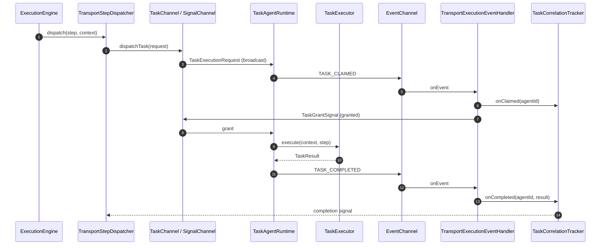

# Catalogue des composants — Performance Engineering Platform

> Vue composant par composant : responsabilité, collaborations, cycle de vie et points
> d'attention. Complète `architecture.md` (vue d'ensemble et mécanismes) et les specs
> par domaine. Mis à jour : 2026-11-15.

Depuis [ADR-045](adr/ADR-045-project-layout-and-execution-boundaries.md), le moteur
de campagne et son plan builder vivent dans `performance/platform-campaign-engine`
(`com.performance.platform.campaign`), le sampling dans `performance/platform-assertion`,
et le scheduling/dispatch generique dans `execution/`. Les contrats de transport
et de rapport sont dans `core/` ; YAML, transports et renderers sont dans `infra/`.
Voir [l'inventaire des modules](architecture.md#organisation-du-depot-adr-045).

---

## 1. Entrée et assemblage (`platform-bootstrap`)

| Composant | Rôle | Collaborateurs |
|---|---|---|
| `PerformancePlatformApplication` | `main()` ; choisit `WebApplicationType` (SERVLET ou NONE pour un profil agent) avant Spring ; lance l'application | `RuntimeConfigResolver`, `SpringApplication` |
| `RuntimeConfigResolver` | Source unique de résolution mode/rôle/transport (env > CLI > property > défaut) ; parsing partagé | `Environment`, args CLI |
| `RuntimeConfigEnvironmentPostProcessor` | Réinjecte `RUNTIME_MODE`, `MODE`, `TRANSPORT_TYPE` comme properties avant les `@ConditionalOnProperty` | `Environment` |
| `RuntimeModeResolver` | Façade Spring historique autour de `RuntimeConfigResolver` | `Environment` |
| `RuntimeAssemblyConfiguration` | Composition root mince : `TaskExecutorLookup`, parser/validateur DSL, read-model, fallback `RestClient.Builder` | `TaskExecutorRegistry`, `ExecutionRepository` |
| `ExecutionUseCaseConfiguration` | Expose `ListExecutionsUseCase`, `DeleteExecutionUseCase`, `ExecutionProgressCalculator` | `ExecutionRepository` |
| `AgentRuntimeConfiguration` | Crée `TaskAgentRuntime` LOCAL (tous les executors) ou DISTRIBUTED (`agent.supported-tasks`) + `SmartLifecycle` | `InMemoryExecutionTransport`/`ExecutionTransport`, `TaskExecutor` |
| `PluginBootstrap` | Charge les JARs de `platform.plugins.dir` au démarrage et logge le résultat | `PluginLoader`, `PluginProperties` |
| `CliScenarioRunner` | Mode headless `--scenario=` : parse, exécute, imprime un résumé, code 0/1/2 | `ScenarioParsingUseCase`, `ExecuteScenarioUseCase`, `GetExecutionStatusUseCase` |
| `SecurityConfiguration` | Chaîne de sécurité : permissive si `platform.security.enabled=false`, sinon JWT + rôles sur `/api/**` | `Environment`, `HttpSecurity` |
| `WebUiConfiguration` | Sert l'IHM statique si `web.ui.enabled=true` | `WebMvcConfigurer` |

Contrôleurs REST (tous `@ConditionalOnWebApplication(SERVLET)`) :
`ScenarioController`, `ScenarioUploadController`, `ScheduleController`, `ExecutionController`,
`AgentController`, `ReportController`.

---

## 2. Domaine (`platform-domain`)

| Composant | Rôle |
|---|---|
| `ScenarioDefinition` | Définition immuable d'un scénario (steps, metadata, report, YAML source) ; le mode n'y figure plus (ADR-053) |
| `StepDefinition` | Étape déclarative : `id`, `taskName`, `phase` ou `during`, `parameters`, `dependsOn`, `ref`, `drain`, `fanOut`, `requiredContexts`, `timeout`, `retryPolicy` |
| `ExecutionPlan` | Plan résolu : steps par phase + `injectionServices`/`scenarioServices` + contexte initial |
| `ExecutionStep` | Step + dépendances + `dagLevel` + clés de contexte requises |
| `ExecutionContext` | Store immuable `taskId → agentId → TaskResult`, outputs nommés, `PersistentStore` |
| `PartialExecutionContext` | Sous-ensemble transmis aux agents (`requiredContexts`), outputs nommés |
| `ExecutionState` | État persisté : statut global, statuts de phases, contexte, timestamps |
| `TaskResult` | Résultat immuable : `taskName`, statut, durée, outputs, erreur |
| `TaskStatus` | `SUCCESS`, `FAILED`, `SKIPPED`, `TIMEOUT` |
| `RetryPolicy` | Politique de retry avec backoff exponentiel (définie, non appliquée par le dispatcher) |
| `FanOut` | `ONE` (défaut) ou `ALL` : nombre d'agents autorisés à exécuter une étape (ADR-055) |
| `ServiceScope` | `INJECTION` ou `SCENARIO` : portée de vie d'une service step (ADR-054) |
| `AgentDescriptor` / `AgentHeartbeat` / `AgentState` | Identité, heartbeat, cycle de vie agent |
| `InjectionResult` | KPIs Gatling (`OUTPUT_KEY = "result"`) |
| `AssertionSummary` / `Check` / `SloStatement` | Résultat d'assertion (`OUTPUT_KEY = "assertion"`) : verdict, checks et SLO textuel |
| Events | `ScenarioStarted/Finished/Cancelled`, `PhaseStarted/Completed`, `TaskDispatched/ClaimedByAgent/GrantSignal/Completed/Failed`, `AgentRegistered/Heartbeat/Lost`, `ScenarioRestartSignal`, `ExecutionLifecycleSignal`, `ReportGenerated` |

---

## 3. Ports et use cases (`platform-use-cases`)

| Composant | Rôle |
|---|---|
| `ExecuteScenarioUseCase` | Démarrer une exécution (implémenté par `ExecutionEngine`) |
| `CancelExecutionUseCase` | Annuler une exécution (implémenté par `ExecutionEngine`) |
| `GetExecutionStatusUseCase` | Read-model de statut/progression (`GetExecutionStatusService`) |
| `ListExecutionsUseCase` / `DeleteExecutionUseCase` | Listing et suppression (`ListExecutionsService`, `DeleteExecutionService`) |
| `ScenarioParsingUseCase` | Parse + valide un YAML (`DefaultScenarioParsingService`) |
| `GenerateReportUseCase` | Port défini, **sans implémentation** actuellement |
| `ExecutionRepository` | Persistance des états et résultats de tâches |
| `AgentRegistryPort` | Suivi du cycle de vie des agents (implémenté côté agent-runtime) |
| `LifecycleSignalHandler` | Réception START/STOP (implémenté par `TaskAgentRuntime`) |
| `ExecutionPlanBuilder` | Port de construction du plan, implemente dans le moteur de campagne |
| `ScenarioParser` | Port de parsing, implemente par l'adaptateur YAML |
| `ExecutionConfig` | Timeouts (`taskAvailabilityTimeout`, `taskExecutionTimeout`) et `claimWindow` (`execution.claim-window`) — ADR-055 |
| `ExecutionProgressCalculator` | Calcul de progression à partir de `ExecutionState` |

---

## 4. DSL (`platform-scenario-dsl`)

| Composant | Rôle |
|---|---|
| `DefaultScenarioValidator` | Valide ids, phases ou `during`, dépendances intra-phase, cycles DAG, `ref`, `requiredContexts` effectifs, load model inline |
| `DagCycleDetector` | Détection de cycle |
| `ValidationResult/Error/Warning` | Résultat de validation détaillé |
| `DefaultScenarioParsingService` | Orchestration parse → validate ; erreurs bloquantes seulement |

`infra/platform-scenario-yaml` contient `YamlScenarioParser`, les DTOs et
`DurationParser` : SnakeYAML/Jackson, rejet des cles inconnues et production de
`ScenarioDefinition`.

---

## 5. Campagne (`platform-campaign-engine`) et execution generique (`platform-execution-engine`)

| Composant | Rôle | Collaborateurs |
|---|---|---|
| `campaign.ExecutionEngine` (`performance/`) | Moteur de campagne : initialise, démarre et arrête les services, exécute les 3 phases, calcule le verdict, persiste, publie les events | `ExecutionPlanBuilder`, `DagPhaseExecutor`, `ExecutionRepository`, `StepDispatcher`, `ExecutionLifecycleDispatcher` |
| `campaign.plan.DefaultExecutionPlanBuilder` (`performance/`) | Construit `ExecutionPlan`, sépare action steps par phase et service steps par portée | `DagLevelCalculator` |
| `DagLevelCalculator` | Calcule les niveaux DAG (arêtes `dependsOn` intra-phase uniquement), détecte les cycles |
| `DagPhaseExecutor` | Parcours DAG par niveau, Virtual Threads, skip des dépendances non satisfaites, annulation | `StepDispatcher`, `ExecutionLifecycleDispatcher` |
| `StepDispatcher` | Exécution d'un step : `dispatch`, `startService`, `stopService` | — |
| `TransportStepDispatcher` | Dispatcher unique (tous modes) : disponibilité, partial context, broadcast, claim/grant, attente de complétion, service steps | `TaskChannel`, `SignalChannel`, `AgentAvailabilityChecker`, `TaskCorrelationTracker`, `ExecutionConfig` |
| `TransportExecutionEventHandler` | Consomme les événements agent, décide et diffuse les grants, alimente tracker/repository, publie les events | `EventChannel`, `SignalChannel`, `TaskCorrelationTracker`, `ExecutionRepository` |
| `PartialContextBuilder` | Extrait les outputs nommés requis du contexte complet | — |
| `DefaultTaskCorrelationTracker` | Suit claims/grants/completions/échecs par `MessageId`, fast-fail sur perte d'agent | — |
| `DefaultAgentAvailabilityChecker` | Attend qu'un agent compétent soit enregistré | `AgentRegistryPort` |
| `DefaultRetryExecutor` | Backoff exponentiel plafonné (non câblé au dispatcher) | — |
| `TransportLifecycleDispatcher` | START/STOP (et service steps) via le `SignalChannel`, unique implémentation | `SignalChannel` |
| `OrchestratorRestartFailureModel` | Au démarrage, marque les exécutions non terminales `FAILED` et publie `ScenarioFinished` (ADR-058) | `ExecutionRepository`, `ApplicationEventPublisher` |
| `campaign.schedule.ScheduleRunService` (`performance/`) | Programme un run (immédiat, one-shot ou cron), le rend visible dans l'API et le dispatche à échéance | `ScheduleScenarioUseCase`, `ScheduledRunRepository`, `ScheduleCalculator` |
| `campaign.schedule.ScheduledRunDispatcher` | Réveille les runs arrivés à échéance et lance l'exécution ; replanifie les crons | `ScheduledRunRepository`, `ExecuteScenarioUseCase`, `ScheduleCalculator` |

---

## 6. Runtime agent (`platform-agent-runtime`)

| Composant | Rôle |
|---|---|
| `TaskAgentRuntime` | Runtime unique : connexion, enregistrement optionnel, claim, attente du grant, exécution, drain, restart ; delegue les signaux a la politique injectee |
| `TaskExecutionPipeline` | Exécution d'une requête (action ou service) : progression, résolution du `TaskExecutor`, publication du résultat ; gère le STOP des services |
| `DefaultTaskSpecializationFilter` | Décide si l'agent est responsable d'un `taskName` |
| `TransportAgentRegistration` | Publie registration/heartbeat/deregistration sur le `LifecycleChannel` |
| `AgentLifecyclePayloadCodec` | Encodage/décodage typé de `AgentDescriptor`/`AgentHeartbeat` |
| `HeartbeatScheduler` | Heartbeat périodique (Virtual Thread), TTL = 3 × intervalle |
| `AgentLifecycleIngestion` | Orchestrateur : transport lifecycle → registre |
| `InMemoryAgentRegistry` | Registre thread-safe des agents |
| `AgentTtlMonitor` | Éviction TTL + publication `AgentLost` |
| `AgentRegistryConfiguration` | Câblage conditionnel DISTRIBUTED + ORCHESTRATOR |
| `ScenarioRestartHandler` | Cleanup stateful + annulation des tâches + retour IDLE |

---

## 7. Contrats (`platform-transport-api`) et transports (`platform-transport`)

Canaux : `TaskChannel`, `SignalChannel`, `EventChannel`, `LifecycleChannel`,
`ConnectionLifecycle` ; façade `ExecutionTransport`. Ces contrats et leurs messages
sont dans `core/platform-transport-api`, sans dependance reseau ou Spring.

| Implémentation | Composants | Notes |
|---|---|---|
| `InMemoryExecutionTransport` | handlers sur Virtual Threads | LOCAL/tests (ADR-059) |
| `KafkaExecutionTransport` | `DynamicKafkaListenerRegistry`, `KafkaMessageCodec`, `KafkaTransportBeans` | consumer group par agent (ADR-009) |
| `HttpExecutionTransport` | `HttpEventCallbackController`, `HttpTransportListener` | POST vers agents, callbacks `/api/v1/events` |

RabbitMQ et socket sont hors du build cœur : fournis comme plugins via `CUSTOM`
(ADR-056).

`TransportConfiguration` sélectionne l'implémentation par `@ConditionalOnProperty` ;
aucun `getType()`.

---

## 8. Infrastructure (`platform-infrastructure`, `platform-persistence`, `platform-executor-*`)

### Exécuteurs (`TaskExecutor`) — un module `infra/executors/platform-executor-<famille>` par famille (ADR-057)
`DatabaseTaskExecutor` (`database`), `DockerTaskExecutor` (`docker`),
`FilesystemTaskExecutor` (`filesystem`), `HttpClientTaskExecutor` (`http-client`),
`KafkaProducerTaskExecutor` (`kafka-producer`), `KafkaConsumerTaskExecutor`
(`kafka-consumer`), `MockServerTaskExecutor` (`mock-server`, service step implémentant
`ServiceTaskExecutor`), `ShellTaskExecutor` (`shell`).
Paquets : `infrastructure.executor.{database,docker,fs,http,kafka,mock,shell}`.

### Registre et plugins (`platform-infrastructure`)
`TaskExecutorRegistry`/`DefaultTaskExecutorRegistry` (beans Spring),
`PluginLoader`, `DefaultPluginLoader`, `AnnotationScanner`, `PluginDescriptor`,
`PluginLoadResult`, `PluginRegistry`/`DefaultPluginRegistry`, `UnsupportedTaskNameException`.

### Persistance (`platform-persistence`)
`JpaExecutionRepository`, `ExecutionStateEntity`, `TaskResultEntity`,
`ExecutionStateJpaRepository`, `TaskResultJpaRepository`, mappers, `JpaConfiguration`,
`PersistenceDataSourceConfiguration` (DataSource primaire).
Runs programmés : `JpaScheduledRunRepository`, `ScheduledRunEntity`,
`ScheduledRunJpaRepository`, `ScheduledRunMapper`. `SpringScheduleCalculator` reste
dans `platform-infrastructure` (`infrastructure.scheduling`).

### Ressources nommées (dans le module de leur famille)
`platform-executor-database` : `DatasourceConfiguration`, `DatasourceProvider`
(`NamedResourceResolver<DataSource>`), `PlatformDatasourcesProperties`.
`platform-executor-http` : `HttpTargetRegistry` (`EndpointResolver`), `HttpTargetProperties`,
`PlatformHttpTargetsProperties`.
`platform-executor-kafka` : `KafkaClusterRegistry`, `KafkaClusterProperties`, `PlatformKafkaProperties`.

---

## 9. Capacités

| Module | Composants |
|---|---|
| `platform-injection-gatling` | `GatlingTaskExecutor`, `GatlingRunner`/`DefaultGatlingRunner`, `SimulationInjectionHolder`, `LoadModelTranslator`/`DefaultLoadModelTranslator`, `GatlingResultParser`, `ProtocolSupportInfo` |
| `platform-assertion` | `CheckEvaluator`, `TemporalCheckEvaluator`, `ParameterBinder`, `OperatorResolver`, `AssertionSummaryFactory`, `assertion.lifecycle.DefaultLifecycleSignalHandler` (sampling START/STOP injecte dans l'agent) |
| `platform-assertion-adapters` | `PerformanceThresholdsAssertionExecutor`, `DirectAssertionAssertionExecutor`, `DirectMeasurementResolver` |
| `platform-report-api` | Modeles et ports `ReportEngine`, `ReportRenderer`, `ReportOutput`, `PerformanceAssessment` (dont `ReviewState`) |
| `platform-reporting` | `DefaultReportEngine`, `PerformanceAssessmentBuilder`, `VerdictCalculator` |
| `platform-report-renderers` | `HtmlReportRenderer`, `PdfReportRenderer`, `JsonReportRenderer`, `ReportFileWriter`, `ReportProperties` |
| `platform-observability` | `ObservabilityEventListener`, `MicrometerExecutionMetrics`, `ExecutionContextMdcFilter`, `ObservabilityConfiguration` |

---

## 10. Relations critiques et pièges

1. **`ExecutionEngine` ne connaît jamais le transport.** Toute dépendance réseau passe
   par `StepDispatcher` (`TransportStepDispatcher`) ; le handler d'événements est un
   collaborateur séparé, identique dans tous les modes (ADR-059).
2. **`TaskAgentRuntime` ne connaît jamais le mode.** `registrationPort == null` est le
   seul discriminant LOCAL.
3. **Aucun `if/switch` sur le type de transport ou le mode.** Sélection par beans
   conditionnels ; le mode n'est lu que par la racine de composition.
4. **Les outputs sont nommés.** Ne pas revenir à `get(Class<T>)` (supprimé du contexte
   orchestrateur) : utiliser `getOutput`/`getFirstOutput`.
5. **Le store est persistant.** Ne pas copier le store complet dans un executor ; utiliser
   `context.with(...)`. `fanOut: one` stocke sous `context[taskId]`, `all` par agent.
6. **Le timeout du step borne les clients I/O.** Les exécuteurs Kafka/HTTP configurent
   leurs timeouts à partir de `StepDefinition.timeout`.
7. **Un agent n'exécute qu'après un grant.** Ne jamais exécuter une tâche sur simple
   réception du broadcast (ADR-055).
8. **Gaps connus** (documentés, non implémentés) :
   - `PluginRegistry` découvre les JARs mais n'est pas raccordé au moteur/agent
     (`TaskExecutorRegistry` ne collecte que les beans Spring) ;
   - le retry n'est appliqué ni par le dispatcher ni par `TaskExecutionPipeline`
     (une seule tentative) ;
   - `ReportFileWriter` n'est pas câblé à `ReportGenerated` (aucune écriture disque
     automatique) et `GenerateReportUseCase` n'a pas d'implémentation ;
   - le transport HTTP n'expose pas d'endpoint entrant de tâches et l'AGENT n'a pas de
     serveur web (ADR-019) : il sert au dispatch sortant + callbacks d'événements ;
   - le déplacement des paquets de fonctionnalité hors de `platform-domain` (ADR-060)
     n'est pas terminé.
