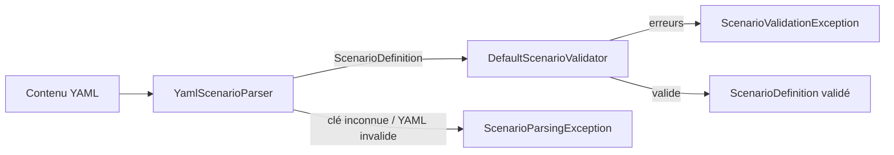

# Spec 01 — Scenario DSL

**Module** : `platform-scenario-dsl`  
**Dépend de** : `platform-domain`

---

## 1. Objectif

Définir le format YAML des scénarios et des load models, les règles de validation,
et les interfaces de parsing. La sortie de ce module est un `ScenarioDefinition`
immuable utilisable par le moteur d'exécution.

Le modèle est décrit dans le présent document ; les raisons des simplifications
sont dans [ADR-053](../adr/ADR-053-scenario-model-simplification.md) (modèle),
[ADR-054](../adr/ADR-054-service-steps-and-reactive-behaviour.md) (service steps)
et [ADR-055](../adr/ADR-055-single-claim-dispatch-by-default.md) (`fanOut`).

---

## 2. Structure YAML d'un Scénario

La section optionnelle `scenario.report` definit le contexte du rapport et ses
preuves/criteres ; elle ne configure pas Spring ni un collecteur. Contrat et
exemple : [Spec 08 - report evidence](08-report-engine.md#8-configuration-des-preuves-et-criteres).

`scenario.metadata.executionGroup` (chaîne optionnelle) sérialise les tirs
partageant une ressource : le groupe est acquis avant PREPARATION et libéré après
les événements de fin, reporting et nettoyage. Sans groupe, les tirs restent
parallèles. La coordination est limitée à une instance d'orchestrateur
(ADR-058 : un seul orchestrateur par déploiement).

**Un seul fichier de scénario pour les deux modes.** Le mode est une propriété du
runtime (`runtime.mode`, ADR-005/ADR-053) : la clé `execution.mode` n'existe plus
et est rejetée par le parser strict. Une étape est soit une **action step**
(`phase`), soit une **service step** (`during`), jamais les deux (ADR-054).

```yaml
scenario:
  id: customer-api-perf                # REQUIRED - unique
  name: Customer API Campaign          # REQUIRED
  version: 1.0.0                       # REQUIRED - semver
  tags:
    - performance
    - regression
  metadata:
    executionGroup: customer-perf-env   # optionnel : tirs exclusifs sur ce SUT
    owner: team-a
    jira: PERF-123
    description: "Test de performance de l'API client"

  # NOTE R5 : taskAvailabilityTimeoutSeconds — durée d'attente d'un agent compétent.
  # Doit être supérieur au temps de démarrage d'un agent (min 120s en K8s).
  taskAvailabilityTimeoutSeconds: 120

  steps:
    - id: start-mock                  # service step : vivante pendant INJECTION
      task: mock-server
      during: injection
      drain: 8s                       # optionnel : retarde le STOP
      parameters:
        deployment: EMBEDDED
        port: 8090
        mappingsPath: classpath:mock
      timeout: 30s

    - id: purge-db
      task: database                   # matché avec agent.supported-tasks
      phase: PREPARATION
      parameters:
        operation: PURGE
        datasource: customer-db
      timeout: 30s

    - id: seed-db
      task: database
      phase: PREPARATION
      dependsOn: [purge-db]
      parameters:
        operation: POPULATE
        datasource: customer-db
        scriptPath: classpath:sql/seed.sql
      timeout: 2m

    - id: customer-api-load
      task: gatling
      phase: INJECTION
      fanOut: all                      # tous les agents compétents injectent
      dependsOn: [seed-db]
      parameters:
        simulation: com.example.CustomerApiSimulation
        loadModel:                     # modèle inline uniquement
          type: RAMP
          parameters: { from: 1, to: 300, durationSeconds: 840 }
      timeout: 20m

    - id: api-slo
      task: performance-thresholds
      phase: ASSERTION
      dependsOn: [customer-api-load]
      description:
        title: Customer API latency
        sli: p95 and error rate of the customer API calls
        slo: p95 <= 500 ms et taux d'erreur <= 1 %
      parameters:
        latency: { p95: 500, unit: ms, severity: WARNING }
        errorRate: { max: 1.0, unit: percent, severity: CRITICAL }

    - id: mock-called
      task: direct-assertion
      phase: ASSERTION
      dependsOn: [customer-api-load]
      ref: start-mock                  # lit le résultat publié au STOP du service
      description:
        title: Calls reached the mock
        sli: nombre d'appels reçus par le mock
        slo: au moins un appel en fin de tir
      parameters:
        metric: http.requests.matched
        operator: GTE
        threshold: 1
        severity: CRITICAL
```

### Champs d'une étape

| Champ | Requis | Rôle |
|---|---|---|
| `id` | oui | identifiant unique dans le scénario (`TaskId`) |
| `task` | oui | nom libre matchant `agent.supported-tasks` |
| `phase` | action step | `PREPARATION` \| `INJECTION` \| `ASSERTION` |
| `during` | service step | `injection` \| `scenario` (ADR-054) |
| `drain` | non | durée ajoutée avant le STOP d'une service step |
| `fanOut` | non | `one` (défaut) \| `all` (ADR-055) |
| `parameters` | non | opaque pour le moteur : appartient à la task |
| `dependsOn` | non | ordonne les steps **dans une phase** (ADR-053) |
| `ref` | non | référence de première classe vers un autre step |
| `requiredContexts` | non | override explicite ; défaut = `dependsOn` + `ref` |
| `timeout` | non | défaut 5 min |
| `retryPolicy` | non | `maxAttempts`, `initialDelay`, `multiplier`, `maxDelay`, `retryableExceptions` |
| `description` | non | `title`, `sli`, `slo`, `rationale` — recopié dans `parameters.description` |

`parameters.refTaskId` et `parameters.linkedTo` n'existent plus : `ref` remplace le
premier (ADR-053) et `during` remplace le second (ADR-054).

---

## 3. Load Models

Un load model est **inline** dans les paramètres de l'étape (`parameters.loadModel`,
ADR-053). Le registre nommé `loadModels` au niveau `scenario` n'existe plus
(`LoadModelRegistry` et `ScenarioDefinition.loadModels` sont supprimés). Seule une
étape `gatling` de phase `INJECTION` est concernée.

```yaml
parameters:
  loadModel:
    type: RAMP
    parameters: { from: 1, to: 300, durationSeconds: 840 }
```

| Type | Clés de `parameters` |
|---|---|
| `RAMP` | `from`, `to`, `durationSeconds` |
| `CONSTANT` | `usersPerSec`, `durationSeconds` |
| `SPIKE` | `base`, `spike`, `spikeDurationSeconds`, `totalDurationSeconds` |
| `STAIR` | `startUsersPerSec`, `incrementUsersPerSec`, `steps`, `stepDurationSeconds` |
| `SOAK` | `usersPerSec`, `durationSeconds`, `rampDurationSeconds` |
| `BURST` | `users`, `bursts`, `intervalSeconds` |
| `RAMP_UP_DOWN` | `from`, `to`, `rampUpDurationSeconds`, `holdDurationSeconds`, `rampDownDurationSeconds` |
| `CUSTOM` | `points` : liste de `{ timeSeconds, usersPerSec }` |

La traduction en `OpenInjectionStep` Gatling est dans
[Spec 06 section 4](06-injection-gatling.md#4-loadmodel--gatling-openinjection).

---

## 4. Interfaces de Parsing

```java
// Port entrant
public interface ScenarioParser {
    ScenarioDefinition parse(InputStream yamlContent) throws ScenarioParsingException;
    ScenarioDefinition parse(String yamlContent) throws ScenarioParsingException;
    ScenarioDefinition parseFile(Path scenarioFile) throws ScenarioParsingException;
}

// Port entrant
public interface ScenarioValidator {
    ValidationResult validate(ScenarioDefinition scenario);
}
```

---



## 5. Règles de Validation

Le parser rejette toute clé inconnue (`FAIL_ON_UNKNOWN_PROPERTIES` + listes explicites
`ROOT_KEYS`, `SCENARIO_KEYS`, `STEP_KEYS`, `RETRY_KEYS`) : une faute de frappe dans un
nom de propriété produit une erreur de parsing, jamais un champ ignoré. `execution`,
`loadModels` et `parameters.refTaskId`/`linkedTo` sont donc rejetés (ADR-053).

### Erreurs (bloquantes)
- `scenario.id` : obligatoire, alphanumérique + tirets, max 100 chars
- `scenario.version` : obligatoire, format semver strict
- Chaque `step.id` : unique au sein du scénario
- `phase` : obligatoire sur une action step ; `during` obligatoire sur une service step ;
  une étape ne porte jamais les deux ; `drain` n'est valide que sur une service step
- `drain` : non négatif
- `fanOut` : `one` ou `all` uniquement
- `dependsOn` : référence des IDs existants dans le même scénario, pas de self-référence,
  pas de dépendance vers une service step
- `dependsOn` : ordonne uniquement **dans une phase** ; une référence à une phase
  antérieure est acceptée et ignorée pour l'ordonnancement, une référence à une phase
  postérieure est une erreur (ADR-053)
- `dependsOn` : pas de cycle dans le DAG intra-phase
- `ref` : référence un step existant, jamais lui-même
- `requiredContexts` (ou son défaut `dependsOn` + `ref`) : chaque clé doit désigner un
  step disponible avant l'exécution — phase antérieure, ancêtre DAG dans la même phase,
  ou service `during: injection` pour une assertion (ADR-054)
- `loadModel` dans un step INJECTION `gatling` : mapping inline avec un `type` valide ;
  une référence nommée est une erreur
- `task` : obligatoire — le `taskName` n'est pas validé contre un registre au parse time
  (les agents ne sont pas connus à ce stade)

### Avertissements (non bloquants)
- Pas de `metadata.owner` : warning
- `timeout` non défini sur step INJECTION : warning
- Scénario sans step de phase ASSERTION : warning

---

## 6. Modèle de Données (Domain)

```java
// Tous les records sont immuables ; 0 annotation framework (ADR-060)
public record ScenarioDefinition(
    ScenarioId id,
    String name,
    String version,
    List<String> tags,
    Map<String, String> metadata,
    List<StepDefinition> steps,           // liste unifiée — remplace preparation/injections/assertions
    String sourceYaml,
    ReportDefinition report
) {}

/**
 * StepDefinition remplace TaskDefinition.
 * Action step : phase. Service step : during (+ drain optionnel). Jamais les deux.
 * fanOut : nombre d'agents accordés (ADR-055).
 * ref : référence de première classe vers un autre step (ADR-053).
 */
public record StepDefinition(
    TaskId id,                            // identifiant unique dans le scénario
    String taskName,                      // nom libre matchant agent.supported-tasks
    Phase phase,                          // PREPARATION | INJECTION | ASSERTION (action step)
    Map<String, Object> parameters,       // paramètres spécifiques à la task (opaque)
    List<TaskId> dependsOn,               // ordonne les steps dans une phase
    TaskId ref,                           // référence vers un step, nullable
    ServiceScope during,                  // INJECTION | SCENARIO (service step), nullable
    Duration drain,                       // ZERO par défaut, service step uniquement
    FanOut fanOut,                        // ONE (défaut) | ALL
    List<String> requiredContexts,        // override explicite, vide = dependsOn + ref
    Duration timeout,                     // nullable = default 5min
    RetryPolicy retryPolicy               // nullable = pas de retry
) {
    boolean isService();                      // during != null
    List<String> resolvedRequiredContexts();  // override, sinon dependsOn + ref
}

public record LoadModel(
    LoadModelType type,
    Map<String, Object> parameters
) {}
```

`ExecutionMode` a été supprimé du domaine scenario : le mode vient uniquement du
runtime (ADR-053). `LoadModel` reste un type d'injection ; il n'y a plus de map
`loadModels` dans `ScenarioDefinition`.

---

## 7. Exceptions

```java
public class ScenarioParsingException extends RuntimeException {
    private final List<String> errors;   // liste des erreurs de parsing YAML
}

public class ScenarioValidationException extends RuntimeException {
    private final ValidationResult result; // détail des erreurs de validation
}

public record ValidationResult(
    boolean valid,
    List<ValidationError> errors,
    List<ValidationWarning> warnings
) {}

public record ValidationError(String field, String message, String path) {}
public record ValidationWarning(String field, String message) {}
```
