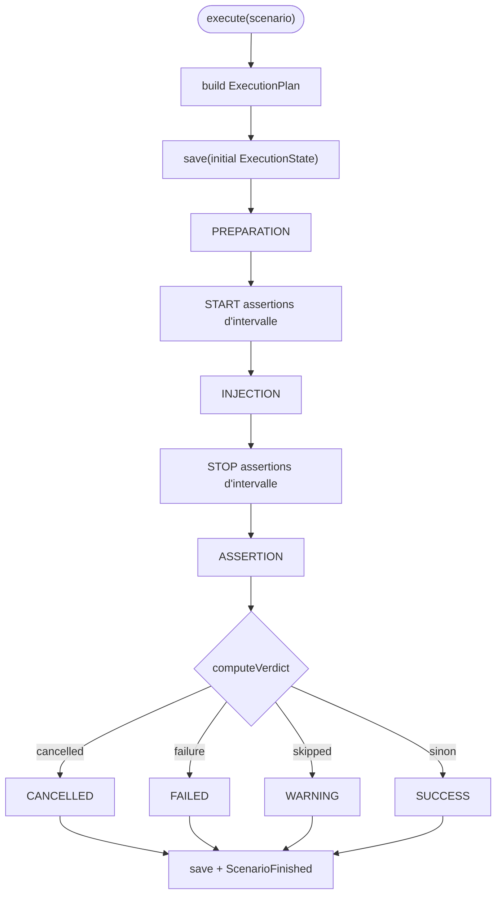

# Spec 02 — Execution Engine

**Module** : `platform-execution-engine`
**Dépend de** : `platform-domain`, `platform-use-cases`, `platform-scenario-dsl`,
`platform-plugin-api`, `platform-transport` (ports étroits uniquement)

---

## 1. Objectif

Transformer un `ScenarioDefinition` validé en `ExecutionPlan`, puis orchestrer les trois
phases en séquence obligatoire :

```
PREPARATION → INJECTION → ASSERTION
```

Il existe **un seul moteur** (`ExecutionEngine`) pour LOCAL et DISTRIBUTED (ADR-037).
Le mode n'est pas un fork : il est porté par les collaborateurs injectés
(`StepDispatcher`, `OutcomeEventPublisher`, `ExecutionLifecycleDispatcher`).
Conséquence : même machine d'état, même calcul de verdict, mêmes règles de skip/retry
dans les deux modes.

---

## 2. Interfaces et ports

```java
// Ports entrants implémentés par ExecutionEngine
public interface ExecuteScenarioUseCase {
    ExecutionId execute(ScenarioDefinition scenario) throws ExecutionException;
}
public interface CancelExecutionUseCase {
    void cancel(ExecutionId id);
}

// Lecture d'état (read-model, peut aussi venir du repository)
ExecutionStatus getStatus(ExecutionId id);

// Port sortant de persistance
public interface ExecutionRepository {
    void save(ExecutionState state);
    Optional<ExecutionState> findById(ExecutionId id);
    void updatePhase(ExecutionId id, Phase phase, PhaseStatus status);
    void saveTaskResult(ExecutionId id, TaskId taskId, AgentId agentId, TaskResult result);
    Map<AgentId, TaskResult> getTaskResults(ExecutionId id, TaskId taskId);
    List<ExecutionState> findAll(int limit);
    Map<TaskId, Map<AgentId, TaskResult>> findAllTaskResults(ExecutionId id);
    void deleteById(ExecutionId id);
}
```

Activation Spring du moteur :

```java
@ConditionalOnExpression(
  "'${runtime.mode:LOCAL}'.equals('LOCAL') || "
+ "('${runtime.mode:LOCAL}'.equals('DISTRIBUTED') && '${runtime.role:NONE}'.equals('ORCHESTRATOR'))")
```

Autres contrats internes :

```java
@FunctionalInterface
public interface StepDispatcher {
    TaskResult dispatch(ExecutionStep execStep, ExecutionContext context);
}

@FunctionalInterface
public interface OutcomeEventPublisher {
    void publish(ExecutionId executionId, List<DagPhaseExecutor.StepOutcome> outcomes, Phase phase);
}

@FunctionalInterface
public interface ExecutionLifecycleDispatcher {
    void dispatch(ExecutionLifecycleSignal signal);
}
```

---

## 3. Modèle de plan

```java
public record ExecutionPlan(
    ExecutionId id,
    ScenarioId scenarioId,
    List<ExecutionStep> preparationSteps,
    List<ExecutionStep> injectionSteps,
    List<ExecutionStep> assertionSteps,
    List<ExecutionStep> assertionIntervalSteps,   // assertions `linkedTo` une injection
    ExecutionContext initialContext
) {
    int totalSteps();
}

public record ExecutionStep(
    StepDefinition step,
    List<TaskId> dependencies,
    int dagLevel,
    Set<String> requiredContextKeys
) {}
```

`DefaultExecutionPlanBuilder` :
1. calcule les niveaux DAG globaux (`DagLevelCalculator`, détection de cycle →
   `InvalidScenarioException`) ;
2. crée un `ExecutionStep` par `StepDefinition` ;
3. sépare par phase, puis distingue les assertions d'intervalle : une assertion dont le
   paramètre `linkedTo` référence un step d'injection est placée dans
   `assertionIntervalSteps` ; une référence inconnue est une erreur ;
4. trie chaque liste par `dagLevel` croissant ;
5. initialise un `ExecutionContext` vide.

Les assertions d'intervalle ne sont pas exécutées dans la phase ASSERTION : le moteur
leur envoie un signal de cycle de vie `START` avant l'INJECTION et `STOP` après.
Elles échantillonnent ainsi pendant toute la durée de la charge.

---

## 4. ExecutionContext

```java
public record ExecutionContext(
    ExecutionId executionId,
    ScenarioId scenarioId,
    Map<String, Map<String, TaskResult>> store   // taskId → agentId → TaskResult
) {
    static ExecutionContext initial(ExecutionId, ScenarioId);
    ExecutionContext with(String taskId, String agentId, TaskResult result);

    // Outputs nommés (ADR-031)
    <T> Optional<T> getOutput(String taskId, String agentId, String outputName, Class<T> type);
    <T> Optional<T> getFirstOutput(String taskId, String outputName, Class<T> type);
    Map<String, TaskResult> getAll(String taskId);
}
```

- **Immuable** : `with(...)` retourne une nouvelle instance ; aucune mutation, aucun
  `setXxx()` (CF-02).
- Store **persistant par couches** (`PersistentStore`) : `with` est O(profondeur) et ne
  copie que la map de la tâche modifiée. Snapshot lisible matérialisé à la demande et
  mis en cache par instance.
- Accès **par nom d'output**, pas par type : `getOutput(..., "p95Ms", Long.class)`.
  Clés contractuelles : `InjectionResult.OUTPUT_KEY = "result"`,
  `AssertionSummary.OUTPUT_KEY = "assertion"`.
- `PartialExecutionContext` (transmis aux agents) contient uniquement les
  `requiredContexts`, sous la forme `taskId → agentId → Map<String,Object>` (tous les
  outputs nommés). Les payloads historiques à valeur brute restent tolérés.

---

## 5. Algorithme d'exécution

### 5.1 Séquence

```
initializeExecution :
  plan = planBuilder.build(scenario)
  state = ExecutionState(RUNNING, phases PENDING, contexte initial)
  repository.save(state)            ← AVANT toute phase (API/CLI doit pouvoir suivre)
  activeExecutions[executionId] = state
  publish ScenarioStarted

executePhase(PREPARATION)
  → signaux START aux assertions d'intervalle
executePhase(INJECTION)
  → signaux STOP aux assertions d'intervalle
executePhase(ASSERTION)

verdict = computeVerdict(...)
applyVerdict(...)                   ← COMPLETED / FAILED / CANCELLED
publish ScenarioFinished
```

Aucun arrêt sur échec de phase : les phases suivantes s'exécutent (les steps dépendants
sont SKIPPED), afin de produire un rapport complet.



### 5.2 Une phase

```java
PhaseStarted(executionId, phase)
repository.updatePhase(executionId, phase, RUNNING)
result = dagPhaseExecutor.executePhase(steps, context, phase, cancelled)
outcomeEventPublisher.publish(executionId, result.outcomes(), phase)  // LOCAL seulement
status = result.anyFailed() ? FAILED : COMPLETED
PhaseCompleted(executionId, phase, status)
repository.updatePhase(executionId, phase, status)
repository.save(updatedState)
```

### 5.3 Parcours DAG (`DagPhaseExecutor`)

1. Grouper les steps par `dagLevel`.
2. Pour chaque niveau, en ordre croissant :
   - si `cancelled` est vrai, arrêter la phase ;
   - classer les steps : dépendances satisfaites → exécutables ; sinon → SKIPPED avec
     `TaskResult.skipped(..., "dependency failed")` stocké sous l'agent
     `DEFAULT_AGENT = "agent-local"` ;
   - exécuter les steps exécutables **en parallèle** sur
     `Executors.newVirtualThreadPerTaskExecutor()` ;
   - chaque step reçoit un signal START avant exécution et STOP après ;
   - les résultats sont fusionnés dans le contexte (copy-on-write).
3. Annulation coopérative : les futures en attente sont annulés (interruption) ;
   les steps non terminés ne produisent pas de résultat et `anyFailed` passe à vrai.
4. Retourner `PhaseResult(updatedContext, anyFailed, outcomes)`.

Le `StepDispatcher` est seul responsable de la stratégie d'exécution d'un step
(résolution du `TaskExecutor`, retry, transport éventuel). Le parcours DAG ne connaît
ni le transport ni le mode.

### 5.4 Retry

`RetryPolicy(maxAttempts, initialDelay, multiplier, maxDelay, retryableExceptions)` :
- défauts : 3 tentatives, 1 s initial, multiplicateur 2, plafond 30 s ;
- `retryableExceptions` vide = toutes les exceptions sont retryables ;
- `DefaultRetryExecutor` applique un backoff exponentiel plafonné
  `min(initialDelay × multiplier^(n-1), maxDelay)` via `Thread.sleep`
  (Virtual Threads, pas de blocage du carrier).

En LOCAL le retry est appliqué par `LocalStepDispatcher`. En DISTRIBUTED, la politique
voyage dans `TaskExecutionRequest.retryPolicy`, mais l'agent
(`TaskExecutionPipeline`) ne l'applique pas encore : la tâche distante est exécutée une
seule fois. Le retry distribué est un suivi d'implémentation.

---

## 6. Stratégies de dispatch

### 6.1 LOCAL — `LocalStepDispatcher`

- `TaskExecutorLookup.findTaskExecutor(step.taskName())` : chemin **unique** pour toutes
  les phases (les `AssertionExecutor` étendent `TaskExecutor`).
- Exécution directe dans la JVM (pas de sérialisation, pas de réseau, pas de heartbeat).
- Retry via `RetryExecutor`.
- Introuvable → `TaskResult.failed("No TaskExecutor found for taskName: …")`.
- Le moteur publie ensuite `TaskCompleted`/`TaskFailed` via `LocalOutcomeEventPublisher`
  avec l'agent local ; `saveTaskResult` est appelé pour que le read-model et le CLI
  voient les résultats.

### 6.2 DISTRIBUTED — `RemoteStepDispatcher`

1. `availabilityChecker.awaitAgentFor(taskName, taskAvailabilityTimeout)` — échec →
   `NoAvailableAgentException` → tâche FAILED.
2. `PartialContextBuilder.build(context, step.requiredContextKeys)` : extrait les outputs
   nommés des tâches requises.
3. Créer `TaskExecutionRequest(MessageId.generate(), executionId, step, partial, now,
   retryPolicy)`. **Pas de `targetAgentId`** : broadcast.
4. `tracker.trackDispatched(messageId, taskId, executionId)` **avant** le dispatch.
5. `transport.dispatchTask(request)` puis publier `TaskDispatched`.
6. Attendre `tracker.completionSignal(messageId, policy)` — aucun polling.
7. En `finally`, `tracker.release(messageId)` (évite toute fuite d'état).
8. Sélectionner le résultat :
   - `ResultSelectionPolicy.FIRST_COMPLETED` → ordre de complétion ;
   - `LAST_COMPLETED` → ordre inverse ;
   - préférence pour le premier résultat `SUCCESS`, sinon le premier candidat.

`TransportExecutionEventHandler` (souscrit au `EventChannel`) :
- `TASK_CLAIMED` → `tracker.onClaimed`, publie `TaskClaimedByAgent` ;
- `TASK_COMPLETED` → reconstruit `TaskResult` depuis le payload
  (`status`, `durationMs`, `outputs`, `error`), `tracker.onCompleted`,
  `repository.saveTaskResult`, publie `TaskCompleted` ;
- `TASK_FAILED` → `tracker.onFailed` ;
- `TASK_WORK_IN_PROGRESS` → trace/log ;
- événements dont le `correlationId` est inconnu ou déjà libéré → ignorés.

Perte d'agent : `@EventListener onAgentLost(AgentLost)` →
`tracker.onAgentLost(agentId)`. Les claims non terminés sont considérés comme échoués ;
`FIRST_COMPLETE` échoue immédiatement si tous les claimers ont échoué, sans attendre
`taskExecutionTimeout` (ADR-033).

### 6.3 Signaux de cycle de vie

`ExecutionLifecycleDispatcher` :
- LOCAL → `LocalLifecycleDispatcher` appelle directement
  `TaskAgentRuntime.onLifecycleSignal(signal)` ;
- DISTRIBUTED → `RemoteLifecycleDispatcher` publie sur le `SignalChannel` (broadcast).

Les signaux START/STOP encadrent :
- chaque step exécuté (START avant, STOP après) ;
- les assertions d'intervalle (START avant INJECTION, STOP après).

---

## 7. Verdict et finalisation

```java
Verdict computeVerdict(context, plan, hasFailure, cancelled) {
    if (cancelled || hasFailure) return FAILED;
    if (anyStepSkippedInAnyPhase(context, plan)) return WARNING;
    return SUCCESS;
}
```

- `hasFailure` est vrai si un résultat de n'importe quelle phase est `FAILED`
  (ou si `NoAvailableAgentException`/exception inattendue survient).
- `SKIPPED` produit `WARNING`, pas `FAILED`.
- Annulation → `ScenarioCancelled` et statut `CANCELLED`.

Finalisation :
- retirer l'exécution active de la map mémoire ;
- persister l'état final ;
- publier `ScenarioFinished(executionId, scenarioId, verdict, duration, timestamp)`.

Événements de domaine publiés par le moteur (`ApplicationEventPublisher`) :
`ScenarioStarted`, `PhaseStarted`, `PhaseCompleted`, `ScenarioFinished`,
`ScenarioCancelled`, `TaskDispatched`, `TaskClaimedByAgent`, `TaskCompleted`,
`TaskFailed`. (`TaskRetried` est défini dans le domaine mais n'est pas publié
actuellement.)

---

## 8. Configuration

Préfixe `execution.*` (`ExecutionEngineProperties`) :

| Propriété | Défaut | Rôle |
|---|---|---|
| `task-availability-timeout` | 120 s | attente d'un agent compétent (R5 : ≥ 120 s en K8s) |
| `task-execution-timeout` | 300 s | exécution maximale d'une tâche distante |
| `work-in-progress-reset-interval` | 100 s | défini et transmis dans `ExecutionConfig` ; **non exploité** par le dispatcher actuel (les `TaskWorkInProgress` sont seulement journalisés) |
| `completion-policy` | `FIRST_COMPLETE` | `FIRST_COMPLETE` ou `ALL_COMPLETE` |
| `result-selection-policy` | `FIRST_COMPLETED` | `FIRST_COMPLETED` ou `LAST_COMPLETED` |

Les propriétés sont résolues avec la priorité env > CLI > property > défaut (ADR-006).
Seul le mode DISTRIBUTED les utilise ; en LOCAL, l'exécution est synchrone.

---

## 9. Gestion des erreurs

| Situation | Comportement |
|---|---|
| Task FAILED (retry épuisé) | Résultat FAILED stocké ; phase FAILED ; phases suivantes exécutées ; verdict FAILED |
| Task TIMEOUT (remote) | `completion_timeout` → `TaskResult.failed("Task execution timed out")` |
| Cycle DAG | `InvalidScenarioException` au build du plan (avant exécution) |
| `linkedTo` inconnu | `InvalidScenarioException` au build du plan |
| Aucun agent compétent | `NoAvailableAgentException` → tâche FAILED ; verdict FAILED |
| Agent perdu | `AgentLost` → claims invalidés → fast-fail (ADR-033) |
| Annulation utilisateur | flag coopératif ; steps non terminés FAILED ; statut CANCELLED |
| Exception inattendue | log error, verdict FAILED, état persisté, `ScenarioFinished` publié |

Il n'existe **pas** de reprise après redémarrage de l'orchestrateur dans l'implémentation
actuelle : l'état est persisté par phase, mais un nouvel orchestrateur ne reprend pas une
exécution interrompue.
