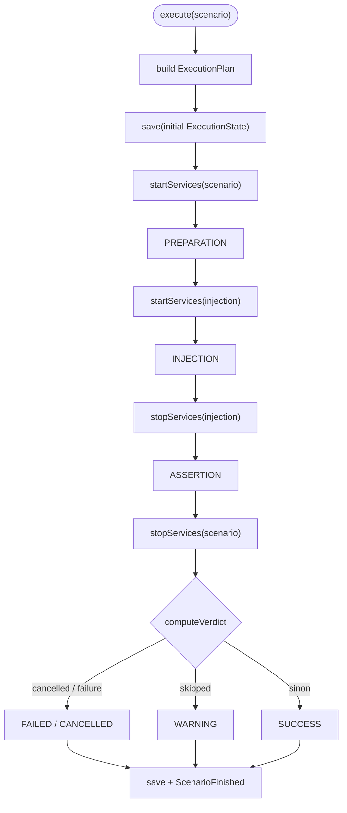

# Spec 02 — Execution Engine

**Module** : `platform-execution-engine`
**Dépend de** : `platform-domain`, `platform-use-cases`, `platform-scenario-dsl`,
`platform-plugin-api`, `platform-transport` (ports étroits uniquement)

---

## 1. Objectif

Transformer un `ScenarioDefinition` validé en `ExecutionPlan`, puis orchestrer les trois
phases en séquence obligatoire :

```
PREPARATION → INJECTION → ASSERTION
```

Il existe **un seul moteur** (`ExecutionEngine`) et **un seul chemin d'exécution**
pour LOCAL et DISTRIBUTED (ADR-037, ADR-059). Le moteur dispatche toujours via les ports
de transport ; en LOCAL le transport est le transport en mémoire et un agent embarqué est
réellement démarré. Le mode n'est lu que par la racine de composition, pour choisir les
beans. Conséquence : même machine d'état, même calcul de verdict, mêmes timeouts, mêmes
règles de claim/grant, de skip et de perte d'agent dans les deux modes.

**Règle (ADR-054)** : l'orchestrateur coordonne des durées de vie (service steps), jamais
des messages individuels. Un enchaînement requête → réponse reste interne à un exécuteur
sur un agent.

---

## 2. Interfaces et ports

```java
// Ports entrants implémentés par ExecutionEngine
public interface ExecuteScenarioUseCase {
    ExecutionId execute(ScenarioDefinition scenario) throws ExecutionException;
}
public interface CancelExecutionUseCase {
    void cancel(ExecutionId id);
}

// Lecture d'état (read-model, peut aussi venir du repository)
ExecutionStatus getStatus(ExecutionId id);

// Port sortant de persistance
public interface ExecutionRepository {
    void save(ExecutionState state);
    Optional<ExecutionState> findById(ExecutionId id);
    void updatePhase(ExecutionId id, Phase phase, PhaseStatus status);
    void saveTaskResult(ExecutionId id, TaskId taskId, AgentId agentId, TaskResult result);
    Map<AgentId, TaskResult> getTaskResults(ExecutionId id, TaskId taskId);
    List<ExecutionState> findAll(int limit);
    Map<TaskId, Map<AgentId, TaskResult>> findAllTaskResults(ExecutionId id);
    void deleteById(ExecutionId id);
}
```

Activation Spring du moteur :

```java
@ConditionalOnExpression(
  "'${runtime.mode:LOCAL}'.equals('LOCAL') || "
+ "('${runtime.mode:LOCAL}'.equals('DISTRIBUTED') && '${runtime.role:NONE}'.equals('ORCHESTRATOR'))")
```

Autres contrats internes :

```java
public interface StepDispatcher {
    List<StepDispatchResult> dispatch(ExecutionStep execStep, ExecutionContext context);
    void startService(ExecutionStep execStep, ExecutionContext context);
    List<StepDispatchResult> stopService(ExecutionStep execStep, ExecutionContext context);
}

public record StepDispatchResult(AgentId agentId, TaskResult result) {}

@FunctionalInterface
public interface ExecutionLifecycleDispatcher {
    void dispatch(ExecutionLifecycleSignal signal);
}
```

`StepDispatchResult` porte un résultat par agent accordé : un seul en `fanOut: one`,
un par agent en `fanOut: all` (ADR-055). `startService` / `stopService` ne concernent que
les service steps (ADR-054). Il n'existe plus d'`OutcomeEventPublisher` : les events de
tâche sont publiés par `TransportExecutionEventHandler` à partir des événements reçus du
transport, dans tous les modes.

---

## 3. Modèle de plan

```java
public record ExecutionPlan(
    ExecutionId id,
    ScenarioId scenarioId,
    List<ExecutionStep> preparationSteps,
    List<ExecutionStep> injectionSteps,
    List<ExecutionStep> assertionSteps,
    List<ExecutionStep> injectionServices,   // service steps `during: injection`
    List<ExecutionStep> scenarioServices,    // service steps `during: scenario`
    ExecutionContext initialContext
) {
    int totalSteps();
}

public record ExecutionStep(
    StepDefinition step,
    List<TaskId> dependencies,
    int dagLevel,
    Set<String> requiredContextKeys
) {}
```

`DefaultExecutionPlanBuilder` :
1. calcule les niveaux DAG (`DagLevelCalculator`, détection de cycle →
   `InvalidScenarioException`). Seules les arêtes `dependsOn` **intra-phase entre action
   steps** ordonnent le DAG ; une référence à une autre phase ou à une service step est
   ignorée (ADR-053) ;
2. crée un `ExecutionStep` par `StepDefinition` ; `requiredContextKeys` =
   `step.resolvedRequiredContexts()` (override explicite, sinon `dependsOn` + `ref`) ;
3. sépare les action steps par phase et les service steps par portée
   (`injectionServices`, `scenarioServices`) ; une service step n'appartient à aucune
   phase ;
4. trie chaque liste de phase par `dagLevel` croissant ;
5. initialise un `ExecutionContext` vide.

Les assertions ne sont plus détectées par un paramètre `linkedTo` : elles lisent le
résultat d'une service step via `ref`, publié au STOP (ADR-054).

---

## 4. ExecutionContext

```java
public record ExecutionContext(
    ExecutionId executionId,
    ScenarioId scenarioId,
    Map<String, Map<String, TaskResult>> store   // taskId → agentId → TaskResult
) {
    static ExecutionContext initial(ExecutionId, ScenarioId);
    ExecutionContext with(String taskId, String agentId, TaskResult result);

    // Outputs nommés (ADR-031)
    <T> Optional<T> getOutput(String taskId, String agentId, String outputName, Class<T> type);
    <T> Optional<T> getFirstOutput(String taskId, String outputName, Class<T> type);
    Map<String, TaskResult> getAll(String taskId);
}
```

- **Immuable** : `with(...)` retourne une nouvelle instance ; aucune mutation, aucun
  `setXxx()` (CF-02).
- Store **persistant par couches** (`PersistentStore`) : `with` est O(profondeur) et ne
  copie que la map de la tâche modifiée. Snapshot lisible matérialisé à la demande et
  mis en cache par instance.
- Accès **par nom d'output**, pas par type : `getOutput(..., "p95Ms", Long.class)`.
  Clés contractuelles : `InjectionResult.OUTPUT_KEY = "result"`,
  `AssertionSummary.OUTPUT_KEY = "assertion"`.
- En `fanOut: one` (défaut, ADR-055), un seul agent exécute : le résultat est stocké sous
  `context[taskId]` et les consommateurs n'ont pas besoin d'une map indexée par agent.
  En `fanOut: all`, un résultat est stocké par agent accordé
  (`taskId → agentId`), et les assertions agrègent par règle déclarée sur la métrique
  (ADR-049).
- `PartialExecutionContext` (transmis aux agents) contient uniquement les
  `requiredContexts`, sous la forme `taskId → agentId → Map<String,Object>` (tous les
  outputs nommés). Les payloads historiques à valeur brute restent tolérés.

---

## 5. Algorithme d'exécution

### 5.1 Séquence

```
initializeExecution :
  plan = planBuilder.build(scenario)
  state = ExecutionState(RUNNING, phases PENDING, contexte initial)
  repository.save(state)            ← AVANT toute phase (API/CLI doit pouvoir suivre)
  activeExecutions[executionId] = state
  publish ScenarioStarted

startServices(plan.scenarioServices)     ← before PREPARATION
executePhase(PREPARATION)

startServices(plan.injectionServices)    ← before INJECTION
executePhase(INJECTION)
stopServices(plan.injectionServices)     ← after INJECTION (results at STOP)

executePhase(ASSERTION)
stopServices(plan.scenarioServices)      ← after ASSERTION

verdict = computeVerdict(...)
applyVerdict(...)                   ← COMPLETED / FAILED / CANCELLED
publish ScenarioFinished
```

Aucun arrêt sur échec de phase : les phases suivantes s'exécutent (les steps dépendants
sont SKIPPED), afin de produire un rapport complet. Un échec de démarrage de service
échoue l'exécution : la charge ne peut pas être interprétée sans le service. Les STOP
sont exécutés même sur une exécution annulée, car ils appartiennent au moteur.



### 5.2 Une phase

```java
PhaseStarted(executionId, phase)
repository.updatePhase(executionId, phase, RUNNING)
result = dagPhaseExecutor.executePhase(steps, context, phase, cancelled)
// les outcomes sont fusionnés dans le contexte ; les events TaskCompleted/TaskFailed
// sont publiés par TransportExecutionEventHandler sur réception des événements agent
status = result.anyFailed() ? FAILED : COMPLETED
PhaseCompleted(executionId, phase, status)
repository.updatePhase(executionId, phase, status)
repository.save(updatedState)
```

### 5.3 Parcours DAG (`DagPhaseExecutor`)

1. Grouper les steps par `dagLevel`.
2. Pour chaque niveau, en ordre croissant :
   - si `cancelled` est vrai, arrêter la phase ;
   - classer les steps : dépendances satisfaites → exécutables ; sinon → SKIPPED avec
     `TaskResult.skipped(..., "dependency failed")` stocké sous l'agent
     `DEFAULT_AGENT = "agent-local"` ;
   - exécuter les steps exécutables **en parallèle** sur
     `Executors.newVirtualThreadPerTaskExecutor()` ;
   - chaque step reçoit un signal START avant exécution et STOP après ;
   - les résultats sont fusionnés dans le contexte (copy-on-write).
3. Annulation coopérative : les futures en attente sont annulés (interruption) ;
   les steps non terminés ne produisent pas de résultat et `anyFailed` passe à vrai.
4. Retourner `PhaseResult(updatedContext, anyFailed, outcomes)`.

Le `StepDispatcher` est seul responsable de l'exécution d'un step : il passe toujours par
les ports de transport (ADR-059). Le parcours DAG ne connaît ni le transport ni le mode.

### 5.4 Retry

`RetryPolicy(maxAttempts, initialDelay, multiplier, maxDelay, retryableExceptions)` :
- défauts : 3 tentatives, 1 s initial, multiplicateur 2, plafond 30 s ;
- `retryableExceptions` vide = toutes les exceptions sont retryables ;
- `DefaultRetryExecutor` applique un backoff exponentiel plafonné
  `min(initialDelay × multiplier^(n-1), maxDelay)` via `Thread.sleep`
  (Virtual Threads, pas de blocage du carrier).

**État actuel** : `TransportStepDispatcher` rejoue un step sur échec transitoire (aucun agent accordé,
timeout, résultat absent) selon la `retryPolicy` du step. **Politique absente (`null`) = une seule
tentative**, conformément à `StepDefinition` et à la spec 01 ; les défauts ci-dessus ne s'appliquent
qu'à `RetryPolicy.defaults()` demandé explicitement. Un échec avec cause (erreur métier du
`TaskExecutor`, perte d'agent sous `onAgentLoss: abort`) n'est jamais rejoué.

---

## 6. Dispatch : un seul chemin (ADR-059)

### 6.1 `TransportStepDispatcher`

Le dispatcher unique est utilisé dans **tous** les modes. En LOCAL, `TaskChannel` et
`SignalChannel` sont ceux du transport en mémoire (livraison sur Virtual Threads) et
l'agent est embarqué dans le même processus.

Une action step :
1. `availabilityChecker.awaitAgentFor(taskName, taskAvailabilityTimeout)` — échec →
   `NoAvailableAgentException` → tâche FAILED ;
2. `PartialContextBuilder.build(context, step.requiredContextKeys)` ;
3. `MessageId` généré, `tracker.trackDispatched(messageId, taskId, executionId, fanOut)`
   **avant** le dispatch ;
4. `transport.dispatchTask(request)` puis publication `TaskDispatched` ;
5. **attente du grant** (ADR-055) :
   - `fanOut: one` : attente du premier claim, avec `execution.claim-window` comme
     borne ; le premier claim est accordé, les suivants rejetés ;
   - `fanOut: all` : attente de la fin de la fenêtre de claim, puis
     `tracker.settleClaims(...)` accorde tous les claims ; les grants sont diffusés sur
     le `SignalChannel` ;
   - aucun agent accordé → résultat FAILED (`No agent was granted the task`) ;
6. attente de `tracker.completionSignal(messageId)` (timeout = `step.timeout` ou
   `taskExecutionTimeout`) ;
7. résultats : `tracker.getResults(messageId)` triés par `AgentId`, un
   `StepDispatchResult` par agent ;
8. en `finally`, `tracker.release(messageId)`.

Une service step :
- `startService` : dispatch + attente du grant, puis mémorisation du `MessageId` par
  `(executionId, taskId)` ; le service reste vivant sur l'agent ;
- `stopService` : diffusion d'un `ExecutionLifecycleSignal` STOP sur le `SignalChannel`,
  attente du résultat publié au STOP, puis `tracker.release(...)`.

`TransportExecutionEventHandler` (souscrit au `EventChannel`, unique dans tous les
modes) :
- `TASK_CLAIMED` → `tracker.onClaimed`, publie `TaskClaimedByAgent` et, si la décision
  est immédiate (`GRANTED` en `one`, `REJECTED` après settlement), diffuse
  `TaskGrantSignal` ;
- `TASK_COMPLETED` → reconstruit `TaskResult` depuis le payload
  (`status`, `durationMs`, `outputs`, `error`), `tracker.onCompleted`,
  `repository.saveTaskResult`, publie `TaskCompleted` ;
- `TASK_FAILED` → `tracker.onFailed` ;
- `TASK_WORK_IN_PROGRESS` → trace/log ;
- événements dont le `correlationId` est inconnu ou déjà libéré → ignorés.

Perte d'agent : `@EventListener onAgentLost(AgentLost)` →
`tracker.onAgentLost(agentId)`. Les grants non répondus de l'agent sont marqués comme
échoués et le fast-fail s'applique sans attendre `taskExecutionTimeout` (ADR-033).

### 6.2 Signaux de cycle de vie (`TransportLifecycleDispatcher`)

`ExecutionLifecycleDispatcher` a une seule implémentation : tous les signaux passent par
le `SignalChannel` du transport, dans tous les modes (ADR-059). En LOCAL, le transport en
mémoire livre le signal à l'agent embarqué sur un Virtual Thread ; il n'y a plus d'appel
direct.

Les signaux START/STOP encadrent :
- chaque action step exécuté (START avant, STOP après) ;
- les service steps : START au démarrage de la portée, STOP à sa fin (ADR-054).

### 6.3 Service steps (ADR-054)

Une service step a une durée de vie : démarrée, maintenue, arrêtée.

| Portée (`during`) | START | STOP |
|---|---|---|
| `injection` | avant la phase INJECTION | après la phase INJECTION |
| `scenario` | avant la phase PREPARATION | après la phase ASSERTION |

- `drain` (optionnel) retarde le STOP après la fin de la portée ; il remplace les steps
  `shell sleep`.
- Le `TaskResult` est publié **au STOP**, sous l'id de la service step, comme pour toute
  étape ; les assertions le lisent via `ref`.
- Un échec de démarrage échoue l'exécution ; un échec d'arrêt est journalisé et
  n'empêche pas les phases suivantes.
- L'agent qui héberge la service step conserve son état entre START et STOP ; la perte de
  l'agent fait échouer l'étape (ADR-033).

---

## 7. Verdict et finalisation

```java
Verdict computeVerdict(context, plan, hasFailure, cancelled) {
    if (cancelled || hasFailure) return FAILED;
    if (anyStepSkippedInAnyPhase(context, plan)) return WARNING;
    return SUCCESS;
}
```

- `hasFailure` est vrai si un résultat de n'importe quelle phase est `FAILED`
  (ou si `NoAvailableAgentException`/exception inattendue survient).
- `SKIPPED` produit `WARNING`, pas `FAILED`.
- Annulation → `ScenarioCancelled` et statut `CANCELLED`.

Finalisation :
- retirer l'exécution active de la map mémoire ;
- persister l'état final ;
- publier `ScenarioFinished(executionId, scenarioId, verdict, duration, timestamp)`.

Événements de domaine publiés par le moteur (`ApplicationEventPublisher`) :
`ScenarioStarted`, `PhaseStarted`, `PhaseCompleted`, `ScenarioFinished`,
`ScenarioCancelled`, `TaskDispatched`, `TaskClaimedByAgent`, `TaskCompleted`,
`TaskFailed`. (`TaskRetried` est défini dans le domaine mais n'est pas publié
actuellement.)

---

## 8. Configuration

Préfixe `execution.*` (`ExecutionEngineProperties`) :

| Propriété | Défaut | Rôle |
|---|---|---|
| `execution.task-availability-timeout` | 120 s | attente d'un agent compétent (R5 : ≥ 120 s en K8s) |
| `execution.task-execution-timeout` | 300 s | exécution maximale d'une tâche |
| `execution.claim-window` | 1 s | fenêtre de collecte des claims (`fanOut: all`) et borne d'attente du premier claim (`fanOut: one`) — ADR-055 |

Les propriétés sont résolues avec la priorité env > CLI > property > défaut (ADR-006).
Elles s'appliquent identiquement dans les deux modes (ADR-059).

`completion-policy`, `result-selection-policy` et `work-in-progress-reset-interval` sont
supprimés (ADR-055, ADR-058) : le fan-out est déclaré par étape et
`TaskWorkInProgress` n'est qu'un signal de progression pour le read-model.

---

## 9. Gestion des erreurs

| Situation | Comportement |
|---|---|
| Task FAILED | Résultat FAILED stocké ; phase FAILED ; phases suivantes exécutées ; verdict FAILED |
| Task TIMEOUT | `completion_timeout` → `TaskResult.failed("Task execution timed out")` ; un timeout de service produit `Service stop timed out` |
| Aucun agent accordé | `No agent was granted the task` → étape FAILED |
| Cycle DAG | `InvalidScenarioException` au build du plan (avant exécution) |
| Aucun agent compétent | `NoAvailableAgentException` → tâche FAILED ; verdict FAILED |
| Agent perdu | `AgentLost` → grants invalidés → fast-fail (ADR-033) |
| Annulation utilisateur | flag coopératif ; steps non terminés FAILED ; statut CANCELLED ; services arrêtés |
| Exception inattendue | log error, verdict FAILED, état persisté, `ScenarioFinished` publié |

### 9.1 Orchestrateur unique et redémarrage (ADR-058)

- **Un seul orchestrateur par déploiement.** Deux instances ne sont pas supportées (pas
  de verrou distribué : cette unicité rend le grant de l'ADR-055 correct par construction).
- Au démarrage, `OrchestratorRestartFailureModel` marque toute exécution non terminale
  (`STARTED` ou `RUNNING`) en `FAILED` avec la raison `orchestrator restarted` et publie
  `ScenarioFinished`. Aucune exécution ne peut rester `RUNNING` indéfiniment.
- Un résultat tardif pour une exécution déjà terminale est journalisé
  (`late_result_discarded`) et ignoré.
- Pas de reprise après redémarrage, pas de haute disponibilité : un long tir est perdu si
  l'orchestrateur redémarre.
