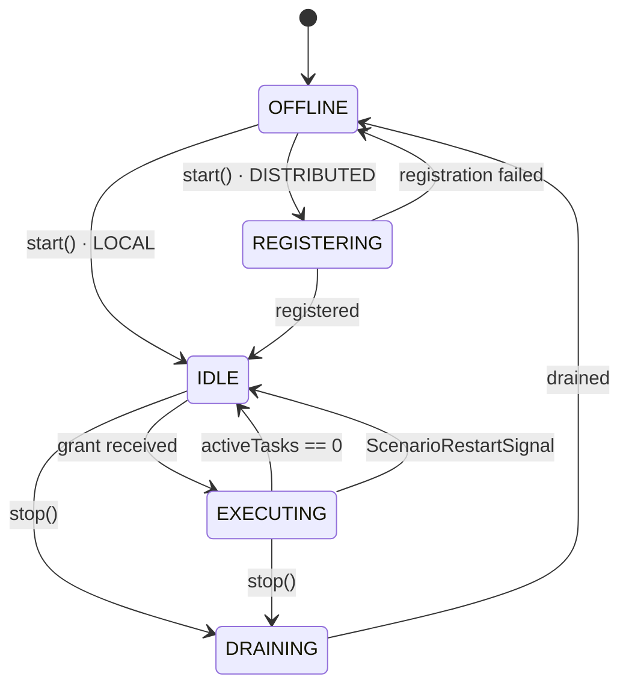
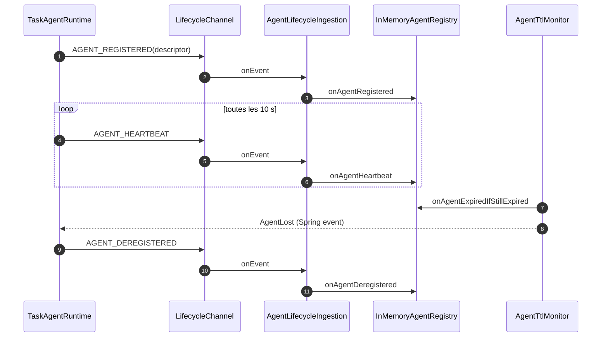

# Spec 04 — Agent Runtime

**Module** : `platform-agent-runtime`
**Dépend de** : `platform-domain`, `platform-use-cases`, `platform-transport`,
`platform-plugin-api`

---

## 1. Objectif

Un agent est une instance JVM qui :
1. se connecte au transport ;
2. en DISTRIBUTED, s'enregistre et envoie un heartbeat ;
3. reçoit les `TaskExecutionRequest` en broadcast ;
4. filtre localement selon ses `supportedTaskNames` ;
5. **revendique** la tâche puis attend le **grant** de l'orchestrateur (ADR-055) ;
6. exécute les tâches (action ou service) et publie progression et résultat ;
7. libère ses ressources stateful sur signal de restart ;
8. draine ses tâches à l'arrêt.

Il existe **un seul runtime** (`TaskAgentRuntime`) pour LOCAL et DISTRIBUTED (ADR-037,
ADR-059). En LOCAL, ce runtime est un agent embarqué, démarré par la racine de
composition, qui reçoit ses messages du transport en mémoire.
La différence est portée par `AgentRegistrationPort` :
- `registrationPort == null` → LOCAL : pas de REGISTERING, pas de heartbeat,
  pas de deregister ;
- `registrationPort != null` → DISTRIBUTED : enregistrement, heartbeat, deregister.

Un agent n'exécute **jamais** une tâche sur simple réception du broadcast : il doit
d'abord avoir reçu un `TaskGrantSignal` accordé (ADR-055).

> **Aucune surface d'accès en mode AGENT (ADR-019).** La JVM démarre avec
> `WebApplicationType.NONE` : ni API REST, ni IHM, ni CLI, pas de Tomcat. L'agent est un
> pur worker piloté par le transport. Le récepteur HTTP de callbacks
> (`HttpEventCallbackController`, actif seulement si `transport.type=HTTP`) est un canal
> interne du transport, pas une surface d'accès.

---

## 2. Cycle de vie



Règles :
- `start()` est idempotent : deuxième appel ignoré avec WARN.
- `stop()` est idempotent ; il passe en DRAINING, attend les tâches actives
  (timeout = 2 × `taskExecutionTimeout`), annule le reste, arrête le heartbeat,
  se désenregistre, se déconnecte puis passe OFFLINE.
- Un agent OFFLINE ou DRAINING ignore les nouvelles tâches et les nouveaux grants.

---

## 3. Interfaces

```java
public interface AgentRuntime {
    void start();
    void stop();
    AgentState getState();
    AgentDescriptor getDescriptor();
    boolean canExecute(String taskName);
    void onScenarioRestart(ScenarioRestartSignal signal);
    void onLifecycleSignal(ExecutionLifecycleSignal signal);
}

public interface AgentRegistrationPort {
    void register(AgentDescriptor descriptor) throws RegistrationException;
    void deregister(AgentId agentId);
    void sendHeartbeat(AgentId agentId, AgentHeartbeat heartbeat);
}

// Côté orchestrateur
public interface AgentRegistry extends AgentRegistryPort { }   // marqueur, impl. InMemoryAgentRegistry

public interface AgentRegistryPort {
    void onAgentRegistered(AgentDescriptor descriptor);
    void onAgentHeartbeat(AgentId agentId, AgentHeartbeat heartbeat);
    void onAgentExpired(AgentId agentId);
    void onAgentDeregistered(AgentId agentId);
    List<AgentDescriptor> findByTaskName(String taskName);
    boolean hasAgentFor(String taskName);
    Optional<AgentDescriptor> findById(AgentId agentId);
    List<AgentDescriptor> findAll();
}
```

`TaskAgentRuntime` collabore avec :
- `TaskChannel`, `SignalChannel`, `EventChannel`, `ConnectionLifecycle` (ports étroits,
  ADR-028) ;
- `TaskSpecializationFilter` ;
- `TaskExecutionPipeline` ;
- `ScenarioRestartHandler` ;
- `DefaultLifecycleSignalHandler` ;
- optionnellement `HeartbeatScheduler` + `AgentRegistrationPort`.

---

## 4. AgentDescriptor

```java
public record AgentDescriptor(
    AgentId id,
    String name,
    String host,
    int port,
    String httpCallbackUrl,          // nullable si transport != HTTP
    Set<String> supportedTaskNames,  // ADR-015 : depuis agent.supported-tasks (DISTRIBUTED)
    AgentCapabilities capabilities,
    AgentState state,
    Instant registeredAt,
    Instant lastHeartbeatAt,
    Duration registrationTtl        // >= 3 × heartbeat interval
) {}

public record AgentCapabilities(int maxConcurrentTasks, String version) {}
public record AgentHeartbeat(AgentId agentId, AgentState state, int activeTasks, Instant sentAt) {}
```

En LOCAL, le descripteur est construit avec **tous** les `TaskExecutor` du contexte et
l'identité `local-agent`. En DISTRIBUTED, `supportedTaskNames` est dérivé
exclusivement de `agent.supported-tasks` (surchargeable par `AGENT_SUPPORTED_TASKS`).

---

## 5. Spécialisation (`TaskSpecializationFilter`)

```java
public interface TaskSpecializationFilter {
    TaskFilterResult filter(TaskExecutionRequest request);
    boolean canExecute(String taskName);
}

public sealed interface TaskFilterResult
        permits TaskFilterResult.Responsible, TaskFilterResult.NotResponsible {
    record Responsible(MessageId messageId, AgentId agentId) implements TaskFilterResult {}
    record NotResponsible(MessageId messageId, AgentId agentId) implements TaskFilterResult {}
}
```

`DefaultTaskSpecializationFilter` :
- `Responsible` si `request.step().taskName()` ∈ `supportedTaskNames` ;
- `NotResponsible` sinon (log DEBUG, aucun appel réseau) ;
- décision purement locale, aucun agentTags, aucune coordination (ADR-015).

Le runtime vérifie en plus l'idempotence via `MessageId` : un message déjà traité est
ignoré. Le set `processedMessageIds` est purgé au-delà de 10 000 entrées.

---

## 6. Pipeline d'exécution

### 6.1 Réception, claim et grant (ADR-055)

`TaskAgentRuntime.onTaskReceived(request)` :
1. ignore le message si l'agent est OFFLINE ou DRAINING ;
2. `TaskSpecializationFilter` : `NotResponsible` → ignoré, aucun appel réseau ;
   2bis. refus de claim : si l'executor implémente `ExecutorAvailability` et
   `canAcceptNewTask() == false` (ex. `injection.worker.max-concurrent` atteint, ADR-066),
   l'agent ne claim pas ; un autre agent peut prendre l'étape ;
3. idempotence : un `MessageId` déjà traité est ignoré ;
4. publie `TASK_CLAIMED` (`TaskClaimedByAgent`) et mémorise la requête en attente ;
5. planifie l'expiration du claim (nettoyage mémoire si aucun grant n'arrive) ;
6. **n'exécute rien** tant que `TaskGrantSignal` n'est pas reçu.

`onGrantReceived(grant)` :
- ignore le grant destiné à un autre agent ;
- `granted == false` (`fanOut: one`, un autre agent a été accordé) → le claim est
  abandonné, aucune exécution ;
- `granted == true` → `IDLE → EXECUTING`, soumission du pipeline ; la part reçue
  (`GrantShare(index, count, fraction)`, ADR-067) est exposée à l'executor comme attribut
  en lecture seule de l'`ExecutionContext`.

Le `TaskGrantSignal` circule sur le `SignalChannel` et porte
`(executionId, taskId, messageId, agentId, granted, share)`. `fanOut: one` →
`GrantShare(0, 1, 1.0)` ; `fanOut: all` → agents triés par `AgentId`, fractions `1/count`.

### 6.2 Exécution

`TaskExecutionPipeline.execute(request)` :
1. planifie la publication périodique de `TaskWorkInProgress`
   (intervalle = `taskExecutionTimeout / 3`, minimum 1 s) ;
2. résout le `TaskExecutor` par `step.taskName()` ; absent → `TaskResult.failed`
   publié immédiatement ;
3. convertit le `PartialExecutionContext` en `ExecutionContext` local (les outputs
   nommés sont exposés tels quels ; les anciens payloads bruts restent supportés) ;
4. exécute sur un Virtual Thread :
   - action step → `executor.execute(context, step)` ;
   - service step → `ServiceTaskExecutor.executeService(context, step, control)`,
     qui démarre le service et bloque jusqu'au STOP (ADR-054) ;
5. publie `TASK_COMPLETED` (succès) ou `TASK_FAILED` (échec) avec payload :
   `taskName`, `taskId`, `status`, `durationMs`, `outputs` (succès), `error` (échec) ;
6. en `finally` : arrête la progression, retire la tâche active, décrémente le compteur
   et repasse `EXECUTING → IDLE` si plus aucune tâche active.

Le claim `TASK_CLAIMED` est publié à la réception, avant tout grant.

### 6.3 Service steps et STOP (ADR-054)

- Un exécuteur qui ne déclare pas `ServiceTaskExecutor` ne peut pas servir une service
  step : le pipeline publie un `TASK_FAILED` explicite.
- Le pipeline enregistre le `ServiceControl` vivant par `executionId::taskId` ;
  `stopService(executionId, taskId)` demande l'arrêt.
- Un `ExecutionLifecycleSignal` STOP reçu sur le `SignalChannel` est traité par le
  pipeline (arrêt du service) puis transmis au `LifecycleSignalHandler` pour les
  assertions.
- Le `TaskResult` d'une service step est publié **au STOP**, sous l'id de l'étape ; les
  assertions le lisent via `ref`. Le service n'a pas besoin de rester vivant pendant la
  phase ASSERTION.
- L'agent conserve l'état du service entre START et STOP ; la perte de l'agent fait
  échouer l'étape (ADR-033).

---

## 7. Enregistrement, heartbeat, TTL (DISTRIBUTED)

Côté agent (`TransportAgentRegistration`, `LifecycleChannel`) :
- `register` → `AgentLifecycleEvent(type=AGENT_REGISTERED, payload=AgentDescriptor)`
  (codec typé `AgentLifecyclePayloadCodec`) ;
- `sendHeartbeat` → `AGENT_HEARTBEAT` : après un `register` réussi, le payload
  inclut aussi le descripteur enregistré. L'état et `lastHeartbeatAt` sont
  actualisés avec le heartbeat courant ;
- `deregister` → `AGENT_DEREGISTERED`.

`HeartbeatScheduler` :
- premier heartbeat immédiat puis toutes les `intervalSeconds` (10 s dans le bean
  distribué) ;
- `registrationTtlSeconds = 3 × intervalSeconds` ;
- l'état et le nombre de tâches actives sont fournis à chaque heartbeat.

Côté orchestrateur (`AgentRegistryConfiguration`, actif DISTRIBUTED + ORCHESTRATOR) :
- `InMemoryAgentRegistry` (bean unique satisfaisant `AgentRegistry` et
  `AgentRegistryPort`) ;
- `AgentLifecycleIngestion` s'abonne au `LifecycleChannel` et alimente le registre
  (`registered`, `heartbeat`, `deregistered`, `lost`) ;
- après un redémarrage de l'orchestrateur ou une expiration TTL, un heartbeat
  auto-descriptif réinscrit un agent inconnu sans redémarrer les agents ni relire
  les anciens événements Kafka. Un ancien heartbeat sans descripteur met
  uniquement à jour un agent déjà connu ; sinon il est ignoré avec un warning ;
- `AgentTtlMonitor` vérifie périodiquement les TTL expirés
  (`agent.registry.ttl-check-interval-seconds`, défaut 10 s) et publie `AgentLost` ;
- `AgentLost` déclenche le fast-fail des steps en cours (ADR-033).



Sans `AgentLifecycleIngestion`, le registre resterait vide et l'orchestrateur ne pourrait
dispatcher aucune tâche.

---

## 8. Claim, grant et fan-out (ADR-055)

Plusieurs agents peuvent être spécialisés pour la même tâche. L'agent revendique, puis
n'exécute qu'après un grant accordé par l'orchestrateur unique (ADR-058) :

| `fanOut` | Comportement |
|---|---|
| `one` (défaut) | l'orchestrateur accorde le premier claim et rejette les suivants ; les agents rejetés n'exécutent pas |
| `all` | tous les claims reçus pendant la fenêtre de claim (`execution.claim-window`) sont accordés ; l'étape se termine quand tous les agents accordés ont répondu ou expiré |

- Chaque agent publie `TaskClaimedByAgent` puis son propre `TaskCompleted`/`TaskFailed`.
- `TaskCorrelationTracker` enregistre claims, grants, résultats et échecs.
- `completion-policy` et `result-selection-policy` sont supprimés : `fanOut` est le seul
  paramètre, et il est déclaré par étape.
- Le même `TaskId` peut avoir plusieurs `TaskResult` persistés, un par agent accordé
  (`fanOut: all`).

---

## 9. Restart (`ScenarioRestartSignal`)

```java
public record ScenarioRestartSignal(
    SignalId id,
    ExecutionId executionId,   // null = toutes les exécutions
    String reason,             // ex. "ORCHESTRATOR_RESTART"
    Instant issuedAt
) {}
```

`ScenarioRestartHandler` :
1. appelle `StatefulResourceCleaner.cleanup(executionId)` sur chaque cleaner
   (best-effort ; une erreur n'empêche pas les autres) ;
2. annule les futures actifs correspondant à l'`executionId` (ou tous si null) ;
3. repasse l'agent à IDLE si plus aucune tâche active.

Ressources stateful typiques :

| Exécuteur | Ressources |
|---|---|
| `gatling` | simulation en cours, connexions |
| `mock-server` | WireMock embarqué, mappings |
| `kafka-consumer` / `kafka-producer` | consumer/producer, offsets, flush |
| `database` | connexions, transactions |
| `docker` | containers démarrés par l'exécution |
| `shell` | processus fils |

Il n'y a **pas** de reprise : le scénario repart de zéro après restart.

---

## 10. Signaux de cycle de vie START/STOP

`DefaultLifecycleSignalHandler` reçoit `ExecutionLifecycleSignal` :
- START : prépare l'exécution de l'assertion ;
- STOP : termine l'exécution de l'assertion, produit l'`AssertionSummary` final et publie
  `TaskCompleted`.

Les signaux concernant une tâche non supportée sont ignorés (log DEBUG).
Tous les signaux passent par le `SignalChannel` (broadcast) :
`TransportLifecycleDispatcher` est la seule implémentation, en LOCAL comme en DISTRIBUTED
(ADR-059). En LOCAL, le transport en mémoire livre le signal sur un Virtual Thread.

Un STOP de service step est d'abord traité par `TaskExecutionPipeline` (arrêt du service,
publication du résultat) puis transmis au handler de cycle de vie (ADR-054).

---

## 11. Configuration

```yaml
agent:
  supported-tasks:            # DISTRIBUTED uniquement — source UNIQUE (ADR-015)
    - database
    - mock-server
    - kafka-producer
    - gatling
    - direct-assertion
  registry:
    ttl-check-interval-seconds: 10   # orchestrateur
```

| Propriété | Défaut | Portée |
|---|---|---|
| `agent.supported-tasks` | `[]` (agent idle avec WARN) | agent DISTRIBUTED |
| `AGENT_SUPPORTED_TASKS` (env) | — | surcharge la liste (binding Spring) |
| `agent.registry.ttl-check-interval-seconds` | 10 s | orchestrateur |
| heartbeat interval | 10 s (bean distribué) | agent |
| registration TTL | 3 × heartbeat | calculé |
| `taskExecutionTimeout` | 5 min (bean distribué) | agent |

En LOCAL, `agent.supported-tasks` est ignoré : tous les exécuteurs du contexte sont
supportés. `AGENT_TAGS` n'existe plus (ADR-015).

---

## 12. Reconnexion et perte d'agent

1. TTL expiré sans heartbeat → `AgentTtlMonitor` → `AgentLost`.
2. L'orchestrateur invalide les claims de l'agent (`tracker.onAgentLost`).
3. Les steps en cours échouent immédiatement (fast-fail) au lieu d'attendre le timeout.
4. L'agent peut se ré-enregistrer après redémarrage ; il repasse IDLE.
5. Aucune reprise de l'exécution interrompue côté orchestrateur.
