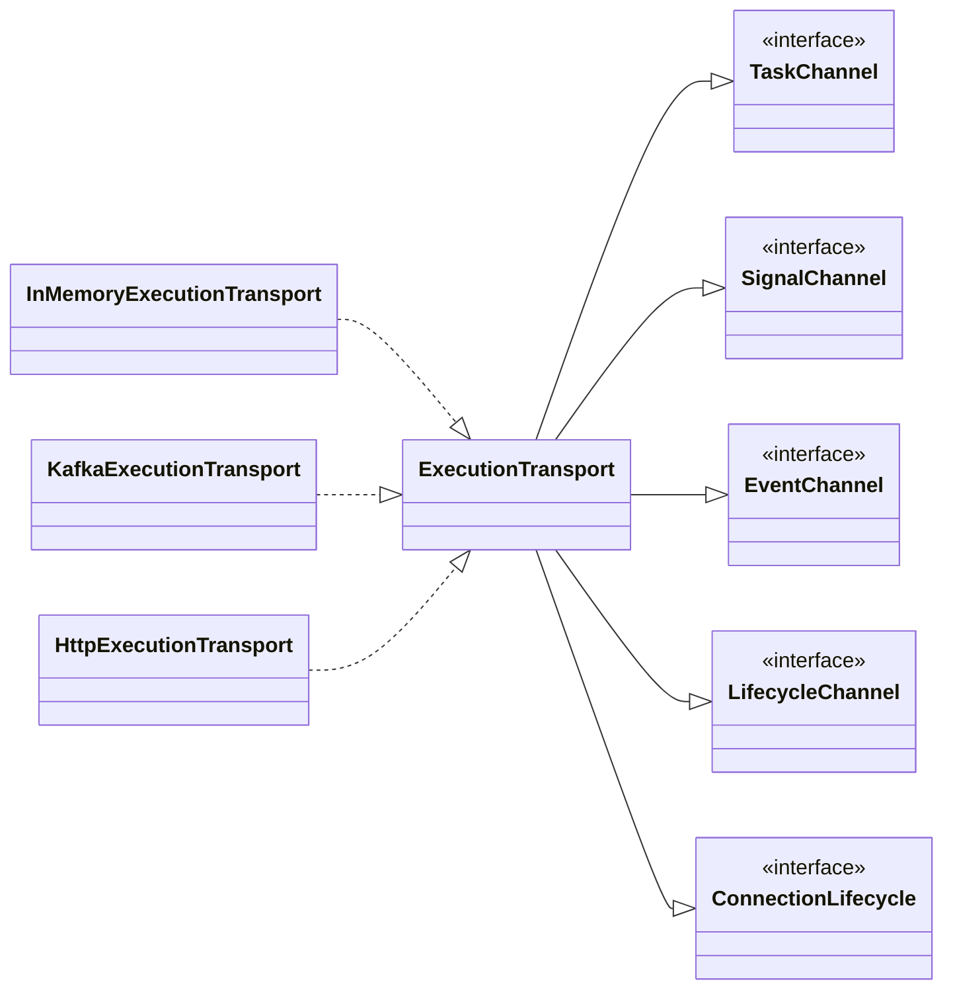
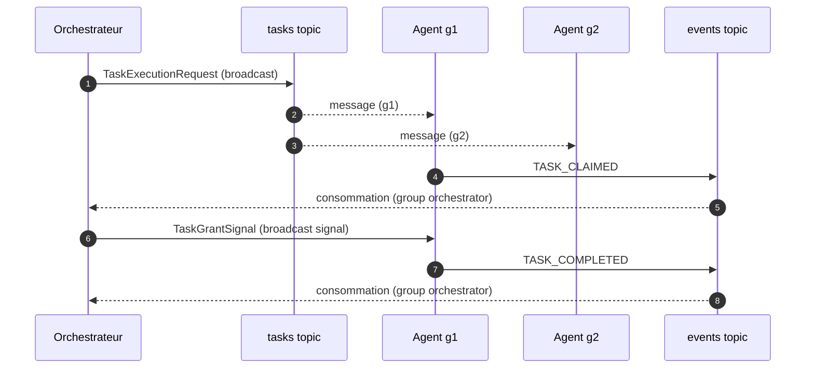

# Spec 05 — Transport Layer

**Module** : `platform-transport`
**Dépend de** : `platform-domain`

---

## 1. Objectif

TLS optionnel pour le transport HTTP et Kafka : voir
[ADR-047](../adr/ADR-047-optional-transport-mtls-and-independent-web-tls.md) et le
[guide de configuration TLS](../../../distribution/example/tls/README.md).
`transport.tls.enabled=false` par defaut. Le bundle Spring Boot de transport est
independant de `server.ssl.bundle` (UI/API HTTPS sans certificat client).
HTTP utilise un listener dedie, y compris en AGENT sans serveur servlet.
Les clients visant le SUT ne sont pas modifies.

Transports supportés par le build cœur (ADR-056) : **`IN_MEMORY`, `HTTP`, `KAFKA`**.
RabbitMQ et le transport socket ont été retirés ; ils peuvent être fournis comme
plugins externes via `CUSTOM`.

Abstraire le mécanisme de communication entre orchestrateur et agents. Changer de
transport = changer `transport.type` ; aucun changement de code métier.

Modèle de communication : **broadcast + filtre côté agent**. L'orchestrateur publie une
`TaskExecutionRequest` sans ciblage ; chaque agent décide localement s'il est concerné
(`TaskSpecializationFilter`, spec 04).

Depuis ADR-028, `ExecutionTransport` n'est plus une interface monolithique : c'est une
**façade composite de migration** qui étend cinq ports étroits. Les consommateurs
dépendent du port dont ils ont besoin (ISP), et `getType()` a été supprimé (aucun
`if/switch` sur le type — CF-03).

---

## 2. Ports

```java
public interface TaskChannel {
    void dispatchTask(TaskExecutionRequest request);   // orchestrateur → agents (broadcast)
    void receiveTask(TaskRequestHandler handler);      // côté agent
}

public interface SignalChannel {
    void broadcastSignal(AgentSignal signal);          // restart, START/STOP, grants
    void receiveSignal(AgentSignalHandler handler);    // côté agent
}

public interface EventChannel {
    void publishEvent(ExecutionEvent event);           // agents → orchestrateur
    Subscription subscribe(ExecutionEventHandler handler);
}

public interface LifecycleChannel {
    void publishAgentEvent(AgentLifecycleEvent event); // registration/heartbeat/lost
    Subscription subscribeAgentEvents(AgentLifecycleEventHandler handler);
}

public interface ConnectionLifecycle {
    void connect() throws TransportException;
    void disconnect();
    boolean isConnected();
}

// Façade conservée pour les beans Spring et TransportConfiguration
public interface ExecutionTransport
        extends TaskChannel, SignalChannel, EventChannel, LifecycleChannel, ConnectionLifecycle {}
```

Handlers :

```java
@FunctionalInterface public interface TaskRequestHandler { void onRequest(TaskExecutionRequest r); }
@FunctionalInterface public interface AgentSignalHandler { void onSignal(AgentSignal s); }
@FunctionalInterface public interface ExecutionEventHandler { void onEvent(ExecutionEvent e); }
@FunctionalInterface public interface AgentLifecycleEventHandler { void onEvent(AgentLifecycleEvent e); }
```



Consommateurs et ports utilisés :

| Consommateur | Port |
|---|---|
| `TransportStepDispatcher` | `TaskChannel` + `SignalChannel` (grants, STOP de service) |
| `TransportLifecycleDispatcher` | `SignalChannel` |
| `TaskExecutionPipeline` | `EventChannel` |
| `TransportExecutionEventHandler` | `EventChannel` + `SignalChannel` (grants) |
| `TransportAgentRegistration` | `LifecycleChannel` |
| `AgentLifecycleIngestion` | `LifecycleChannel` |
| `TaskAgentRuntime` | `TaskChannel` + `SignalChannel` + `EventChannel` + `ConnectionLifecycle` |

---

## 3. Messages et événements

### 3.1 TaskExecutionRequest (remplace TaskMessage)

```java
public record TaskExecutionRequest(
    MessageId id,                       // clé d'idempotence côté agent
    ExecutionId executionId,
    StepDefinition step,                // taskName, phase, parameters, timeout, retryPolicy
    PartialExecutionContext context,    // uniquement step.resolvedRequiredContexts()
    Instant dispatchedAt,
    RetryPolicy retryPolicy
) {}
```

- **Pas de `targetAgentId`** : la sélection appartient aux agents.
- L'étape porte son `fanOut` (`one`/`all`) et son `during` éventuel : l'agent sait s'il
  doit exécuter une action ou maintenir un service (ADR-054/ADR-055).
- Le payload du contexte peut être volumineux (résultats Gatling) ; surveiller la taille
  si de nombreux `requiredContexts` sont déclarés.

### 3.2 ExecutionEvent (agents → orchestrateur)

```java
public record ExecutionEvent(
    EventId id,
    ExecutionId executionId,
    MessageId correlationId,       // MessageId de la TaskExecutionRequest
    AgentId agentId,
    String eventType,
    Map<String, Object> payload,   // copie défensive immuable
    Instant occurredAt
) {
    public static final String TASK_CLAIMED          = "TaskClaimedByAgent";
    public static final String TASK_WORK_IN_PROGRESS = "TaskWorkInProgress";
    public static final String TASK_COMPLETED        = "TaskCompleted";
    public static final String TASK_FAILED           = "TaskFailed";
}
```

Types de payload :
- `TASK_CLAIMED` : `taskName`, `agentId` ;
- `TASK_WORK_IN_PROGRESS` : `taskId`, `agentId`, `messageId` ;
- `TASK_COMPLETED` : `taskName`, `taskId`, `status`, `durationMs`, `outputs` ;
- `TASK_FAILED` : `taskName`, `taskId`, `status`, `durationMs`, `error`.

### 3.3 AgentLifecycleEvent (canal séparé, ADR-012)

```java
public record AgentLifecycleEvent(
    EventId id,
    AgentId agentId,
    String eventType,              // AGENT_REGISTERED | AGENT_HEARTBEAT |
                                   // AGENT_DEREGISTERED | AGENT_LOST
    Map<String, Object> payload,   // AgentDescriptor ou AgentHeartbeat (codec typé)
    Instant occurredAt
) {}
```

Séparé du canal d'exécution : pas d'`ExecutionId`, pas de pollution du tracker de
corrélation.

### 3.4 AgentSignal

```java
public sealed interface AgentSignal
        permits ScenarioRestartSignal, ExecutionLifecycleSignal, TaskGrantSignal {
    SignalId id();
    Instant issuedAt();
}
```

### 3.5 TaskGrantSignal (ADR-055)

```java
public record TaskGrantSignal(
    SignalId id,
    ExecutionId executionId,
    TaskId taskId,
    MessageId messageId,     // MessageId de la TaskExecutionRequest revendiquée
    AgentId agentId,         // agent destinataire du verdict
    boolean granted,         // true = exécuter ; false = claim rejeté
    Instant issuedAt,
    GrantShare share         // part de charge (ADR-067) ; GrantShare.single() par défaut
) implements AgentSignal {}

public record GrantShare(int index, int count, double fraction) {}
// index : position 0-based de l'agent parmi les agents accordés ; count : nombre d'agents accordés
// fraction : part du tout ; somme = 1.0. L'orchestrateur ne calcule rien d'autre (ADR-045).
```

Réponse de l'orchestrateur au claim d'un agent. Chaque agent ne retient que le grant qui
le concerne ; un agent sans grant n'exécute pas. Ce signal réutilise le `SignalChannel`
existant (aucun nouveau port).

### 3.6 PartialExecutionContext

```java
public record PartialExecutionContext(
    ExecutionId executionId,
    ScenarioId scenarioId,
    Map<String, Map<String, Object>> store   // taskId → agentId → outputs nommés
) {
    <T> Optional<T> getOutput(String taskId, String agentId, String outputName, Class<T> type);
    <T> Optional<T> getFirstOutput(String taskId, String outputName, Class<T> type);
    <T> Optional<T> get(String taskId, String agentId, Class<T> type);   // historique
    <T> Optional<T> getFirst(String taskId, Class<T> type);              // historique
}
```

Les messages récents transportent la map complète des outputs ; les anciens messages à
valeur brute restent lisibles via les accesseurs historiques.

---

## 4. Implémentations

### 4.1 InMemory (LOCAL, tests)

- Sélection : `transport.type` absent ou `IN_MEMORY` (`matchIfMissing = true`).
- **Livraison asynchrone** (ADR-059) : `dispatchTask` et `broadcastSignal` remettent le
  message sur un Virtual Thread ; `publishEvent` utilise un dispatcher dédié. La
  livraison ne se fait **jamais** sur le thread de l'émetteur.
- Aucun broker, aucun serveur. Utilisé par LOCAL et par les tests.

### 4.2 Kafka

```yaml
transport:
  type: KAFKA
  kafka:
    bootstrap-servers: ${KAFKA_BOOTSTRAP_SERVERS:localhost:9092}
    tasks-topic: platform-tasks
    events-topic: platform-events
    signals-topic: platform-signals
    producer-acks: all
    consumer-group: ${AGENT_ID:agent}-${random.uuid}   # agent ; "orchestrator" côté orchestrateur
```

- Producer : `KafkaTemplate<String, byte[]>` qualifié `transportKafkaTemplate`.
- Consumer : `DynamicKafkaListenerRegistry` crée un `KafkaMessageListenerContainer` par
  agent et par type de flux (tasks, signals, events exécution, events lifecycle).
- `AckMode.RECORD`, `auto.offset.reset=earliest`, `enable.auto.commit=false`.
- **ADR-009** : chaque agent a un consumer group unique, sinon Kafka distribuerait les
  messages entre agents au lieu de les broadcaster.
- Topics : tasks (orchestrateur → tous les agents), signals (orchestrateur → agents),
  events (agents → orchestrateur, groupe `orchestrator`).
- Beans qualifiés `transport*` pour éviter les collisions avec les clusters métier
  (`platform.kafka-clusters.*`) et l'auto-configuration `spring.kafka.*`.



### 4.3 HTTP

```yaml
transport:
  type: HTTP
  http:
    broadcast-mode: ALL_CAPABLE        # ALL_CAPABLE | FIRST_AVAILABLE
    request-timeout-seconds: 30
    task-availability-timeout-seconds: 120
    callback-base-path: /api/v1/events
```

- L'orchestrateur POST les `TaskExecutionRequest` aux agents capables via leur
  `httpCallbackUrl` ; l'agent répond `202 Accepted`.
- Les agents remontent leurs événements en POST sur `/api/v1/events`
  (`HttpEventCallbackController`), qui les republie dans le transport local.
- Le grant (`TaskGrantSignal`) et les signaux de cycle de vie passent par le même canal
  de callbacks.
- `broadcast-mode` contrôle la diffusion de la requête (`ALL_CAPABLE` par défaut,
  `FIRST_AVAILABLE` pour un seul destinataire) ; le nombre d'agents qui **exécutent** est
  décidé par `fanOut` et le grant (ADR-055).
- Appels bloquants exécutés sur Virtual Threads (client JDK `HttpClient`).

> **Limite actuelle** : le code fournit l'envoi sortant et le contrôleur de callbacks
> d'événements (`POST /api/v1/events`), mais **aucun endpoint entrant de tâches**
> (`TaskExecutionRequest`) n'est exposé par la plateforme. Un agent HTTP nécessiterait
> un récepteur externe. De plus, un nœud AGENT démarre sans serveur web (ADR-019), donc
> `HttpEventCallbackController` n'y est pas actif. Le transport HTTP est utilisable pour
> le dispatch orchestrateur → système externe et les callbacks, pas comme canal complet
> orchestrateur ↔ agent plateforme en l'état.

### 4.4 CUSTOM

`transport.type=CUSTOM` est un point d'extension : le transport est fourni comme JAR
externe (RabbitMQ, socket ou tout autre protocole), avec un bean
`@ConditionalOnProperty(transport.type=CUSTOM)`. Aucune implémentation n'est fournie
dans le build cœur et aucun chargement dynamique par nom de classe n'a lieu.

---

## 5. Sélection par configuration

```java
@Configuration
@EnableConfigurationProperties({
    KafkaTransportProperties.class, HttpTransportProperties.class,
    HttpListenerProperties.class})
public class TransportConfiguration {

    @Bean @ConditionalOnProperty(name="transport.type", havingValue="IN_MEMORY", matchIfMissing=true)
    InMemoryExecutionTransport inMemoryExecutionTransport() { ... }

    @Bean @ConditionalOnProperty(name="transport.type", havingValue="HTTP")
    ExecutionTransport httpExecutionTransport(HttpTransportProperties props,
                                               ObjectProvider<AgentRegistryPort> registry, ...) { ... }

    // transport.type=CUSTOM : bean fourni par un plugin (RabbitMQ, socket, ...)
}
```

Kafka est configuré dans `KafkaTransportBeans`, conditionnel à `transport.type=KAFKA`.

Priorité de configuration (ADR-006) : `TRANSPORT_TYPE` env > `--transport.type=` >
`transport.type` property > défaut `IN_MEMORY`.

---

## 6. Garanties de livraison

| Transport | Modèle | At-least-once | Ordre | Idempotence agent |
|---|---|---|---|---|
| IN_MEMORY | livraison asynchrone, même JVM | oui | par handler | requise (`MessageId`) |
| KAFKA | broadcast par consumer group | oui (offsets) | par partition | requise (`MessageId`) |
| HTTP | POST + timeouts | via retry orchestrateur | non garanti | requise |

Clé d'idempotence : `TaskExecutionRequest.id`. Un agent ne ré-exécute jamais un
`MessageId` déjà traité.

---

## 7. Enregistrement des agents

Le décodage des signaux (Kafka, HTTP) distingue les trois sous-types de `AgentSignal` :
`ExecutionLifecycleSignal` (`action`/`taskId`, START ou STOP), `ScenarioRestartSignal`
(`reason`) et `TaskGrantSignal` (`messageId`, `agentId`, `granted`). Le décodage conserve
le format existant, y compris les messages déjà en file ; aucun champ `reason`
artificiel n'est ajouté aux signaux START/STOP. Les payloads invalides ou ambigus sont
rejetés.

L'enregistrement passe par le **canal lifecycle** (ADR-012), pas par le canal exécution :

```
Agent démarre
  → connection.connect()
  → LifecycleChannel.publishAgentEvent(AGENT_REGISTERED, AgentDescriptor)
  → orchestrateur : AgentLifecycleIngestion → AgentRegistry.onAgentRegistered

Heartbeat (toutes les 10 s)
  → LifecycleChannel.publishAgentEvent(AGENT_HEARTBEAT, AgentHeartbeat)
  → AgentRegistry.onAgentHeartbeat → refresh TTL

Arrêt graceful
  → LifecycleChannel.publishAgentEvent(AGENT_DEREGISTERED)
  → AgentRegistry.onAgentDeregistered

TTL expiré
  → AgentTtlMonitor publie AgentLost
  → tracker invalide les claims → fast-fail des steps en cours
```

L'orchestrateur ne peut dispatcher que si `AgentLifecycleIngestion` est actif
(DISTRIBUTED + ORCHESTRATOR). Sans lui, le registre reste vide.
