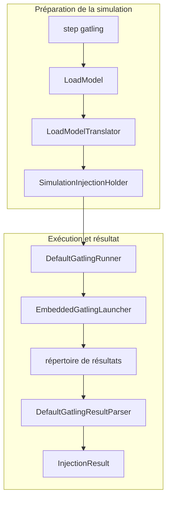

# Spec 06 — Injection Gatling

**Module** : `platform-injection-gatling`  
**Dépend de** : `platform-domain`, `platform-use-cases`

---

## 1. Objectif

Exécuter des simulations Gatling depuis la plateforme, collecter les métriques
et retourner un `InjectionResult` complet dans l'`ExecutionContext`.

**DSL Gatling utilisé : Java DSL uniquement (pas Scala).**

---

## 2. GatlingTaskExecutor

```java
@Injection(name = "gatling", description = "Gatling load injection")
public class GatlingTaskExecutor implements TaskExecutor {

    @Override
    public String getSupportedTaskName() { return "gatling"; }

    @Override
    public TaskResult execute(ExecutionContext context, StepDefinition step) {
        // 1. Extraire les paramètres depuis step.parameters()
        // 2. Résoudre le LoadModel depuis step.parameters().get("loadModel")
        // 3. Configurer la simulation Gatling
        // 4. Lancer via GatlingRunner
        // 5. Parser les résultats
        // 6. Retourner TaskResult avec InjectionResult dans outputs
        //    L'orchestrateur mergera dans context[step.id()][agentId]
    }
}
```

### 2.1 Injection HTTP générique (sans `simulation`)

Quand `simulation` est absent, l'executor détecte une injection HTTP et crée la simulation dynamiquement (aucune classe utilisateur à déclarer) :

1. `HttpRequestSpecFactory` construit un `HttpRequestSpec` depuis les paramètres du step (`target` via le port `EndpointResolver`, ou `baseUrl` ; `method`, `path` logique, `pathParams`, `queryParams`, `headers` fusionnés avec `defaultHeaders` de la cible, `body`, `contentType`, `expectedStatus`) et le valide par un rendu à blanc.
2. Le spec est publié dans `HttpRequestSpecHolder` (clé = `simulationId`), retiré en `finally`.
3. `GatlingRunConfig.simulationClass` = `HttpScenarioSimulation` (instanciée par Gatling) : protocole `baseUrl`, un `exec` qui rend la requête via `HttpRequestRenderer` (`{index}` = compteur global 1-based, identique pour path/query/headers/body d'une même requête), puis la requête HTTP, injectée avec les `OpenInjectionStep` du `LoadModel`.

`simulation: <classe>` reste supporté pour une simulation personnalisée ; les paramètres HTTP sont alors ignorés. Placeholders : voir spec 03 (ADR-039).

---

## 3. GatlingRunner

```java
public interface GatlingRunner {
    /**
     * Lance une simulation Gatling en-process.
     * Retourne le chemin du répertoire de résultats.
     */
    Path run(GatlingRunConfig config) throws GatlingExecutionException;
}

public record GatlingRunConfig(
    String simulationClass,          // nom qualifié de la classe
    LoadModel loadModel,
    Map<String, String> systemProperties,
    Path resultsDirectory,
    String simulationId,
    Duration timeout
) {}
```

---

## 4. LoadModel → Gatling OpenInjection

Chaque `LoadModelType` se traduit en OpenInjectionStep Gatling Java DSL :

```java
public interface LoadModelTranslator {
    List<OpenInjectionStep> translate(LoadModel model);
}

// Implémentations :

// RAMP → rampUsersPerSec(from).to(to).during(duration) par stage
// CONSTANT → constantUsersPerSec(n).during(duration)
// SPIKE → rampUsersPerSec(base).to(spike).during(spikeDuration)
// STAIR → stressPeakUsers(n).during(duration) ou stairs custom
// SOAK → constantUsersPerSec(n).during(duration) avec ramp initial
// BURST → Séquence de nothingFor() + atOnceUsers() répétée
// RAMP_UP_DOWN → rampUp + hold + rampDown
// CUSTOM → interpolation linéaire entre les points
```

---



## 5. InjectionResult

```java
public record InjectionResult(
    TaskId taskId,
    String simulationClass,
    Duration duration,
    long totalRequests,
    long successfulRequests,
    long failedRequests,
    double errorRate,               // en pourcentage : 0.0 - 100.0
    double throughput,              // requests/second
    long p50Ms,
    long p75Ms,
    long p90Ms,
    long p95Ms,
    long p99Ms,
    long maxMs,
    long minMs,
    double meanMs,
    Path gatlingReportDirectory,    // répertoire du rapport HTML Gatling
    Map<String, Object> rawStats    // stats brutes pour assertions custom
) {}
```

---

## 6. Stockage dans ExecutionContext

L'executor retourne l'`InjectionResult` dans `TaskResult.outputs` sous la clé `"result"`.
L'orchestrateur merge dans `context[step.id()][agentId]` après réception.

```java
// Dans GatlingTaskExecutor.execute() — retourner dans TaskResult.outputs
return TaskResult.success(
    TaskId.of(step.id().value()),
    getSupportedTaskName(),
    elapsed,
    Map.of("result", injectionResult)
);
// L'orchestrateur fait ensuite : context.with(step.id().value(), agentId, taskResult)
```

---

## 7. Protocoles Supportés

| Protocole | Support | Dépendance |
|---|---|---|
| HTTP/HTTPS | oui (`HttpProtocolBuilder`) | `gatling-http` |
| WebSocket | oui (`HttpProtocolBuilder`, ws) | `gatling-http` |
| Kafka | oui, natif : action Gatling `KafkaPublishAction` (`protocol: kafka`) via ports `MessageChannel`/`MessageChannelFactory` (adapter infra) | aucune nouvelle (pas de `gatling-kafka` en 3.11.x) |
| JMS | oui (`JmsProtocolBuilder`) | `gatling-jms` (optionnel) |
| gRPC | **exclu du périmètre** — aucune dépendance, aucun `TransportType.GRPC` | — |

La liste canonique est exposée par `ProtocolSupportInfo.SUPPORTED_PROTOCOLS`
(HTTP, HTTPS, WebSocket, Kafka, JMS) ; `gRPC` figure dans `EXCLUDED_PROTOCOLS`.
Sans `simulation`, le param `protocol` (`http` défaut | `kafka`) sélectionne un `InjectionProtocol` (SPI, beans Spring). Kafka : `cluster`, `topic` (logique, `platform.kafka-clusters.<c>.topics`), `key`, `headers`, `payload` dynamiques (ADR-039) ; cadence/durée via `loadModel`. Gatling ne dépend jamais de infra.

---

## 8. Exemple Simulation Java DSL Référence

```java
public class CustomerApiSimulation extends Simulation {

    private final HttpProtocolBuilder httpProtocol = http
        .baseUrl("http://customer-api:8080")
        .acceptHeader("application/json")
        .contentTypeHeader("application/json");

    private final ScenarioBuilder scn = scenario("Customer API")
        .exec(
            http("Create Customer")
                .post("/api/customers")
                .body(StringBody(session -> generateCustomerJson()))
                .check(status().is(201))
        );

    // La liste des OpenInjectionStep est injectée par GatlingTaskExecutor
    // via le mécanisme de configuration Gatling
    {
        setUp(scn.injectOpen(/* injecté dynamiquement */))
            .protocols(httpProtocol);
    }
}
```

---

## 9. Parsing des Résultats Gatling

Les résultats Gatling sont dans `simulation.log` (format interne) et dans le
répertoire `results/<simId>/`. Parser :

`DefaultGatlingRunner` utilise `-nr` : Gatling 3.11.2 écrit `simulation.log`,
**pas** `stats.json` ni rapport HTML. Le runner retourne l'unique nouveau
sous-répertoire contenant ce log (indépendamment de la casse du nom de classe),
en excluant les résultats déjà présents ; absence ou ambiguïté = erreur.

**Lancement embarqué / logging hôte** : `Gatling$.fromArgs` (3.11.2) est conçu
pour un process dédié — son `finally` invoque `stop()` sur l'`ILoggerFactory`
SLF4J, donc `LoggerContext.stop()`/`reset()` Logback : appenders de l'hôte
détachés, plus aucun log applicatif après la simulation (dernier log visible :
`CoordinatedShutdown ... ActorSystemTerminateReason`). Le runner utilise donc
`EmbeddedGatlingLauncher`, qui reproduit `Gatling.start` (mêmes args CLI,
`Runner`, terminaison ActorSystem/EventLoopGroup bornée par
`gatling.core.shutdownTimeout`, `RunResultProcessor`) sans arrêter le logging.
Ces classes `gatling-app` sont internes (comme `fromArgs`) : à revalider à
chaque montée de version Gatling (`DefaultGatlingRunnerLoggingTest`).

`DefaultGatlingResultParser` conserve la priorité et le comportement existants
de `js/stats.json`, puis `stats.json`. Sans JSON, il lit le log en streaming :

- `RUN` fournit la classe de simulation ; chaque `REQUEST` compte une fois,
  HTTP comme Kafka, avec statut OK/KO et latence `endTimestamp - startTimestamp`.
  Les enregistrements `GROUP`/`ERROR` ne sont pas des requêtes supplémentaires.
- Durée mesurée : du premier au dernier timestamp `USER`/`REQUEST` ;
  throughput = nombre total de requêtes / durée en secondes.
- Min/max/moyenne incluent OK et KO. p50/p75/p90/p95/p99 utilisent le rang
  supérieur (`ceil(N * percentile)`), calculé sur un histogramme de latences
  en millisecondes ; p90 est mesuré, pas interpolé dans ce mode.
- `rawStats` expose les compteurs, throughput et latences avec les mêmes clés
  globales que le JSON. Les enregistrements mesurés malformés, métadonnées RUN
  absentes, absence de requêtes ou durée non positive échouent explicitement :
  aucune métrique zéro de remplacement. Un JSON existant invalide reste une erreur.

La lecture s'appuie sur le format de `LogFileDataWriter` du Gatling déjà fourni,
sans dépendance supplémentaire ni génération de rapports via SPI.

```java
public interface GatlingResultParser {
    InjectionResult parse(Path gatlingResultDirectory, TaskId taskId) throws ResultParsingException;
}
```
