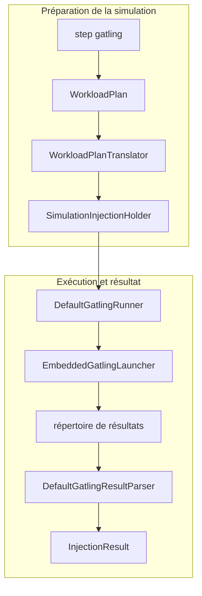

# Spec 06 — Injection Gatling

**Module** : `platform-injection-gatling`  
**Dépend de** : `platform-domain`, `platform-use-cases`

---

## 1. Objectif

Exécuter des simulations Gatling depuis la plateforme, collecter les métriques
et retourner un `InjectionResult` complet dans l'`ExecutionContext`.

**DSL Gatling utilisé : Java DSL uniquement (pas Scala).**

---

## 2. GatlingTaskExecutor

```java
@Injection(name = "gatling", description = "Gatling load injection")
public class GatlingTaskExecutor implements TaskExecutor {

    @Override
    public String getSupportedTaskName() { return "gatling"; }

    @Override
    public TaskResult execute(ExecutionContext context, StepDefinition step) {
        // 1. Extraire les paramètres depuis step.parameters()
        // 2. Décoder le plan inline : WorkloadPlanCodec.fromMap(parameters.workload)
        //    puis admission (PlanAdmission, ADR-065) et mise à l'échelle par la part (PlanScaler, ADR-067)
        // 3. Configurer la simulation Gatling
        // 4. Lancer via GatlingRunner
        // 5. Parser les résultats
        // 6. Retourner TaskResult avec InjectionResult dans outputs
        //    L'orchestrateur mergera dans context[step.id()][agentId]
    }
}
```

### 2.1 Injection HTTP générique (sans `simulation`)

Quand `simulation` est absent, l'executor détecte une injection HTTP et crée la simulation dynamiquement (aucune classe utilisateur à déclarer) :

1. `HttpRequestSpecFactory` construit un `HttpRequestSpec` depuis les paramètres du step (`target` via le port `EndpointResolver`, ou `baseUrl` ; `method`, `path` logique, `pathParams`, `queryParams`, `headers` fusionnés avec `defaultHeaders` de la cible, `body`, `contentType`, `expectedStatus`) et le valide par un rendu à blanc.
2. Le spec est publié dans `HttpRequestSpecHolder` (clé = `simulationId`), retiré en `finally`.
3. `GatlingRunConfig.simulationClass` = `HttpScenarioSimulation` (instanciée par Gatling) : protocole `baseUrl`, un `exec` qui rend la requête via `HttpRequestRenderer` (`{index}` = compteur global 1-based, identique pour path/query/headers/body d'une même requête), puis la requête HTTP, injectée avec les étapes Gatling issues du `WorkloadPlan` (§4). Avec `requests`, un `RequestMix` tire une requête par utilisateur virtuel selon `weight`, graine = hash du plan + `GrantShare.index` (ADR-070).

`simulation: <classe>` reste supporté pour une simulation personnalisée ; les paramètres HTTP sont alors ignorés. Placeholders : voir spec 03 (ADR-039).

---

## 3. GatlingRunner

```java
public interface GatlingRunner {
    /**
     * Lance une simulation Gatling (dans le worker isolé, §3.1).
     * Retourne le chemin du répertoire de résultats.
     */
    Path run(GatlingRunConfig config) throws GatlingExecutionException;
}

public record GatlingRunConfig(
    String simulationClass,          // nom qualifié de la classe
    WorkloadPlan plan,
    Map<String, String> systemProperties,
    Path resultsDirectory,
    String simulationId,
    Duration timeout
) {}
```

---

## 3.1 Worker isolé (ADR-066)

`GatlingTaskExecutor` ne lance pas Gatling dans la JVM de l'agent : il démarre une JVM fille
(`InjectionWorkerMain`) par étape d'injection et l'attend sur un Virtual Thread. LOCAL utilise
le même chemin (agent embarqué, ADR-059) : pas de repli en-process.

- Entrée : répertoire de run (plan résolu, `GrantShare`, spec de protocole, ressources
  nommées). Les secrets passent par l'environnement du worker, jamais par le répertoire.
- Sortie : répertoire de résultats Gatling + un fichier résultat (`InjectionResult`).
  Code de sortie ≠ 0 → `TaskResult.failed` avec la fin du log du worker.
- Annulation / timeout / `cleanup(executionId)` : `destroy()`, attente `stop-grace`, puis
  `destroyForcibly()` ; résultat `complete=false`. L'arrêt de l'agent tue ses workers.
- Concurrence : l'executor implémente `ExecutorAvailability` ; à `max-concurrent` il ne
  claim plus l'étape (spec 04 §6.1).

| Propriété | Variable d'env (prioritaire) | Défaut |
|---|---|---|
| `injection.worker.max-concurrent` | `INJECTION_WORKER_MAX_CONCURRENT` | `1` |
| `injection.worker.jvm-args` | `INJECTION_WORKER_JVM_ARGS` | vide |
| `injection.worker.stop-grace` | `INJECTION_WORKER_STOP_GRACE` | `10s` |
| `injection.max-arrival-rate` | `INJECTION_MAX_ARRIVAL_RATE` | aucune limite |
| `injection.max-concurrent-users` | `INJECTION_MAX_CONCURRENT_USERS` | aucune limite |
| `injection.window` | `INJECTION_WINDOW` | `5s` |

## 4. WorkloadPlan → Gatling

```java
public interface WorkloadPlanTranslator {
    List<OpenInjectionStep> toOpenSteps(WorkloadPlan plan);       // model: open
    List<ClosedInjectionStep> toClosedSteps(WorkloadPlan plan);   // model: closed
}
```

| Stage | Open | Closed |
|---|---|---|
| `ramp` | `rampUsersPerSec(from).to(to).during(d)` | `rampConcurrentUsers(from).to(to).during(d)` |
| `hold` | `constantUsersPerSec(level).during(d)` | `constantConcurrentUsers(level).during(d)` |
| `burst` | `atOnceUsers(users)` | rejeté |
| `pause` | `nothingFor(d)` | `nothingFor(d)` |

### 4.1 Capacités et admission (ADR-065)

`GatlingTaskExecutor` implémente `InjectionCapabilityProvider` et déclare une
`InjectionCapabilities(models, stageKinds, protocols, supportsGlobalScope,
supportsCancellation, providesHistogram, providesWindows)`. `PlanAdmission.check` s'exécute
sur l'agent **avant la première arrivée** : tout ce que l'adaptateur ne sait pas exécuter est
rejeté avec un message nommant la fonctionnalité (`Unsupported feature 'scope: global'`),
sans approximation. Garde-fou : le pic de la part de l'agent est comparé à
`injection.max-arrival-rate` / `injection.max-concurrent-users`.

Une simulation personnalisée qui ne déclare pas ses capacités est **opaque** : `scope: global`
rejeté, déviation d'arrivée `INCONCLUSIVE`, rapport précisant que le profil vient de la
simulation.

### 4.2 Scope global (ADR-067)

`PlanScaler` applique la part de l'agent : débits et niveaux × `fraction` ; quantités
entières (`burst.users`, utilisateurs `closed`) réparties au plus fort reste selon `index`
(somme exacte). Une part nulle ne lance rien et n'est pas une erreur. Les compteurs `{index}`
avancent de `index + n × count` : valeurs disjointes sans coordination.

### 4.3 Mix de requêtes (ADR-070)

`requests` : liste de `{ name, weight, ...spec }` (HTTP) ou gabarits de message (Kafka). Un
utilisateur virtuel = une requête. Compteurs, histogrammes et fenêtres sont tenus par nom de
requête (`InjectionResult.perRequest`) et au total.



## 5. InjectionResult

```java
public record InjectionResult(
    TaskId taskId,
    String simulationClass,
    Duration duration,
    long totalRequests,
    long successfulRequests,
    long failedRequests,
    double errorRate,               // en pourcentage : 0.0 - 100.0
    double throughput,              // requests/second
    long p50Ms,
    long p75Ms,
    long p90Ms,
    long p95Ms,
    long p99Ms,
    long maxMs,
    long minMs,
    double meanMs,
    Path gatlingReportDirectory,    // répertoire du rapport HTML Gatling
    Map<String, Object> rawStats,   // stats brutes pour assertions custom
    Instant startedAt, Instant endedAt,   // instants réels sur l'agent (ADR-068)
    LatencyHistogram histogram,     // buckets creux {borneMs → compte}, succès/échecs séparés
    List<LoadWindow> windows,       // fenêtres horodatées : plannedArrivals, startedUsers, requests, failures, measured
    GeneratorHealth generatorHealth,// CPU, pause GC, heap max du worker
    boolean complete,               // false = worker arrêté avant la fin du plan
    Map<String, RequestStats> perRequest // par nom de requête (ADR-070)
) {}
```

---

## 6. Stockage dans ExecutionContext

L'executor retourne l'`InjectionResult` dans `TaskResult.outputs` sous la clé `"result"`.
L'orchestrateur merge dans `context[step.id()][agentId]` après réception.

```java
// Dans GatlingTaskExecutor.execute() — retourner dans TaskResult.outputs
return TaskResult.success(
    TaskId.of(step.id().value()),
    getSupportedTaskName(),
    elapsed,
    Map.of("result", injectionResult)
);
// L'orchestrateur fait ensuite : context.with(step.id().value(), agentId, taskResult)
```

### 6.1 Charge multi-agents — `fanOut: all` (ADR-055)

Une étape d'injection ne s'exécute sur plusieurs agents que si elle le déclare :

```yaml
- id: inject-events
  task: gatling
  phase: INJECTION
  fanOut: all
  dependsOn: [check-sut]
  parameters:
    target: sut-api
    path: submit-event
    method: POST
    workload:
      model: open
      scope: global
      stages:
        - ramp: { from: 1, to: 200, duration: 30s }
  timeout: 5m
```

- `fanOut: one` (défaut) : un seul agent accordé exécute la simulation ; le résultat est
  stocké sous `context[taskId]`.
- `fanOut: all` : tous les agents compétents accordés dans la fenêtre de claim
  (`execution.claim-window`) exécutent **le même** plan ; chaque agent produit un
  `InjectionResult` stocké sous `taskId → agentId`. La charge totale est la somme des
  charges de chaque agent en `scope: per-agent` ; en `scope: global` le plan décrit le
  total et chaque agent applique sa part (§4.2). `minAgents` fait échouer l'étape avant
  tout grant si trop peu d'agents répondent.
- L'agrégation des résultats multi-agents se fait dans les assertions, par règle déclarée
  sur la métrique (ADR-049) — jamais par une politique globale de sélection.
- Les autres étapes (préparation, assertions, actions à effet de bord) restent en
  `fanOut: one` : elles ne s'exécutent qu'une fois.

---

## 7. Protocoles Supportés

| Protocole | Support | Dépendance |
|---|---|---|
| HTTP/HTTPS | oui (`HttpProtocolBuilder`) | `gatling-http` |
| WebSocket | oui (`HttpProtocolBuilder`, ws) | `gatling-http` |
| Kafka | oui, natif : action Gatling `KafkaPublishAction` (`protocol: kafka`) via ports `MessageChannel`/`MessageChannelFactory` (adapter infra) | aucune nouvelle (pas de `gatling-kafka` en 3.11.x) |
| JMS | oui (`JmsProtocolBuilder`) | `gatling-jms` (optionnel) |
| gRPC | **exclu du périmètre** — aucune dépendance, aucun `TransportType.GRPC` | — |

La liste canonique est exposée par `ProtocolSupportInfo.SUPPORTED_PROTOCOLS`
(HTTP, HTTPS, WebSocket, Kafka, JMS) ; `gRPC` figure dans `EXCLUDED_PROTOCOLS`.
Sans `simulation`, le param `protocol` (`http` défaut | `kafka`) sélectionne un `InjectionProtocol` (SPI, beans Spring). Kafka : `cluster`, `topic` (logique, `platform.kafka-clusters.<c>.topics`), `key`, `headers`, `payload` dynamiques (ADR-039) ; cadence/durée via `workload`. Gatling ne dépend jamais de infra.

---

## 8. Exemple Simulation Java DSL Référence

```java
public class CustomerApiSimulation extends Simulation {

    private final HttpProtocolBuilder httpProtocol = http
        .baseUrl("http://customer-api:8080")
        .acceptHeader("application/json")
        .contentTypeHeader("application/json");

    private final ScenarioBuilder scn = scenario("Customer API")
        .exec(
            http("Create Customer")
                .post("/api/customers")
                .body(StringBody(session -> generateCustomerJson()))
                .check(status().is(201))
        );

    // La liste des OpenInjectionStep est injectée par GatlingTaskExecutor
    // via le mécanisme de configuration Gatling
    {
        setUp(scn.injectOpen(/* injecté dynamiquement */))
            .protocols(httpProtocol);
    }
}
```

---

## 9. Parsing des Résultats Gatling

Les résultats Gatling sont dans `simulation.log` (format interne) et dans le
répertoire `results/<simId>/`. Parser :

`DefaultGatlingRunner` utilise `-nr` : Gatling 3.11.2 écrit `simulation.log`,
**pas** `stats.json` ni rapport HTML. Le runner retourne l'unique nouveau
sous-répertoire contenant ce log (indépendamment de la casse du nom de classe),
en excluant les résultats déjà présents ; absence ou ambiguïté = erreur.

**Lancement embarqué / logging hôte** : `Gatling$.fromArgs` (3.11.2) est conçu
pour un process dédié — son `finally` invoque `stop()` sur l'`ILoggerFactory`
SLF4J, donc `LoggerContext.stop()`/`reset()` Logback : appenders de l'hôte
détachés, plus aucun log applicatif après la simulation (dernier log visible :
`CoordinatedShutdown ... ActorSystemTerminateReason`). Le runner utilise donc
`EmbeddedGatlingLauncher`, qui reproduit `Gatling.start` (mêmes args CLI,
`Runner`, terminaison ActorSystem/EventLoopGroup bornée par
`gatling.core.shutdownTimeout`, `RunResultProcessor`) sans arrêter le logging.
Ces classes `gatling-app` sont internes (comme `fromArgs`) : à revalider à
chaque montée de version Gatling (`DefaultGatlingRunnerLoggingTest`).

`DefaultGatlingResultParser` conserve la priorité et le comportement existants
de `js/stats.json`, puis `stats.json`. Sans JSON, il lit le log en streaming :

- `RUN` fournit la classe de simulation ; chaque `REQUEST` compte une fois,
  HTTP comme Kafka, avec statut OK/KO et latence `endTimestamp - startTimestamp`.
  Les enregistrements `GROUP`/`ERROR` ne sont pas des requêtes supplémentaires.
- Durée mesurée : du premier au dernier timestamp `USER`/`REQUEST` ;
  throughput = nombre total de requêtes / durée en secondes.
- Min/max/moyenne incluent OK et KO. p50/p75/p90/p95/p99 utilisent le rang
  supérieur (`ceil(N * percentile)`), calculé sur un histogramme de latences
  en millisecondes ; p90 est mesuré, pas interpolé dans ce mode.
- `rawStats` expose les compteurs, throughput et latences avec les mêmes clés
  globales que le JSON. Les enregistrements mesurés malformés, métadonnées RUN
  absentes, absence de requêtes ou durée non positive échouent explicitement :
  aucune métrique zéro de remplacement. Un JSON existant invalide reste une erreur.

La lecture s'appuie sur le format de `LogFileDataWriter` du Gatling déjà fourni,
sans dépendance supplémentaire ni génération de rapports via SPI.

```java
public interface GatlingResultParser {
    InjectionResult parse(Path gatlingResultDirectory, TaskId taskId) throws ResultParsingException;
}
```
