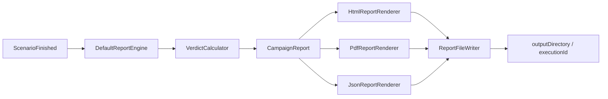
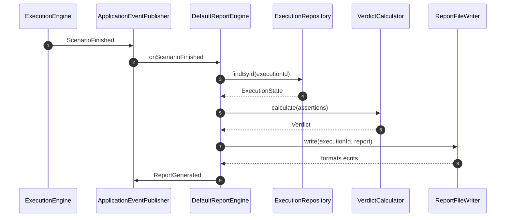

# Spec 08 — Report Engine

**Module** : `platform-reporting`
**Dépend de** : `platform-domain`, `platform-use-cases`

---

## 1. Objectif

Générer un rapport complet de campagne (HTML, PDF, JSON) à partir de l'état persisté
d'une exécution, et l'écrire **localement** sur disque. Il n'y a pas de publication vers
des systèmes externes (ADR-022) : les anciens publishers Confluence/S3/Git/SharePoint/
Nexus sont hors périmètre.

Le moteur est **event-driven** : `DefaultReportEngine` écoute `ScenarioFinished` et
génère et écrit le rapport à la fin de chaque exécution via `ReportFileWriter`.
Un appel direct à `generate(ExecutionState)` assemble uniquement le modèle en mémoire,
sans écriture sur disque.

---



## 2. Interfaces

```java
public interface ReportEngine {
    CampaignReport generate(ExecutionState state) throws ReportGenerationException;
}

public interface ReportRenderer {
    ReportFormat getFormat();                      // HTML | PDF | JSON
    byte[] render(CampaignReport report) throws RenderException;
}
```

`DefaultReportEngine` :
- est conditionnel à la présence d'une datasource (`platform.datasources.default.url`) ;
- relit `ExecutionState` depuis `ExecutionRepository` ;
- classifie les résultats par phase grâce aux types présents dans le contexte
  (`InjectionResult`, `AssertionSummary`, `TaskResult`) ;
- calcule le verdict via `VerdictCalculator` ;
- écrit les formats configurés via `ReportFileWriter`, puis publie
  `ReportGenerated(executionId, reportId, timestamp)` uniquement après une écriture réussie ;
- une erreur de génération est loggée (`action=report_generation_failed`) et ne fait pas
  échouer l'exécution.

---

## 3. Structure du rapport

```java
public record CampaignReport(
    ReportId id,
    ScenarioId scenarioId,
    String scenarioName,
    String scenarioVersion,
    List<String> tags,
    Map<String, String> metadata,
    EnvironmentInfo environment,
    ExecutionSummary executionSummary,
    List<TaskReportEntry> preparationResults,
    List<InjectionReportEntry> injectionResults,
    List<AssertionReportEntry> assertionResults,
    Verdict verdict,
    String verdictReason,
    Instant generatedAt,
    Duration totalDuration
) {}

public record EnvironmentInfo(
    List<String> agentIds,
    String jvmVersion,
    Map<String, String> systemProperties
) {}

public record ExecutionSummary(
    int totalTasks, int successfulTasks, int failedTasks, int skippedTasks,
    Duration preparationDuration, Duration injectionDuration, Duration assertionDuration
) {}

public record TaskReportEntry(
    TaskId taskId, String taskName, TaskStatus status,
    Duration duration, Map<String, Object> outputs
) {}

public record InjectionReportEntry(
    TaskId taskId, InjectionResult metrics, Path gatlingReportDirectory
) {}

public record AssertionReportEntry(
    TaskId assertionId, AssertionResult result, Evidence evidence
) {}
```

Classes de résultat (dans `platform-domain`) :
- `InjectionResult` — KPIs Gatling (`totalRequests`, `successfulRequests`, ...),
  `OUTPUT_KEY = "result"` ;
- `AssertionResult` / `AssertionSummary` — statut, description, evidence,
  `OUTPUT_KEY = "assertion"`.

---

## 4. Calcul du verdict

Le verdict final est calcule par `PerformanceAssessmentBuilder` (ADR-044) :

| Condition | Verdict |
|---|---|
| echec d'un critere critique, erreur d'assertion ou echec technique d'execution | `FAILED` |
| seuil mineur depasse, verification ignoree, information requise absente | `WARNING` (PARTIAL) |
| contexte complet, criteres requis mesures et respectes, aucun echec | `SUCCESS` |

Les criteres requis couvrent `durationSeconds`, `totalRequests`, `errorRate` et
`saturation`, plus au moins un SLO de latence ou throughput. Les informations de
contexte requises sont versions des composants, environnement, objectif/type,
description du modele et hypotheses. Une metrique technique optionnelle absente
ne bloque pas SUCCESS ; une observation `required: true` absente produit WARNING.
Une assertion sans criticite explicite est critique. Une assertion `ERROR` reste
critique meme si son objectif est mineur. Un graphe seul ne prouve pas l'absence
de saturation.

`VerdictCalculator.calculate(assertionEntries)` reste un helper historique, pas le
calcul du verdict final :

| Condition | Verdict |
|---|---|
| aucune assertion | `SUCCESS` |
| au moins une assertion `ERROR` | `FAILED` |
| au moins une assertion `FAILED` | `WARNING` |
| toutes `PASSED`/`SKIPPED` | `SUCCESS` |

`buildVerdictReason(...)` produit une explication lisible (compteurs / première cause).
Le verdict du rapport peut differer du verdict d'execution (`ExecutionEngine`) :
il inclut les limites de mesure et les criteres de validation.

---

## 5. Formats de sortie

| Format | Renderer | Mécanisme |
|---|---|---|
| HTML | `HtmlReportRenderer` | template `templates/campaign-report.html` + substitution de placeholders et sections générées |
| PDF | `PdfReportRenderer` | rendu HTML puis conversion OpenHTMLToPDF (`openhtmltopdf-pdfbox`) |
| JSON | `JsonReportRenderer` | sérialisation Jackson de `CampaignReport` |

Le template contient six sections partagees avec le modele JSON `performance` :
contexte, modele de charge, SLI/SLO, indicateurs techniques, analyse/recommandations,
validation/statut. Les KPI incluent p50/p95/p99, erreurs et throughput, par agent.
Les seuils sont compares aux mesures : percentiles au pire agent, throughput au
minimum des agents, erreurs ponderees par le nombre de requetes. Aucun percentile
global n'est fabrique en moyennant ceux des agents.
La duree totale d'execution est murale ; les durees par phase du resume sont des
sommes de temps de taches (elles peuvent depasser la duree murale en parallele).
Les renderers sont des beans Spring ; `ReportFileWriter` les indexe par `ReportFormat`.

La restauration des sorties JSONB accepte la propriete derivee `passed` emise
par Jackson pour `AssertionSummary.isPassed()` et `AssertionResult.isPassed()`.
Seul `verdict` / `status` fait autorite ; les autres champs inconnus restent
rejetes. Ce mapping est local au reporting, sans annotation Jackson dans le domaine.

---

## 6. Écriture sur disque

`ReportFileWriter.write(executionId, report)` :

```
<reporting.output-directory>/<executionId>/
  campaign.html
  campaign.pdf
  campaign.json
  gatling/<simulationClass>/...     ← copié depuis les répertoires Gatling
  gatling/<simulationClass>/run-N-<taskId>/...  # si plusieurs injections/agents partagent la simulation
```

- Seuls les formats listés dans `reporting.formats` sont produits.
- Les répertoires Gatling sont copiés en parallèle sur Virtual Threads.
- Les erreurs d'I/O sont remontées en `UncheckedIOException`.
- Le répertoire de sortie est créé si nécessaire.

`DefaultReportEngine.onScenarioFinished` assemble le modele, appelle le writer,
puis publie `ReportGenerated`. Le controller ne genere rien au telechargement.
Les anciens fichiers ne sont pas regeneres automatiquement.

Configuration (`ReportProperties`, préfixe `reporting`) :

```yaml
reporting:
  output-directory: ${REPORTING_OUTPUT_DIR:reports}   # défaut : reports
  formats:
    - HTML
    - PDF
    - JSON
```

Si `formats` est absent ou vide, les trois formats sont actifs.

---

## 7. Déclenchement et intégration



## 8. Configuration des preuves et criteres

```yaml
scenario:
  # ... id, name, version, steps ...
  report:
    components: { api: "2.4.1", worker: "3.2" } # versions applicatives, pas version du scenario
    environment: PERF
    objective: Validate release under expected traffic
    testType: LOAD
    loadDescription: Ramp over 60 seconds
    assumptions: [Dedicated dataset, No competing test]
    criteria:
      - {name: Max duration, metric: durationSeconds, taskId: load, operator: "<=", threshold: 75}
      - {name: Target volume, metric: totalRequests, taskId: load, operator: ">=", threshold: 30000}
      - {name: Technical errors, metric: errorRate, taskId: load, operator: "==", threshold: 0}
      - {name: p95, metric: p95Ms, taskId: load, operator: "<=", threshold: 500}
      - {name: Minor p99, metric: p99Ms, taskId: load, operator: "<=", threshold: 1000, critical: false}
      - {name: No systemic saturation, metric: saturation, operator: "==", threshold: 0}
      - {name: Minor assertion, metric: assertion, taskId: check-minor, operator: "==", threshold: 1, critical: false}
    observations:
      # References to actual outputs of existing/custom collector steps.
      # "monitor" is not a built-in collector task name.
      - {name: CPU, taskId: monitor, output: cpu.max, unit: "%", required: true}
      - {name: RAM, taskId: monitor, output: memory.peak, unit: MB, required: false}
      - {name: saturation, taskId: monitor, output: systemicSaturation, unit: flag, required: true}
      - {name: "Slow query: SELECT ...", taskId: monitor, output: database.slowestQueryMs, unit: ms}
      # Alternatively import an actual measurement with an explicit source:
      # - {name: CPU, value: 72.5, unit: "%", source: "monitoring export at test end"}
    graphs:
      - title: CPU during test
        url: "https://monitor.example/d/cpu?from=1793124000000&to=1793124060000"
        source: Grafana
      # An exported PNG can also be embedded, with or without a dashboard URL:
      # - {title: CPU export, source: Grafana export, imageDataUri: "data:image/png;base64,..."}
    incidents: []
    recommendations: [Compare the result against the previous release]
```

Les metriques natives sont `p50Ms`, `p95Ms`, `p99Ms`, `throughput` (req/s),
`totalRequests`, `durationSeconds`, `errorRate` (pourcentage 0..100), `assertion`
(1=PASSED, 0=FAILED/ERROR), ou le `name` d'une observation numerique.
Les noms d'observations sont uniques. `taskId` limite une mesure native a un step ;
son absence couvre les injections du tir. Un chemin d'output est une succession
de cles de map separees par des points. Avec plusieurs agents, une observation
retient leur maximum ; les unites et seuils doivent etre coherents avec ce choix.

Les dates de contexte utilisent les fins de taches d'injection et leurs durees
pour reconstituer l'intervalle de tir ; aucun agent de mesure de temps n'est ajoute.
Les erreurs techniques des requetes sont comparees au seuil explicite ; l'echec
d'une tache de preparation/injection reste un echec du rapport.

Les indicateurs CPU/RAM/GC/heap/IO/DB/reseau sans mesure restent `Not collected`.
Une serie temporelle peut etre fournie comme graphe sans valeurs numeriques ;
elle est une preuve visuelle mais ne remplace pas un critere valide.
Les graphes distants ne sont **jamais telecharges** par le serveur de rapport.
Les exports PNG (maximum 7 MB encodes / 16 megapixels) sont integres aux trois
formats. Ne pas placer de tokens ou de credentials dans les URLs.

Note : `DefaultReportEngine` est désactivé en AGENT sans datasource ; le reporting est
une responsabilité d'orchestrateur (ou de LOCAL). Aucun accès réseau n'est effectué pour
produire ou écrire un rapport.
