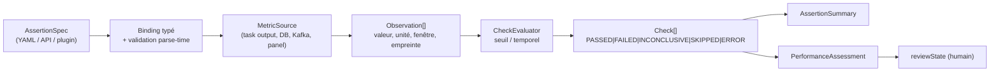

# Spec 10 — Assertions, observability metrics and report evidence

**Statut** : cible de conception. Remplace progressivement la section 4 de la
spec 07 (types d'assertions) et étend la spec 08 (preuves et verdict).
**ADRs** : ADR-049 (modèle d'assertion), ADR-050 (sources de métriques
externes), ADR-051 (preuves et revue humaine).
**Outil annexe** : [observability-probe](../tools/observability-probe.md).

---

## 1. Objectif

Un scénario doit pouvoir :

1. comparer une **mesure directe** (volumétrie, nombre d'updates, appels reçus,
   état d'un fichier) ;
2. comparer des **SLO de performance normalisés** (p50, p95, p99, error rate,
   throughput) ;
3. comparer des **métriques issues d'un dashboard** (Grafana, Kibana) rejouées
   par API sur la fenêtre exacte du test ;
4. exprimer des **critères temporels** (atteinte, persistance, étalement,
   allure, reprise, couverture) ;
5. produire un **verdict automatique** pour tout ce qui est mesurable, et un
   **verdict manuel attribué** uniquement pour ce qui ne l'est pas.

Invariant : une seule structure de résultat (`checks[]`) alimente le verdict du
scénario et le rapport. Aucun executor ne décide seul.

---

## 2. Modèle



### 2.1 Types

```java
record MetricId(String namespace, String name) {}       // "injection.latency.p95"
enum MetricKind { COUNTER, GAUGE, RATIO, QUANTILE, DURATION, STATE }
enum Reduction  { SUM, MAX, MIN, WEIGHTED, ALL, ANY, FIRST }
enum Severity   { CRITICAL, WARNING }

record MetricDefinition(MetricId id, MetricKind kind, String unit,
                        Reduction reduction, String description) {}

record Observation(MetricId metric, double value, String unit,
                   Instant windowStart, Instant windowEnd,
                   String source, QueryFingerprint fingerprint,
                   Map<String, Object> attributes) {}

record TimeWindow(Instant from, Instant to, Duration resolution) {}

record Expectation(AssertionOperator operator, double threshold,
                   double tolerance, Severity severity) {}

record Check(MetricId metric, Observation observed, Expectation expected,
             CheckStatus status, String intent, String rationale) {}

record SloStatement(String title, String sli, String slo, String rationale) {}

record AssertionSummary(TaskId assertionId, AssertionFamily family,
                        SloStatement slo, List<Check> checks, Rollup rollup,
                        List<AssertionSample> history,
                        Duration evaluationDuration, Instant evaluatedAt) {}
```

`AssertionFamily` : `PERFORMANCE_THRESHOLDS`, `DIRECT`, `PANEL`, `CUSTOM`.

`SloStatement` porte l'intention **textuelle** de l'assertion (ADR-049 §Decision) :

| Champ | Contenu | Exemple |
|---|---|---|
| `title` | libellé court de l'assertion | « Latence API clients » |
| `sli` | ce qui est mesuré, formulé métier | « temps de réponse HTTP des POST /api/events » |
| `slo` | l'objectif contractuel | « p95 ≤ 500 ms pendant toute la fenêtre d'injection » |
| `rationale` | pourquoi ce seuil | « contrat client 2026-Q4, marge 20 % sur la référence du 2026-11-01 » |

Invariants :

- le texte **ne produit jamais** de seuil : un check sans `threshold` explicite
  reste une erreur de validation même si la phrase contient un nombre ;
- le `SloStatement` est recopié tel quel dans `AssertionSummary` puis dans le
  rapport (section dédiée, §6) ;
- chaque `Check.intent` est généré par défaut (`"p95 ≤ 500 ms"`) et peut être
  surchargé pour préciser une variante (« p95 sur 5 min glissantes »).

`CheckStatus` (extension de `AssertionStatus`) :

| Statut | Sens | Verdict scénario |
|---|---|---|
| `PASSED` | mesure conforme | succès |
| `FAILED` | mesure non conforme | échec (critique) / avertissement (warning) |
| `INCONCLUSIVE` | mesure absente, insuffisante ou non pertinente | limitation, jamais succès |
| `SKIPPED` | assertion volontairement non applicable | neutre |
| `ERROR` | l'évaluation elle-même a échoué | limitation + anomalie technique |

`Rollup` : `ALL` (défaut), `ANY`, `QUORUM(n)`. Le rollup produit le statut
global de l'assertion, jamais un adapter.

### 2.2 Catalogue canonique

| MetricId | kind | unité | réduction | source typique |
|---|---|---|---|---|
| `injection.latency.p50` / `.p95` / `.p99` | QUANTILE | ms | MAX | `InjectionResult` |
| `injection.requests.total` | COUNTER | count | SUM | `InjectionResult` |
| `injection.requests.failed` | COUNTER | count | SUM | `InjectionResult` |
| `injection.error.rate` | RATIO | percent | WEIGHTED | `InjectionResult` |
| `injection.throughput` | GAUGE | req/s | MIN | `InjectionResult` |
| `database.scalar` | GAUGE | rows | SUM | SQL scalaire |
| `database.updates` | COUNTER | count | SUM | SQL `UPDATE`/rowcount |
| `kafka.messages.consumed` / `.produced` | COUNTER | count | SUM | `Kafka*TaskExecutor` |
| `kafka.consumer.lag` | GAUGE | messages | MAX | `Kafka*TaskExecutor` |
| `http.requests.matched` | COUNTER | count | SUM | WireMock / mock server |
| `filesystem.exists` | STATE | boolean | ALL | filesystem |
| `filesystem.size` | GAUGE | bytes | MAX | filesystem |
| `filesystem.checksum` | STATE | hex | ALL | filesystem (SHA-256) |
| `runtime.cpu.utilization` / `.memory.utilization` | RATIO | percent | MAX | panel |
| `panel.series.<alias>` | déclaré | déclaré | déclaré | panel |

Règles :

- **les quantiles ne s'agrègent jamais par moyenne** ; la réduction est déclarée
  (`MAX` par défaut = pire agent, `MIN` pour throughput) ;
- une métrique inconnue, une unité incompatible ou une réduction interdite sont
  des **erreurs de scénario** (400), pas des `ERROR` d'exécution ;
- `panel.series.*` exige une unité et une réduction explicites.

---

## 3. Grammaire YAML

> Toute assertion peut (devrait) porter un bloc `description` : c'est la
> formulation **textuelle** du SLI/SLO (ADR-049), reprise dans le rapport (§6).
> Le bloc est documentaire — il ne produit aucun seuil.

### 3.1 SLO normalisés

```yaml
- id: api-slo
  phase: ASSERTION
  task: performance-thresholds
  ref: customer-api-load
  description:
    title: Latence API clients
    sli: temps de réponse HTTP des appels POST /api/events
    slo: p95 ≤ 500 ms et p99 ≤ 900 ms pendant toute la fenêtre d'injection,
         taux d'erreur ≤ 1 %, débit ≥ 100 req/s
    rationale: contrat de service client 2026-Q4, marge de 20 % sur la
               référence mesurée le 2026-11-01
  parameters:
    latency:
      p50: 200
      p95: 500
      p99: 900
      unit: ms
      severity: WARNING
    errorRate: { max: 1.0, unit: percent, severity: CRITICAL }
    throughput: { min: 100, unit: req_per_sec, severity: WARNING }
```

Produit 5 checks (`p50`, `p95`, `p99`, `errorRate`, `throughput`) avec rollup
`ALL`. Les trois percentiles sont **toujours présents** dans le résumé, même si
seul p95 est contraint : les non contraints sortent en `SKIPPED` documenté.

### 3.2 Assertion directe

```yaml
- id: orders-processed
  phase: ASSERTION
  task: direct-assertion
  description:
    title: Traitement des commandes créées
    sli: nombre de lignes passées de CREATED à DONE dans orders
    slo: au moins 1 000 commandes traitées pendant le test
    rationale: le SUT annonce 100 req/s, soit ~1 200 commandes sur 12 min ;
               1 000 laisse une marge de 15 %
  parameters:
    metric: database.updates          # ou database.scalar, http.requests.matched, ...
    datasource: customer-db
    query: "UPDATE orders SET status='DONE' WHERE status='CREATED'"
    operator: GTE
    threshold: 1000
    severity: CRITICAL

- id: report-file
  phase: ASSERTION
  task: direct-assertion
  description:
    title: Rapport PDF produit
    sli: présence du fichier de rapport sur le volume partagé
    slo: le fichier existe à la fin du test
  parameters:
    metric: filesystem.exists
    path: /reports/output.pdf
    expect: true
```

`check`/`checksum`/`sizeBytes` historiques deviennent des attributs du
`MetricId` choisi (`filesystem.exists`, `filesystem.size`,
`filesystem.checksum`), plus des branches d'un `switch`.

### 3.3 Métriques de panneau

```yaml
- id: grafana-slo
  phase: ASSERTION
  task: panel-assertion
  description:
    title: SLO observés sur le dashboard API
    sli: p95 et débit lus sur le panel 12 du dashboard api-slo
    slo: p95 ≤ 500 ms et débit ≥ 100 req/s sur la fenêtre d'injection
         (+2 min de marge), données fraîches à 30 s
    rationale: même requête que l'astreinte ; on valide ce que l'exploitant voit
  parameters:
    source: grafana-prod            # nom logique platform.metric-sources.*
    dashboard: api-slo              # uid
    panel: 12
    queries:
      - refId: p95
        metric: injection.latency.p95   # ou panel.series.<alias>
        unit: ms
        step: 15s
      - refId: rps
        metric: injection.throughput
        unit: req_per_sec
        step: 15s
    window:
      from: injection.start          # ancre d'exécution
      to: injection.end
      marginBefore: 1m
      marginAfter: 2m
      freshnessDelay: 30s
    noData: INCONCLUSIVE             # ou FAILED (explicite)
    checks:
      - {metric: injection.latency.p95, operator: LTE, threshold: 500, severity: CRITICAL}
      - {metric: injection.throughput, operator: GTE, threshold: 100, severity: WARNING}
```

```yaml
- id: kibana-errors
  phase: ASSERTION
  task: panel-assertion
  description:
    title: Taux d'erreur APM
    sli: taux d'erreur HTTP lu sur la visualisation APM error rate
    slo: ≤ 2 % des requêtes en erreur pendant le test
  parameters:
    source: kibana-prod
    savedObject: {type: visualization, id: "apm-error-rate"}
    window: {from: injection.start, to: injection.end, marginAfter: 2m, freshnessDelay: 60s}
    queries: [{refId: rate, metric: panel.series.error_rate, unit: percent, interval: 1m}]
    checks: [{metric: panel.series.error_rate, operator: LTE, threshold: 2, severity: CRITICAL}]
```

Sans `queries[]`, le panneau est une **preuve** (`kind: SNAPSHOT` ou `LINK`) et
force `reviewState: REQUIRED`.

### 3.4 Formulation textuelle SLI/SLO

| Clé | Obligatoire | Rôle |
|---|---|---|
| `description.title` | recommandé | libellé court, repris comme titre de section du rapport |
| `description.sli` | recommandé | ce qui est mesuré, en langage métier |
| `description.slo` | recommandé | l'objectif contractuel, chiffré dans le texte |
| `description.rationale` | optionnel | justification du seuil, contexte de la décision |
| `checks[].intent` | optionnel | précision par check (défaut : `p95 ≤ 500 ms`) |

Règles :

- absence de `description` ⇒ avertissement de validation (`documentation`
  manquante), pas une erreur : la compatibilité descendante est préservée ;
- le texte est **recopié sans transformation** dans `AssertionSummary.slo` puis
  dans le rapport — aucune extraction de nombre, aucun couplage aux seuils ;
- un `slo` textuel contredisant un `threshold` machine n'est pas détecté
  automatiquement (choix assumé) mais les deux apparaissent côte à côte dans le
  rapport, ce qui rend la contradiction visible en revue.

---

## 4. Critères temporels

Tous s'appliquent à une série `Observation[]` sur une fenêtre *W*, jamais à une
image. Chaque critère est une `Expectation` typée.

| Critère | Paramètres | Règle | `INCONCLUSIVE` si |
|---|---|---|---|
| `REACH` (atteinte) | opérateur, seuil | au moins un point conforme | série vide |
| `SUSTAINED` (persistance) | opérateur, seuil, `minDutyCycle` | part du temps conforme ≥ p | couverture < `minSamples` |
| `SPREAD` (étalement) | `maxCv` ou `maxRange` | CV = σ/μ ≤ c, ou amplitude ≤ Δ | μ = 0 ou série vide |
| `TREND` (allure) | `minSlope`, `maxSlope` | pente moindres carrés dans [min,max] | moins de 3 points |
| `RECOVERY` | seuil, `within` | retour sous seuil après `injection.end` dans le délai | pas de fin d'injection |
| `COVERAGE` | `minSamples`, `maxGap` | nombre de points et trous | toujours évalué en premier |
| `MONOTONIC` | sens | série croissante/décroissante (ramp) | série vide |

`COVERAGE` est **obligatoire et implicite** : sur un `QUANTILE`, moins de 30
points ou un trou supérieur à `3 × resolution` ⇒ `INCONCLUSIVE` avant toute
comparaison. C'est ce qui empêche un p99 calculé sur 5 échantillons.

---

## 5. Sources externes

### 5.1 Ports

```java
interface MetricSource {
    boolean supports(MetricSourceRef ref);
    List<Observation> fetch(MetricSourceRef ref, TimeWindow window, List<SeriesQuery> queries);
}

interface PanelCatalog {
    Optional<PanelDescriptor> resolve(MetricSourceRef ref);   // identité + version + queries par défaut
}
```

`MetricSourceRef` : nom logique uniquement (`grafana-prod`, `kibana-prod`).
Aucun type vendor ne franchit la frontière.

### 5.2 Mapping Grafana

| Élément | Valeur |
|---|---|
| Catalogue | `GET /api/dashboards/uid/:uid` → `panels[].targets[]`, `templating.list` |
| Requête | `POST /api/ds/query` |
| Fenêtre | `from`/`to` en **epoch ms** |
| Résolution | `intervalMs` + `maxDataPoints` figés et enregistrés |
| Réponse | `results.<refId>.frames[].data.values[][]` |
| Auth | service account token, header `Authorization`, `X-Grafana-Org-Id` |
| Pièges | datasources *backend* seulement ; variables `$var` et `$__rate_interval` à substituer ; `/apis` en Grafana 13 (legacy actif) |

### 5.3 Mapping Kibana — deux canaux

Kibana n'expose pas « exécuter ce panel ». Deux implémentations sont livrées,
choisies par configuration ; le résultat est le même `Observation`.

| Canal | `mode` | Chemin | Avantages | Limites |
|---|---|---|---|---|
| Direct | `ES_DIRECT` (défaut) | `GET /api/saved_objects/<type>/:id` → `POST /<index>/_search` ou `POST /_query` (ES\|QL) | agrégations complètes (`percentiles`, `date_histogram`), percentiles exacts, pas de dépendance Kibana en lecture | nécessite des credentials Elasticsearch |
| Proxy | `CONSOLE_PROXY` | `POST /api/console/proxy?path=…&method=POST` + `kbn-xsrf: true` | réutilise les credentials/espaces Kibana, aligné sur ce que voit l'opérateur dans Dev Tools | dépend de Kibana, corps/params encodés dans l'URL |

Configuration (jamais dans le scénario) :

```yaml
platform:
  metric-sources:
    kibana-prod:
      provider: KIBANA
      mode: ES_DIRECT            # ou CONSOLE_PROXY
      kibana-url: ${KIBANA_URL}
      kibana-api-key: ${KIBANA_API_KEY}
      elasticsearch-url: ${ES_URL}
      elasticsearch-api-key: ${ES_API_KEY}
      fallback: CONSOLE_PROXY    # si ES injoignable ; jamais silencieux (voir fingerprint)
```

Règles :

- le `mode` effectivement utilisé est enregistré dans le `QueryFingerprint` ;
  un fallback change l'empreinte, donc reste auditable ;
- les routes internes `/internal/*` sont interdites (restreintes depuis Kibana 9) ;
- `savedObject.type` ∈ `dashboard | visualization | lens | search`.

| Élément commun | Valeur |
|---|---|
| Fenêtre | `range` sur `@timestamp`, epoch ms |
| Résolution | `date_histogram.fixed_interval` |
| Auth | credentials ES (direct) ou Kibana (proxy), selon le canal |

### 5.4 Empreinte et reproductibilité

Chaque `Observation` persiste un `QueryFingerprint` :

```
provider, source, accessMode (ES_DIRECT | CONSOLE_PROXY | GRAFANA_DS_QUERY),
dashboardRef, panelRef, dashboardVersion, resolvedQuery (texte final),
resolution, datasourceUid, window, fetchedAt
```

Le rapport doit pouvoir rejouer la requête à l'identique. Un dashboard modifié
(version différente) rend le check `INCONCLUSIVE` avec raison `DASHBOARD_CHANGED`.

### 5.5 Confiance

- **horloges** : skew source ↔ plateforme mesuré et journalisé, marge déclarée ;
- **fraîcheur** : attente de `freshnessDelay` avant lecture, sinon `INCONCLUSIVE` ;
- **no data** : trois cas distincts — série absente (`INCONCLUSIVE`), zéro
  légitime (évalué normalement), trou partiel (`COVERAGE`);
- **secrets** : configuration/env uniquement, jamais dans le scénario ni dans le rapport ;
- **rétention** : séries et empreintes conservées avec l'exécution, purge déclarée.

---

## 6. Rapport et preuves

| Élément | Contenu | Rôle |
|---|---|---|
| `slo` | `SloStatement` de chaque assertion (title, sli, slo, rationale) | **contexte lisible** : ce que le test prétend garantir |
| `series` | observations persistées + empreinte | **preuve primaire**, alimente les checks |
| `chart` | SVG reconstruit côté serveur (identique en HTML/PDF), série en JSON | lecture humaine réconciliable avec le verdict |
| `snapshot` | PNG data URI ou lien, bornes ADR-044, + `baselineState` optionnel | **attestation humaine**, sans effet sur le verdict |
| `checks[]` | statuts, valeurs, seuils, sévérité, `intent` | verdict machine |
| `review` | `NONE/REQUIRED/ACCEPTED/REJECTED`, auteur, horodatage, motif, preuves consultées | décision humaine attribuée |

### 6.1 Section SLI/SLO

Chaque assertion apparaît dans le rapport comme un bloc :

```
Latence API clients                                         [PASSED]
  SLI : temps de réponse HTTP des appels POST /api/events
  SLO : p95 ≤ 500 ms et p99 ≤ 900 ms, taux d'erreur ≤ 1 %, débit ≥ 100 req/s
  Pourquoi : contrat client 2026-Q4, marge de 20 % sur la référence du 2026-11-01
  Checks :
    p95     412 ms ≤ 500 ms     PASSED
    p99     884 ms ≤ 900 ms     PASSED
    erreur  0,3 % ≤ 1 %         PASSED
    débit   118 req/s ≥ 100     PASSED
    p50     non contraint       SKIPPED
```

Le rapport JSON expose la même information de façon structurée
(`sloStatements[]` avec `checks[]` imbriqués) : un consommateur automatique lit
les checks, un lecteur humain lit le SLO.

### 6.2 Composition du verdict publié

1. `FAILED` si un check critique échoue, ou échec technique ;
2. sinon `WARNING` si `INCONCLUSIVE`/`SKIPPED`, limitation, ou `review = REQUIRED` ;
3. sinon `SUCCESS` ;
4. une revue `REJECTED` abaisse à `FAILED` avec `override: true` ;
   une revue `ACCEPTED` **ne remonte jamais** un verdict machine en échec.

`PENDING_REVIEW` est produit par le **générateur de rapport** (à partir des
checks `INCONCLUSIVE`, des panneaux sans `queries[]` et des limitations), jamais
par une assertion ni un plugin.

### 6.3 Preuves visuelles et baseline

`ReportDefinition.Graph` est étendu de façon compatible : `kind`
(`SERIES` | `SNAPSHOT` | `LINK`, défaut `LINK`), `seriesRef`, `caption`.

La baseline visuelle est **optionnelle et purement cosmétique** :

```yaml
reporting:
  visual-baseline:
    enabled: false              # défaut : aucune comparaison
    directory: ${REPORTING_BASELINE_DIR:reports/baselines}
    tolerance: 0.02             # 2 % de pixels différents tolérés (perceptual diff)
    onMissing: NO_BASELINE      # ou FAIL_SNAPSHOT (jamais un échec de verdict)
```

| `enabled` | Comportement |
|---|---|
| `false` (défaut) | snapshots affichés tels quels, aucun état de baseline |
| `true` | comparaison avec la baseline, attribut `baselineState` affiché : `UNCHANGED`, `CHANGED`, `NO_BASELINE`, `UNAVAILABLE` |

Invariants : la comparaison ne crée aucun `Check`, ne modifie pas
`reviewState`, ne modifie pas le verdict. Elle sert uniquement à repérer une
régression d'aspect (dashboard cassé, panel vide, thème changé) dans la partie
visuelle du rapport.

---

## 7. Extensibilité plugin

| Niveau | Contrat | Ce que le plugin fournit | Ce que le core garantit |
|---|---|---|---|
| 1 | `AssertionExecutor` (`@Assertion`) | liste de `Check` | binding, opérateurs, rollup, `AssertionSummary`, mapping de statut |
| 2 | `AssertionExecutor` avec collecteur externe | `Check` construits depuis `Observation` / `SeriesObservation` | validation, rollup, sérialisation, rapport |

Le plugin ne choisit jamais le statut mappé : `AssertionSummaryFactory` calcule
le verdict et `AssertionSummaries` le convertit en `TaskResult`. Un plugin qui
mesure une source externe (panneau Grafana/Kibana) reste un `AssertionExecutor`
ordinaire, comme `panel-assertion`.

---

## 8. Plan d'implémentation

### Phase 0 — Cadrage (0,5 j)

- Valider ADR-049/050/051 ; trancher les points ouverts (§9).
- Écrire les exemples YAML de référence dans `distribution/example/scenarios`.

**Sortie** : ADRs acceptés, jeux d'exemples validés syntaxiquement.

### Phase 1 — Modèle domaine (2 j)

- `MetricId`, `MetricDefinition`, `MetricKind`, `Reduction`, `Severity`,
  `Observation`, `TimeWindow`, `Expectation`, `Check`, `QueryFingerprint`.
- `AssertionStatus += INCONCLUSIVE` ; `AssertionSummary` gagne `slo`
  (`SloStatement`), `family`, `checks`, `rollup` ; `Check` gagne `intent`.
- Tests unitaires de domaine (immuabilité, validation, rollup, recopie du SLO).

**Sortie** : `platform-domain` compile, tests verts, **aucun** adapter modifié.

### Phase 2 — Pipeline d'assertion (3 j)

- `platform-assertion` : `ParameterBinder`, `OperatorResolver`, `CheckEvaluator`,
  `AssertionSummaryFactory`, catalogue de métriques (le libellé est produit par
  `AssertionSummaryFactory`).
- Lecture du bloc `description` (SLI/SLO) → `SloStatement`, avertissement si absent.
- `performance-thresholds` et `direct-assertion` implémentés sur ce pipeline.
- Validation parse-time (métrique/unité/`ref`/tolerance) dans `DefaultScenarioValidator`.
- Suppression du mapper dupliqué de `platform-plugin-api`.

**Sortie** : les deux familles fonctionnent en LOCAL ; tests ciblés verts.

### Phase 3 — Suppression du legacy (0 j)

- Aucun alias de compatibilité n'est introduit : le système n'a pas encore
  d'utilisateurs.
- Les six anciens executors (`gatling-metric`, `database-assertion`, `kafka`,
  `wiremock`, `http-mock`, `file`) et les types `AssertionResult` / `Evidence`
  sont supprimés.
- `distribution/example` et les tests utilisent uniquement les deux familles.

**Sortie** : un seul modèle d'assertion dans le code, les exemples et la doc.

### Phase 4 — Rapport branché sur `checks[]` (2 j)

- `PerformanceAssessmentBuilder` lit `checks[]` (plus de mapping de noms).
- Section **SLI/SLO** du rapport depuis `AssertionSummary.slo` (§6.1) :
  JSON `sloStatements[]` + rendu HTML/PDF.
- `ReportDefinition.criteria()` traduit en `AssertionSpec` (sucre, pas moteur).
- Preuves restituées par `Check.observed` (plus de `evidence = null`).
- `reviewState = REQUIRED` calculé par le rapport (checks `INCONCLUSIVE`,
  panneaux sans `queries[]`, limitations).

**Sortie** : rapport JSON/HTML identique sur scénarios de référence, plus la
section SLO.

### Phase 5 — Sources externes, annexe `tools/observability-probe` (5 j)

Structure de l'annexe (hors reactor, comme `distribution/example/sut`) :

```
tools/observability-probe/
├── pom.xml                       (module autonome, shaded runnable jar)
├── README.md                     (voir docs/knowledge/tools/observability-probe.md)
├── Dockerfile                    (JRE 25)
├── src/main/java/.../grafana/    GrafanaMetricSource, GrafanaPanelCatalog
├── src/main/java/.../kibana/     KibanaPanelCatalog, EsDirectSeriesSource, ConsoleProxySeriesSource
├── src/main/java/.../plugin/     @Assertion("panel-assertion") PanelAssertionExecutor
├── src/main/java/.../cli/        ProbeCli (catalog, query, verify, render, install-plugin)
└── src/test/...                  tests contractuels contre WireMock/gabarits JSON
```

- Le JAR déposé dans `platform.plugins.dir` est découvert par `PluginRegistry`
  existant : **aucune ligne de bootstrap à ajouter**.
- Kibana : deux implémentations (`ES_DIRECT`, `CONSOLE_PROXY`), sélectionnées
  par `mode` et `fallback`, mode réel inscrit dans le fingerprint.
- CLI autonome (`--from`/`--to` ISO ou relatifs, `--map refId:metric:unit`,
  `--out`), même code que le plugin ; sortie au format `Observation`.
- Tests : réponses Grafana/Kibana/ES figées (fixtures), aucun appel réseau ;
  un test de parité vérifie que le CLI et le plugin produisent la même empreinte.

**Sortie** : `panel-assertion` disponible via plugin, verdict automatique sur
panneau rejoué, plateforme sans dépendance vendor, outil exécutable seul.

### Phase 5bis — Documentation de l'outil (1 j)

- `docs/knowledge/tools/observability-probe.md` (déjà rédigé) : build, config,
  commandes, exemples Grafana / Kibana `ES_DIRECT` / `CONSOLE_PROXY`, Docker,
  usage CI, dépannage, garanties.
- Exemples de scénarios `panel-assertion` : non fournis dans
  `distribution/example` (ils exigent un dashboard Grafana/Kibana réel) ; les
  exemples de requêtes sont dans le guide de l'outil.

**Sortie** : un utilisateur peut installer et lancer l'outil sans lire le code.

### Phase 6 — Preuves visuelles (2,5 j)

- SVG reconstruit à partir des observations (échelle fixe, unité, résolution).
- `Graph.kind`, `seriesRef`, `caption` ; snapshots marqués « attestation ».
- Baseline visuelle optionnelle : `reporting.visual-baseline.enabled` (défaut
  `false`), `directory`, `tolerance`, `baselineState` affiché, **aucun impact
  sur les checks ni sur le verdict**.
- Rendu HTML/PDF déterministe (test de stabilité binaire du SVG).

**Sortie** : rapport contenant courbe + snapshot optionnel + état de baseline
si activée.

### Phase 7 — Revue humaine (1,5 j)

- `CampaignReport.review` + endpoint `POST /api/v1/executions/{id}/review`
  (append-only, auteur/horodatage/motif/preuves).
- `reviewState` intégré au verdict ; `override` explicite.
- IHM : encart de revue sur la page exécution, badge `REVIEW REQUIRED`.

**Sortie** : un rapport avec panneau non requêtable ne peut pas être `SUCCESS`.

### Phase 8 — Documentation et durcissement (1 j)

- Spec 07/08 marquées « voir spec 10 » ; README ; ADR-048 → 051 liés.
- Journalisation (`action=metric_fetch … fingerprint=…`), métriques Micrometer
  sur les fetchs, timeouts et budget de taille de rapport.

**Total indicatif : ~20 jours** hors IHM avancée.

### Critères d'acceptation globaux

1. Un scénario de référence produit le verdict attendu.
2. Un scénario `performance-thresholds` produit p50/p95/p99 dans le résumé.
3. Le rapport affiche, pour chaque assertion, le titre, le SLI, le SLO et la
   justification saisis dans le scénario.
4. Un panneau Grafana rejoué produit un verdict automatique sur la fenêtre du test.
5. Un panneau Kibana est interrogeable en `ES_DIRECT` **et** en `CONSOLE_PROXY`.
6. Un panneau sans requête force `REQUIRED` et interdit `SUCCESS`.
7. Aucune dépendance Grafana/Kibana dans le reactor plateforme.
8. Toute observation est rejouable à partir de son empreinte.
9. L'outil annexe s'exécute seul (`query`, `verify`, `catalog`, `render`,
   `install-plugin`) et produit la même empreinte que le plugin.
10. Baseline visuelle activée : l'état est affiché, le verdict est inchangé.

---

## 8bis. État d'implémentation

| Élément | État |
|---|---|
| Modèle domaine (`MetricId`, `MetricDefinition`, `Observation`, `Expectation`, `Check`, `SloStatement`, `Rollup`, `TemporalCriterion`, `SeriesAnalysis`) | **implémenté** |
| `INCONCLUSIVE` dans `AssertionStatus` + rollup | **implémenté** |
| Pipeline (`ParameterBinder`, `OperatorResolver`, `CheckEvaluator`, `TemporalCheckEvaluator`, `AssertionSummaryFactory`) | **implémenté** |
| `performance-thresholds` (p50/p95/p99, errorRate, throughput, checks explicites) | **implémenté** |
| `direct-assertion` (`database.scalar`, `database.updates`, `filesystem.*`, `http.requests.*` via `target`, compteurs via outputs) | **implémenté** |
| `description` SLI/SLO parsé et restitué dans le résumé et le rapport | **implémenté** |
| Validation parse-time (métrique inconnue, `EQ` sans tolérance) | **implémenté** |
| Mapping unique `Check -> TaskResult` (`AssertionSummaries`) | **implémenté** |
| Rapport : `sloStatements`, `review.state`, evidence restituée | **implémenté** |
| Annexe `tools/observability-probe` (CLI `catalog`/`query`/`verify`/`render`/`install-plugin`) | **implémenté** |
| Grafana `POST /api/ds/query` + catalogue dashboard | **implémenté** |
| Kibana `ES_DIRECT` et `CONSOLE_PROXY` | **implémenté** |
| Plugin `panel-assertion` (no-arg, découvert par `PluginRegistry`) | **implémenté** |
| Alias legacy → nouvelles familles | **supprimé** : aucun alias, aucun ancien executor (système non utilisé) |
| Rendu SVG de la série dans le rapport plateforme | **partiel** : rendu disponible dans l'annexe (`render`), pas encore branché au renderer HTML/PDF |
| Baseline visuelle `reporting.visual-baseline.*` | **non implémenté** |
| Exemples de scénarios `panel-assertion` dans `distribution/example` | **non fournis** (dashboard externe requis) |
| API/IHM de revue humaine (`POST /executions/{id}/review`) | **non implémenté** (`review.state` est calculé, la décision humaine reste à brancher) |

---

## 9. Décisions actées

| # | Question | Décision |
|---|---|---|
| 1 | `INCONCLUSIVE` dans `AssertionStatus` ou statut de `Check` seulement ? | **acté** : dans l'enum, ADR-049 |
| 2 | `PENDING_REVIEW` : statut d'assertion ou état de rapport ? | **acté** : état de rapport, responsabilité du générateur (ADR-051) |
| 3 | Seuils auto-dérivés d'un historique (auto-SLO) ? | exclu en v1 (circularité) |
| 4 | Revue `REQUIRED` non traitée : expiration ? | reste ouverte + `WARNING`, jamais `FAILED` |
| 5 | Baseline visuelle bloquante ? | **acté** : non — conditionnelle via `reporting.visual-baseline.enabled`, strictement visuelle |
| 6 | Kibana : ES direct ou proxy console ? | **acté** : les deux, `mode` + `fallback` par source |
| 7 | Propriété du `PanelReference` | scénario (conditionne le verdict) |
| 8 | Où exprimer le SLI/SLO ? | **acté** : bloc `description` du scénario, recopié dans le rapport ; jamais converti en seuil |
| 9 | Outil annexe : plugin seul ou exécutable ? | **acté** : les deux, code commun (ADR-050) |

---

## 10. Risques

| Risque | Mitigation |
|---|---|
| Dashboard modifié → métrique différente | version + empreinte, `INCONCLUSIVE` daté |
| Requête lente / fenêtre large | timeouts par source, `_async_search` côté ES |
| Volume du rapport (séries) | résolution déclarée, plafond, purge |
| Faux sentiment de sécurité sur une courbe | `COVERAGE` obligatoire, limitations explicites |
| Divergence YAML ancien/nouveau | supprimée : un seul modèle d'assertion, exemples de référence |
| Secrets exposés | configuration uniquement, jamais de token dans scénario/rapport |
| SLO textuel contredisant les seuils | les deux affichés côte à côte dans le rapport, contradiction visible en revue |
| Baseline visuelle bruyante | désactivée par défaut, tolérance configurable, jamais de verdict |
| Divergence CLI ↔ plugin | test de parité d'empreinte en CI |

